# Senzing Bootcamp Recap

**Bootcamper:** Michael Dockter
**Started:** 2026-11-09T16:32:18-05:00
**Completed:** 2026-11-10
**Programming language:** Java
**Path:** Core
**Plugin version:** 0.6.1
**Operating system:** macOS (arm64)
**Python version:** 3.9.6
**Language runtime:** Java 25.0.2
**Senzing SDK:** 4.3.2
**Database:** SQLite

---

## Entity Resolution Concepts — 2026-11-09T16:32:18-05:00

### Information Shared

- Entity resolution determines whether different records refer to the same real-world entity, are related, or do not match. A false negative treats one entity as multiple entities; a false positive merges distinct entities.
- An ambiguous record may plausibly belong to more than one entity. Assigning it arbitrarily can create an invisible false positive; Senzing's published guidance describes holding it as a possible match until distinguishing information arrives.
- Senzing documentation describes comparing incoming records with known entities using principles based on expected attribute behavior. Possible outcomes include same, possibly the same, or possibly related; common people and organization attributes are preconfigured without training or tuning.
- Sourced from Senzing documentation via MCP.

### Questions & Responses

- **Q:** Do you have any questions about entity resolution before we continue?
  - **R:** No, nothing right now—continue.
- **Q:** Would you like a few quick questions to help the concepts stick?
  - **R:** Yes, let's try.
- **Q:** A record could plausibly belong to either of two existing entities, and the available information does not distinguish between them. What is the careful handling?
  - **R:** Keep it as a possible match until distinguishing information arrives.
- **Q:** Two records refer to different entities that are connected. Which outcome best captures that distinction?
  - **R:** Possibly related.
- **Q:** A system treats records about one person as two separate entities. What is this error called?
  - **R:** False negative.
- **Q:** Are you ready to move on to the next module: Discover the Business Problem?
  - **R:** Yes, I’m ready to move on.

### Actions Taken

- Presented the entity resolution concepts primer and optional knowledge check; the bootcamper answered all three questions correctly.
- Initialized the project recap and B-roll manifest for this module.

### End-of-Module Summary

**What you accomplished:**

- Learned the core purpose of entity resolution and the distinctions among false positives, false negatives, and ambiguous matches.
- Completed the optional three-question knowledge check.

**Files produced:**

- `docs/bootcamp_recap.md` — the accumulating bootcamp recap.
- `docs/video/broll.json` — the module highlights manifest.

**Why it matters:** These concepts provide a foundation for defining the business problem and evaluating what the bootcamp should help accomplish.

---

## Discover the Business Problem — 2026-11-09T16:32:18-05:00

### Information Shared

- Defined a fictional bank's KYC/KYB/AML problem: create a trusted customer view, connect relevant business relationships, and produce evidence-backed screening leads.
- Identified three sources totaling about 159 records: BANK_CUSTOMERS (120), BUSINESS_REGISTRY (22), and AML_WATCHLIST (17).
- Captured matching considerations including name variations and aliases, alternate scripts, partial or missing identifiers, addresses, contact details, and business ownership/officer relationships.
- Defined success as building unified customer views, linking business relationships, keeping similar-but-distinct people separate, and comparing results with the supplied answer key.
- Recorded local/on-premises deployment and no downstream software integrations.
- Senzing's published KYC guidance describes combining internal and external data, including beneficial-ownership information, to create more complete customer views; it also identifies improved KYC/EDD, fewer watchlist false positives, and ongoing due diligence as value areas. Sourced from Senzing docs via MCP.

### Questions & Responses

- **Q:** Would you like to switch your model to Sonnet 5.5 for this module?
  - **R:** Yes, I’d like to switch to Sonnet 5.5.
- **Q:** Are you done modifying the model and effort?
  - **R:** Yes, I’m done modifying the model and effort.
- **Q:** Would you like to see examples of common business problems that entity resolution can solve?
  - **R:** Yes, show me.
- **Q:** Do any of these patterns match your situation?
  - **R:** Neither fits my situation.
- **Q:** How would you like to define the business problem?
  - **R:** The business case is in a local document.
- **Q:** Does that summary capture your situation accurately?
  - **R:** Yes, that’s accurate.
- **Q:** Do you have any diagrams of your data architecture and flows you'd like to share?
  - **R:** No, proceed with the scenario as described.
- **Q:** Will your entity-resolution results need to interface with other software (CRM, search engine, data warehouse, API gateway, downstream app)?
  - **R:** No.
- **Q:** Where do you plan to deploy the final solution?
  - **R:** Local / on-premises.
- **Q:** Does this accurately capture your problem and approach?
  - **R:** Yes, this accurately captures my problem and approach.

### Actions Taken

- Reviewed the bootcamper-provided business-case brief and confirmed the inferred summary.
- Created the business problem statement, updated the project README, and generated a stakeholder summary.
- Recorded the local/on-premises deployment target and empty integration target list.

### End-of-Module Summary

**What you accomplished:**

- Defined the banking KYC/KYB/AML scenario, its data sources, matching considerations, and success criteria.
- Confirmed the problem statement and approach that will guide the remaining bootcamp modules.

**Files produced:**

- `docs/business_problem.md` — confirmed business problem statement.
- `README.md` — project overview and business problem.
- `docs/stakeholder_summary_module1.md` — stakeholder-facing summary and next steps.
- `docs/video/broll.json` — module highlights manifest.

**Why it matters:** The confirmed business goals and source inventory give the next modules a concrete target for data collection, mapping, processing, and validation.

---

## SDK setup — 2026-11-09T17:24:37-05:00

### Information Shared

- The SDK was already installed on macOS Apple Silicon, so no reinstall or EULA prompt was needed. The Java binding was found in the SDK installation and its version was verified as 4.3.2.
- A Homebrew update check could not establish whether a newer SDK was available because `brew outdated --cask senzingsdk` could not access the non-writable Cellar; no permissions were changed.
- Set up project-local Java environment and launch scripts. The first Java probe needed the native library directory included in `java.library.path`; the project launcher now supplies that alongside the environment setting.
- Chose SQLite for the bootcamp, applied and verified the Senzing schema in `database/G2C.db`, then created and reinitialized a default configuration.
- Measured the active license limit first provisionally and again with the engine configuration active; both readings were 500 records.

### Questions & Responses

- **Q:** Would you like to switch to Opus 5.5 at high reasoning effort for this module?
  - **R:** No, keep my current settings.
- **Q:** Which database would you like to use? Reply with a number:
  - **R:** 2. PostgreSQL.
- **Q:** You selected PostgreSQL, then sent “1”. Which setup path did you intend?
  - **R:** SQLite.

### Actions Taken

- Verified the installed SDK version with the MCP-generated Java `SzProduct.getVersion` example and fetched the Java `SzLicense` example to measure the record limit.
- Created `src/scripts/senzing-env.sh` and `src/scripts/senzing-java.sh`; verified the launcher against the installed SDK without modifying global shell configuration.
- Created the SQLite datastore and verified its schema, wrote `config/engine_config.json`, and seeded the default configuration.
- Ran the MCP-generated engine-priming example; its `SzEngine` call succeeded.
- Created the standard project directories and recorded the selected database as SQLite.

### End-of-Module Summary

**What you accomplished:**

- Verified the existing Java SDK installation and configured project-local paths for Java execution.
- Created and configured the SQLite datastore, measured the active license limit, and confirmed an engine-level call succeeds.

**Files produced:**

- `src/scripts/senzing-env.sh` — project-local SDK environment.
- `src/scripts/senzing-java.sh` — Java launcher with the SDK classpath and native library path.
- `config/engine_config.json` — engine configuration for the project datastore.
- `config/license.json` — active license details.
- `database/G2C.db` — schema-initialized SQLite datastore.
- `src/main/java/configuration/InitDefaultConfig.java` — default-configuration initialization example.
- `senzing-scaffold/java/snippets/` — MCP-provided Java examples used for verification and setup.

**Why it matters:** The project now has a working Java-to-engine path and a configured local datastore, so System verification can test the setup end to end.

---

## System verification — 2026-11-09T17:39:52-05:00

### Information Shared

- The module used four synthetic, PII-free records: three identical-feature records designed as a merge cluster and one distinct distractor.
- The Java full-pipeline scaffold selected for file input required JSON-P; that library was absent from the installed SDK jars. Replaced only extraction of the two top-level record-key fields with Java standard-library matching, preserving the scaffold's Senzing SDK calls and JSON records.
- Senzing SDK and Entity Specification details were sourced from the Senzing MCP; verification outcomes were measured locally.
- Results validation is reported separately from the installation checks; this run matched the constructed expectation.

### Questions & Responses

- **Q:** Would you like to switch to Sonnet 5.5 for this module?
  - **R:** No, keep Auto mode.

### Actions Taken

- Confirmed MCP connectivity and successfully initialized the engine and Java SDK against the configured project database.
- Generated and compiled the Java verification pipeline, registered the `VERIFY` source, and loaded all four synthetic records.
- Looked up each record through the SDK: three cluster records resolved to one entity and the distractor remained a separate entity, for two entities total.
- Verified read-by-entity-ID and search-by-attributes operations, then deleted and confirmed the absence of all four synthetic records.
- Retained the generated verification artifacts under `src/system_verification/`.

### End-of-Module Summary

**What you accomplished:**

- Passed all eight installation checks: MCP connectivity, engine initialization, SDK initialization, code generation, build, data-source registration, data loading, and database operations.
- Passed results validation: four synthetic records resolved to two entities, including the expected three-record merge cluster.
- Purged all four synthetic records from the database while retaining the verification artifacts.

**Files produced:**

- `src/system_verification/verification_data.jsonl` — synthetic verification records.
- `src/system_verification/verify_init.java` — Java SDK and engine initialization check.
- `src/system_verification/verify_pipeline.java` — file-reading Java load pipeline.
- `src/system_verification/register_data_sources.java` — `VERIFY` source registration.
- `src/system_verification/validate_results.java` — resolution and database-operation checks.
- `src/system_verification/cleanup.java` — SDK-based verification data cleanup.
- `config/data_sources.yaml` — registered source-code list.

**Why it matters:** The local Java environment and database are verified end to end, so the project can move from setup into its Truth Set visualization and subsequent data work.

---

## Truth Set visualization — 2026-11-09T18:22:17-05:00

### Information Shared

- The six-tab visualization covers the Entity Graph, Merge Statistics, Match Keys, Feature Scores, Cross-Source overlap, and Search / Probe.
- The standalone snapshot keeps its embedded-data views available offline; live Why?, How?, and search require the running server.

### Questions & Responses

- **Q:** Are you ready to continue?
    - **R:** Yes, I'm ready to continue.
- **Q:** Ready for me to stop the visualization server and clean up the Truth Set data?
    - **R:** Yes, stop the server and remove the Truth Set records.

### Actions Taken

- Loaded 159 Truth Set records from CUSTOMERS, REFERENCE, and WATCHLIST and built the Java visualization server and offline snapshot.
- Verified the live page, all ten API endpoints, the populated Search / Probe results, and the matching six-tab live and offline views.
- Captured all six tabs in app order and verified the snapshot contained the loaded records.
- Stopped the server and deleted the 159 Truth Set records through the Java SDK; verified all were absent afterward.

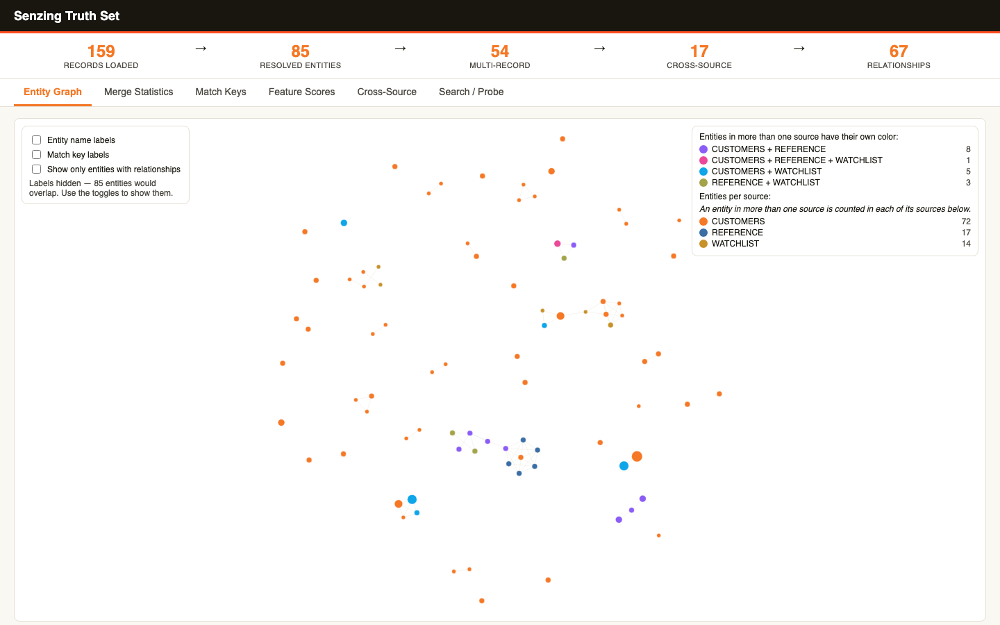
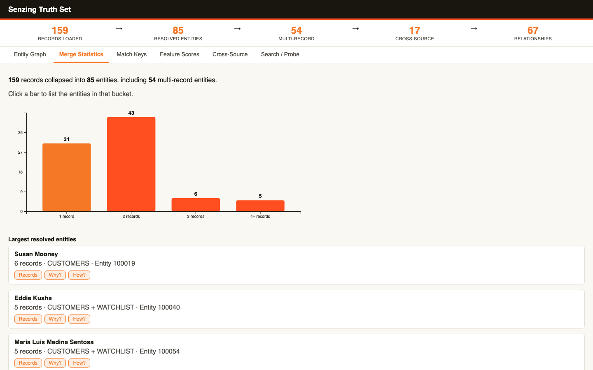
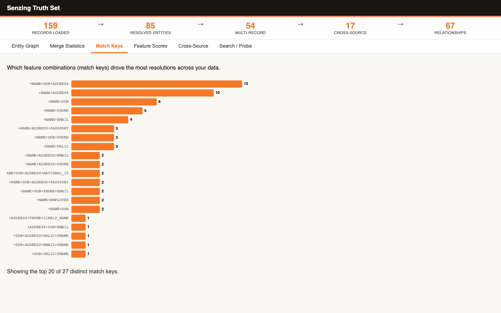
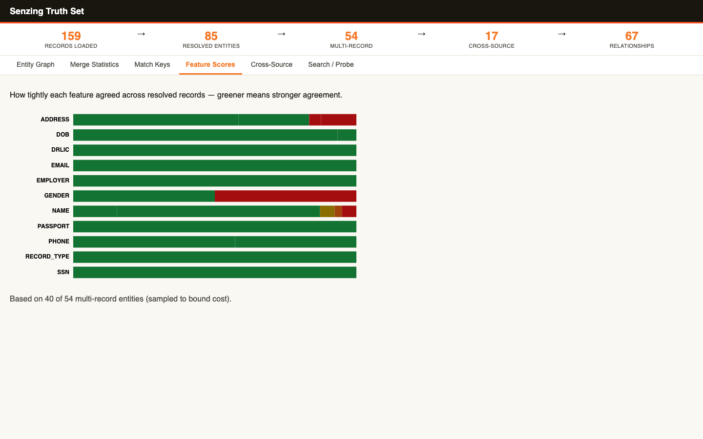
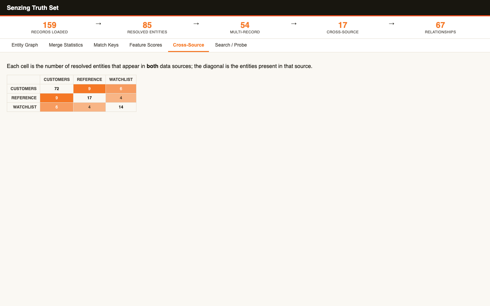
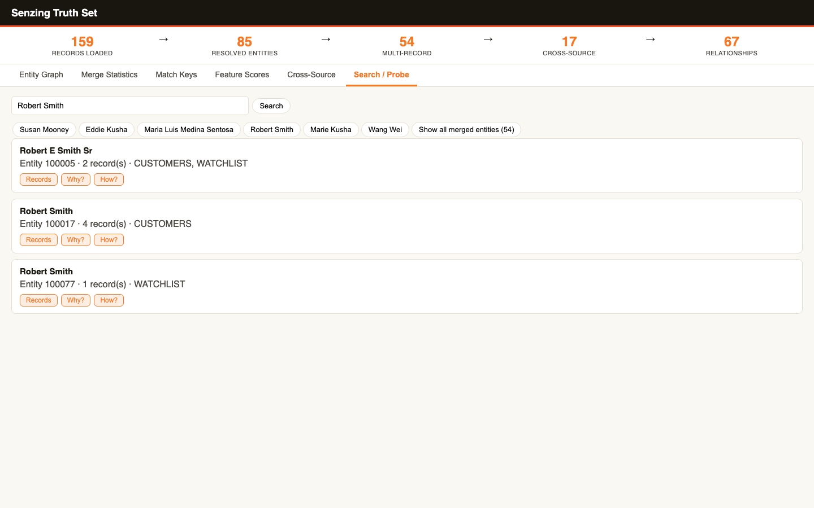

### End-of-Module Summary

**What you accomplished:**

- Built and explored a six-tab visualization from 159 records, resolving them into 85 entities, including 54 multi-record entities and 17 cross-source entities.
- Saved an offline snapshot and all six tab screenshots, then removed the demo records from the database.

**Files produced:**

- `src/system_verification/truthset_data.jsonl` — Truth Set records used for the visualization.
- `src/server/TruthSetVizServer.java` — Java live visualization server and snapshot builder.
- `src/server/pom.xml` — Maven build configuration for the server.
- `src/server/index.template.html` — six-tab visualization UI template.
- `src/server/probe-live.html` — live Search / Probe tab.
- `src/server/vendor/d3.v7.min.js` — local D3 asset for offline rendering.
- `src/system_verification/PurgeTruthSet.java` — SDK-based Truth Set cleanup and verification utility.
- `docs/visualizations/truthset_verification.html` — self-contained offline snapshot.
- `docs/visualizations/truthset_verification-tabs.json` — screenshot coverage manifest.
- `docs/visualizations/truthset_verification-entity-graph.png` — Entity Graph screenshot.
- `docs/visualizations/truthset_verification-merge-statistics.png` — Merge Statistics screenshot.
- `docs/visualizations/truthset_verification-match-keys.png` — Match Keys screenshot.
- `docs/visualizations/truthset_verification-feature-scores.png` — Feature Scores screenshot.
- `docs/visualizations/truthset_verification-cross-source.png` — Cross-Source screenshot.
- `docs/visualizations/truthset_verification-search-probe.png` — Search / Probe screenshot.

**Why it matters:** The visualization makes the resolution results for the bank KYC/KYB/AML scenario inspectable and leaves an offline record for later reference. The demo records have been removed so subsequent data work can proceed without the Truth Set scaffolding.

---

## Data collection — 2026-11-09T18:35:41-05:00

### Information Shared

- Reviewed the three business sources and matched them to the Senzing Demo Truth Set's source groups.
- Confirmed the selected Truth Set is synthetic demo data and that the business brief requires preserving record values and attribute names.
- Explained data-file validation, raw-data handling, and the collection checklist for the next module.

### Questions & Responses

- **Q:** Would you like to switch to the recommended model and effort?
    - **R:** Keep the current settings.
- **Q:** How would you like to provide the data for this source? Reply with a number:
    - **R:** Use the Truthset data as a base. Rename files and fields as appropriate.

### Actions Taken

- Split the retained Truth Set into three JSONL files and changed only each record's `DATA_SOURCE` label to the corresponding business-source name.
- Verified 159 records total (120, 22, and 17 by source), valid JSONL, expected labels, and preservation of record IDs, other fields, and values.
- Added per-source validation and provenance to `config/data_sources.yaml`; documented source locations, collection checks, and data handling.
- Kept the full dataset; no sample was needed within the measured license capacity.

### End-of-Module Summary

**What you accomplished:**

- Collected and validated all three business-source files from the synthetic Truth Set.
- Preserved the original record content while aligning the source labels with the business brief.

**Files produced:**

- `data/raw/BANK_CUSTOMERS.jsonl` — 120 customer and account records.
- `data/raw/BUSINESS_REGISTRY.jsonl` — 22 business registry and reference records.
- `data/raw/AML_WATCHLIST.jsonl` — 17 watchlist records.
- `config/data_sources.yaml` — source registry with measured counts, provenance, and validation results.
- `docs/data_source_locations.md` — source origin, file locations, and source-label mapping.
- `docs/data_collection_checklist.md` — inventory and validation checklist; review the final item before Module 5.
- `docs/security_compliance.md` — data-handling notes.
- `.gitignore` — excludes raw data files.

**Why it matters:** The three sources now match the bank KYC/KYB/AML scenario and are ready for data-quality assessment. Keeping the record values and fields intact preserves the dataset's existing matching evidence.

---

## Data Quality, Mapping, and Transformation — 2026-11-09

### Information Shared

- Reviewed the collected sources and counts: BANK_CUSTOMERS (120), BUSINESS_REGISTRY (22), and AML_WATCHLIST (17).
- Reviewed the quality dimensions and source-specific field applicability, then compared the source structures with the current Entity Specification.
- Explained that feature attributes are grouped by feature in the output, while source context that is not a matching feature can remain as payload.
- Distinguished static structure and value-preservation checks from actual matching behavior, which remains to be evaluated during loading.

### Questions & Responses

- **Q:** Would you like to move on to the next module: Data Quality, Mapping, and Transformation?
  - **R:** Yes.
- **Q:** Would you like to switch to Opus 5.5 at high reasoning effort for this module?
  - **R:** Yes.
- **Q:** Would you like a visual of the quality assessment (coverage bars and per-field completeness)?
  - **R:** Yes.
- **Q:** Your data quality is acceptable but has some gaps. What would you like to do? Reply with a number:
  - **R:** 1 — Improve the weakest fields first.
- **Q:** Your data quality is acceptable but has some gaps. What would you like to do? Reply with a number:
  - **R:** 1 — Return to Data collection for this source.
- **Q:** Your data quality needs attention before mapping will produce good results. What would you like to do? Reply with a number:
  - **R:** 1 — Work on improving the data first.
- **Q:** Quality looks strong for BUSINESS_REGISTRY. Ready to map the next source, AML_WATCHLIST? Reply with a number:
  - **R:** 1 — Yes, map AML_WATCHLIST.
- **Q:** Would you like a web page showing the quality analysis (coverage charts and the field mapping summary)?
  - **R:** Yes.
- **Q:** Quality looks strong for AML_WATCHLIST. Ready to proceed to loading (Data processing)? Reply with a number:
  - **R:** 1 — Yes, proceed to loading.

### Actions Taken

- Compared source fields with the Entity Specification. Unrecognized fields: BANK_CUSTOMERS (AMOUNT, CATEGORY, DATE, STATUS); BUSINESS_REGISTRY and AML_WATCHLIST (CATEGORY, DATE, STATUS).
- Categorized all three sources as needing mapping because those extra fields still need a disposition.
- Corrected a scoring-method mismatch: Phase 1 Step 6 requires per-record applicable source-field completeness, not an average of feature-family coverage. Using the Step 6 presence test and identifier-family grouping, the current scores are BANK_CUSTOMERS 81.9 (74.7 completeness, 98.5 format consistency, 0.0 duplicate rate), BUSINESS_REGISTRY 80.6 (72.2, 100.0, 0.0), and AML_WATCHLIST 88.7 (83.9, 100.0, 0.0). The unrecognized root fields have no Entity Specification counterpart and are excluded from completeness.
- Checked recognized attributes by record type. Shared non-identifier attributes had no cross-type 100%/0% split; the identifier family was checked separately and confirmed at 0% for BUSINESS_REGISTRY PERSON records, 100% for its ORGANIZATION records, and 0% for BANK_CUSTOMERS ORGANIZATION records. Exact 0% and 100% coverage values were sample-checked. The type/name heuristic found zero candidates in all three sources.
- The bootcamper chose to improve BANK_CUSTOMERS first. Created `data/raw/BANK_CUSTOMERS-improved.jsonl` without overwriting the collected file or changing record count or identifiers. Applied safe formatting normalization; no missing values were invented. Under the consistent score, the original scored 72.5 and the improved copy scored 73.1.
- The bootcamper chose to return BANK_CUSTOMERS to Data collection at the no-progress gate. Its regenerated file retains all 120 record IDs and every improved-base value; the current version adds a complete structured synthetic address to each record, 50 PERSON birth dates, 99 phone numbers, and 75 emails. Generated email and phone values are unique with no cross-source collisions, and no identifier numbers were generated. File size: 74,508 bytes.
- After applying the Step 6 field-level method, BANK_CUSTOMERS scores 81.9 (74.7 completeness, 98.5 format consistency, 0.0 duplicate rate). Remaining gaps include PERSON GENDER (17.5%) and identifiers (31.6% PERSON, 0.0% ORGANIZATION).
- The bootcamper accepted the quality visualization. The verified single-page HTML is `docs/visualizations/data_quality_assessment.html`; its captured screenshot is `docs/visualizations/data_quality_assessment.png` (page label: “Data quality assessment”).
- Created `docs/data_source_evaluation.md` with the three source evaluations, record-type checks, mapping priority, and measured cross-source overlap counts.
- Normalized six formatting outliers in a new `data/raw/BUSINESS_REGISTRY-improved.jsonl` file without changing record count. The improved copy was shown as 72.4 under the earlier scoring pass; that figure is not directly comparable because the completeness method was later corrected. The bootcamper then chose the collection-return route; the regenerated copy preserves its 22 IDs and all improved-base values, adds 14 dates of birth, 18 emails, 14 phones, and structured synthetic addresses, and scores 80.6 (72.2 completeness, 100.0 format consistency, 0.0 duplicate rate). Generated email and phone values are unique with no cross-source collisions; no identifier numbers were generated.
- The bootcamper chose to improve AML_WATCHLIST first. Created `data/raw/AML_WATCHLIST-improved.jsonl` without changing the collected original, record count, IDs, or non-whitespace values. Removed trailing whitespace from two populated address lines; no missing values were invented. Format consistency improved from 97.9 to 100.0, raising the score from 59.8 to 60.3 (43.3 completeness, 100.0 format consistency, 0.0 duplicate rate).
- The bootcamper chose the return-to-collection route at AML_WATCHLIST's below-70 no-progress gate. Regenerated `data/raw/AML_WATCHLIST-regenerated.jsonl` from the improved copy, preserving all 17 record IDs and every improved-base feature value. Synthetic additions fill address, date-of-birth, email, employer, gender, and phone coverage; the identifier family remains at 17.6%, and no identifier numbers were generated. Generated emails and phones introduce no cross-source collisions. The 10,101-byte file scores 88.7 (83.9 completeness, 100.0 format consistency, 0.0 duplicate rate).
- Updated the active AML_WATCHLIST registry path and report to the regenerated file. The report's BUSINESS_REGISTRY × AML_WATCHLIST address-line comparison measures one shared distinct value (of 9 and 28 respectively).
- Completed per-source mappings for BANK_CUSTOMERS, BUSINESS_REGISTRY, and AML_WATCHLIST; all 159 records have corresponding load-ready output and per-source mapper documentation.
- Preserved both distinct BUSINESS_REGISTRY addresses on record 2151 and documented the analyzer finding. AML_WATCHLIST's sample and full outputs passed analysis and verbatim checks; routing found no dropped feature values.
- Created source-qualified AML_WATCHLIST profile, schema-hint, and mapping-journal documents, plus its mapping specification and transformation lineage.
- The bootcamper chose to proceed to loading, so the optional AML_WATCHLIST sandbox test load was skipped; the production load is next in Data processing.
- Captured and verified the quality visualizations:

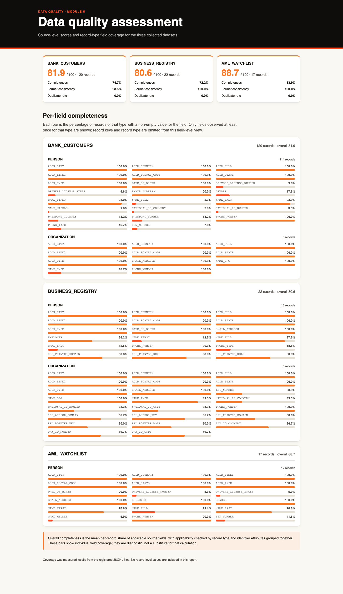

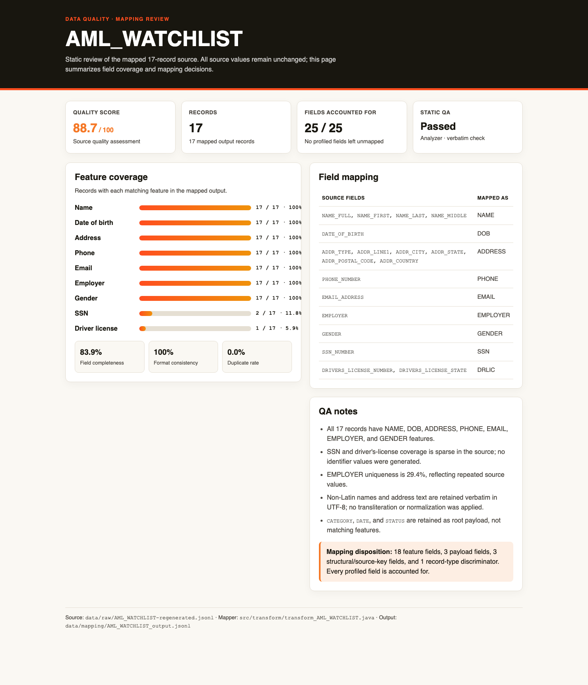

### End-of-Module Summary

**What you accomplished:**

- Assessed all three sources and mapped 159 records into load-ready JSONL, preserving source values and documenting source-quality limitations.
- Completed and documented a separate transformation for each source; all per-source mapping specifications are present.

**Files produced:**

- `data/senzing-ready/BANK_CUSTOMERS.jsonl`, `data/senzing-ready/BUSINESS_REGISTRY.jsonl`, and `data/senzing-ready/AML_WATCHLIST.jsonl` — validated load-ready outputs for 159 records.
- `data/mapping/BANK_CUSTOMERS_mapper.java`, `src/transform/transform_BUSINESS_REGISTRY.java`, and `src/transform/transform_AML_WATCHLIST.java` — source transformation programs.
- `docs/mapping/*_mapper.md`, `docs/mapping/mapping_*.md`, and `docs/mapping/transformation_lineage_*.md` — per-source mapping decisions and transformation provenance.
- `docs/mapping/*_profile_report*.md`, `docs/mapping/*_schema_hints.md`, and `docs/mapping/*_JOURNAL.md` — source-qualified profiling and workflow notes for all three sources.
- `docs/visualizations/data_quality_assessment.html` and `docs/visualizations/mapping_AML_WATCHLIST_quality.html`, with their PNG screenshots — quality and mapping visualizations.
- `config/data_sources.yaml` — registry updated to point each completed source at its load-ready output.

**Why it matters:** The three sources now have validated, reproducible mapped files and source-specific documentation. Data processing can load these outputs and evaluate actual resolution behavior without changing the collected raw files.

---

## Data Processing — 2026-11-10T09:31:45-05:00

### Information Shared

- Reconciled the three source loads and SDK export: 159 records across 120 entities, including 9 cross-source entities.
- Reviewed possible matches and entity construction evidence; operational consistency does not establish match accuracy.
- Senzing's current reporting guidance requires known correct entity assignments for precision, recall, and F1. The requested truth-set key was absent, so absolute match accuracy remains unmeasured.
- Reported per-record and relationship-level suppressors separately; the relationship finding is not an over-merge rate.

### Questions & Responses

- **Q:** Most tests pass but there are gaps. What would you like to do? Reply with a number:
  - **R:** 1. Iterate now to improve the results before moving on.
- **Q:** What authoritative evidence can we use to decide this candidate?
  - **R:** I don't have authoritative ground truth.
- **Q:** How should we continue?
  - **R:** Move forward to Query, Visualize and Discover with the limitation documented.

### Actions Taken

- Compiled and ran the Java SDK audit; reconciled loaded and exported records, checked all 30 multi-record entities, reviewed 9 cross-source entities and 5 possible-match explanations, and made no direct database queries.
- Rechecked the highest-priority possible over-merge against the SDK export and raw/load-ready records. No transformation defect or safe mapping change was identified; the identity remains unconfirmed.
- Created the validation, UAT, and stakeholder-summary reports; updated the loading strategy and the audit to preserve reproducible evidence.

### End-of-Module Summary

**What you accomplished:**

- Loaded and validated all 159 records across three sources and documented the resulting entities and cross-source findings.
- Reviewed potential over- and under-matching evidence without presenting an unsupported accuracy percentage.
- Completed a targeted iteration; with no authoritative truth labels or transformation defect, no mapping change was made.

**Files produced:**

- `src/load/EntityResolutionAudit.java` — Java SDK export and validation audit.
- `docs/uat_results.md` — evidence-based acceptance review and limitations.
- `docs/results_validation.md` — reconciled counts and validation findings.
- `docs/stakeholder_summary_module6.md` — stakeholder-facing summary noting the lack of real sign-off.
- `docs/loading_strategy.md` — load plan and final load/validation results.
- `logs/module6-validation-8752739269744880264/` — audit exports and evidence.

**Why it matters:** The load and retrieval checks are documented, and unresolved match-quality questions remain explicit rather than being presented as measured accuracy. The next phase can explore the resolved data while preserving that limitation.

## Query, Visualize and Discover — 2026-11-10T11:18:04-05:00

### Information Shared

- Derived query requirements from the bank's business goals: unified customer views, evidence for similar-but-distinct records, business ownership/control links, screening leads, and a master list with answer-key comparison.
- Query programs searched records, built customer views, reviewed duplicates and screening leads, and exported entities through the Java SDK. The loaded data contains 159 records and 120 resolved entities; the answer key was unavailable, so precision, recall, F1, and absolute accuracy remain unmeasured.
- The visualization summarizes 30 multi-record entities, 9 cross-source entities, and 153 distinct relationship links. Quality review identified 49 possible-match pairs involving 70 entities; no single remapping action was supported by the evidence.
- Why and How analysis examined records within Entity 200005, showing four resolution steps into one five-record virtual entity. A separate ambiguous cross-source pair remained a review candidate rather than a resolved merge.
- The relationship network contained 21 entities and 62 links. A two-hop path connected Entity 200001 through Entity 200004 to Entity 200010.

### Questions & Responses

- **Q:** Is there anything you'd like to adjust?
    - **R:** No changes; accept these requirements.
- **Q:** Would you like an interactive visualization of your resolved data — entity graph with its relationship view, merge statistics, cross-source overlap, and match/feature analysis, all in one app?
    - **R:** Yes, build it.
- **Q:** Would you like to explore Senzing's advanced discover capabilities using examples from your own data?
    - **R:** Accepted and completed the Discover phase; the exact reply is not in the saved checkpoint.
- **Q:** What would you like to do next after Why Analysis?
    - **R:** Continue to How Analysis.
- **Q:** What would you like to do next after How Analysis?
    - **R:** Continue to Relationship Networks.
- **Q:** Would you like to continue to module completion now?
    - **R:** Continue to the Query Completeness Gate.
- **Q:** Ready for me to stop the visualization server?
    - **R:** Asked for the server URL first; after receiving it, confirmed that the server could be stopped.

### Actions Taken

- Created and successfully ran Java query programs for search, customer views, duplicate analysis, screening leads, and SDK entity exports.
- Added and ran Why Analysis, How Analysis, and relationship-network demonstrations against the loaded data.
- Built and verified the six-tab results visualization; captured its Entity Graph, Merge Statistics, Match Keys, Feature Scores, Cross-Source, and Search / Probe views.
- Produced the data-discoveries report and PDF; checked extracted PDF content for the findings.
- Verified the visualization server at `http://127.0.0.1:8080/`, then stopped its recorded process after the bootcamper's confirmation and verified port 8080 was free.

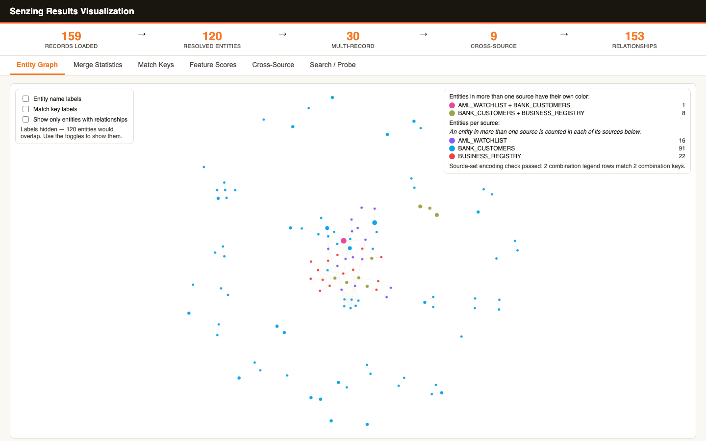
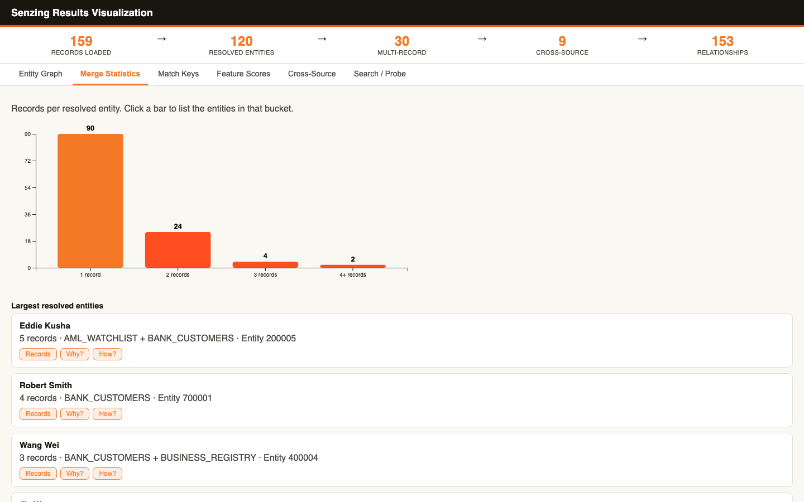
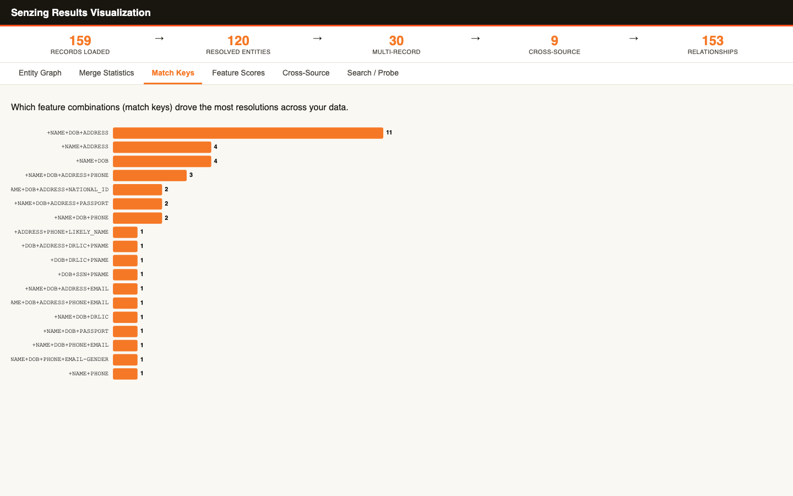
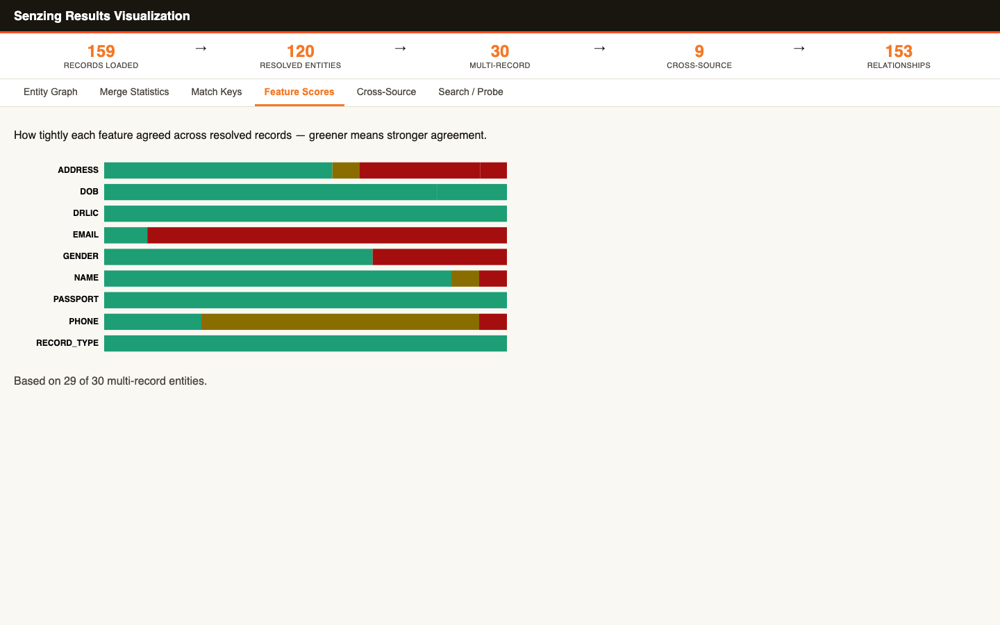
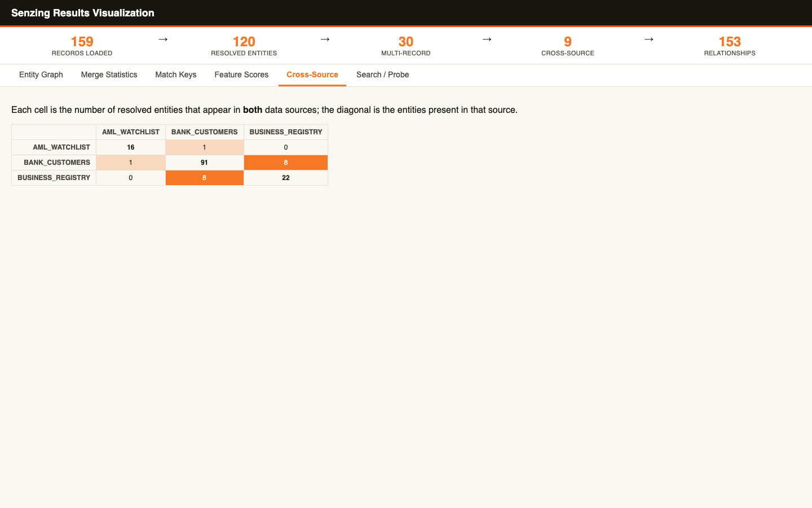
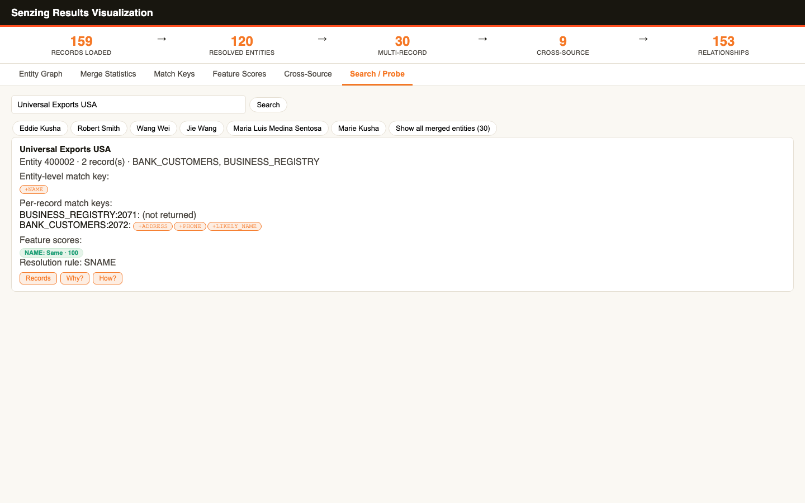

### End-of-Module Summary

**What you accomplished:**

- Built and tested query programs that answer the business questions using the resolved data.
- Explored record comparisons, entity construction, and multi-hop relationships with evidence from the SDK.
- Completed the Query Completeness Gate and recorded the limits of the accuracy assessment.

**Files produced:**

- `src/query/SearchEntities.java` — Java SDK entity search.
- `src/query/Customer360.java` — resolved entity and source-record view.
- `src/query/FindDuplicates.java` — duplicate analysis.
- `src/query/ScreeningLeads.java` — watchlist screening leads for review.
- `src/query/QueryResults.java` — SDK entity export and summary.
- `src/query/WhyRecords.java` — record-level Why Analysis.
- `src/query/HowEntity.java` — entity construction history.
- `src/query/RelationshipNetworkDemo.java` — relationship networks and path demonstration.
- `docs/query_programs.md` — query program usage and limitations.
- `docs/visualizations/results_visualization.html` — interactive tabbed results visualization.
- `docs/visualizations/results_visualization-tabs.json` — captured visualization tab manifest.
- `docs/visualizations/results_visualization-entity-graph.png` — Entity Graph screenshot.
- `docs/visualizations/results_visualization-merge-statistics.png` — Merge Statistics screenshot.
- `docs/visualizations/results_visualization-match-keys.png` — Match Keys screenshot.
- `docs/visualizations/results_visualization-feature-scores.png` — Feature Scores screenshot.
- `docs/visualizations/results_visualization-cross-source.png` — Cross-Source screenshot.
- `docs/visualizations/results_visualization-search-probe.png` — Search / Probe screenshot.
- `docs/bootcamp_data_discoveries.md` — evidence-based findings report.
- `docs/bootcamp_data_discoveries.pdf` — PDF version of the discoveries report.

**Why it matters:** The query programs and report make the resolved data explorable and the review evidence traceable. Accuracy remains explicitly indeterminate without an authoritative answer key.

---
