# Senzing Bootcamp Recap

**Bootcamper:** Senzing Bootcamper
**Started:** 2026-11-11T10:13:40-05:00
**Completed:** 2026-11-12
**Programming language:** Java
**Path:** Core
**Plugin version:** 0.6.1
**Operating system:** macOS 26.6.2 (arm64)
**Python version:** Python 3.9.6
**Language runtime:** Java 25.0.2
**Senzing SDK:** 4.3.2
**Database:** SQLite

---

## Entity Resolution Concepts — 2026-11-11T10:40:13-05:00

### Information Shared

- Entity resolution determines whether records refer to the same entity, are related, or do not match. False negatives split records for the same entity; false positives merge records for different entities.
- Ambiguous records can be held as possible matches until distinguishing information arrives, avoiding an arbitrary assignment that could create an invisible false positive.
- Senzing documentation describes resolving incoming records against known entities using principles based on expected attribute behaviors; common behaviors for people and organizations are preconfigured, and exceptions can prompt earlier decisions to be revisited.
- Disclosed relationships are explicitly stated; discovered relationships can be inferred from shared attributes. Senzing documentation describes explanations for why, why not, and how matching decisions were made.
- Scalability should be evaluated against current and future data volumes and complexity.

### Questions & Responses

- **Q:** Do you have any questions about entity resolution before we continue?
    - **R:** No.
- **Q:** Would you like a few quick questions to help the concepts stick?
    - **R:** Yes.
- **Q:** A record could plausibly belong to more than one entity. Before new information distinguishes them, what should a well-designed system do?
    - **R:** 2 — hold it as a possible match.
- **Q:** Why does a principle-based approach treat identifiers and dates of birth differently?
    - **R:** 2 — an identifier may point to one person, while a date of birth can be shared by many.
- **Q:** Which example is a discovered relationship?
    - **R:** 2 — records share an address, suggesting a relationship.
- **Q:** When resolving a new record, which approach uses what is already known about an entity?
    - **R:** 2 — compare it with information gathered across the entity’s records.
- **Q:** Are you ready to move on to the next module: Discover the Business Problem?
    - **R:** Yes.

### Actions Taken

- Presented the entity-resolution primer and optional knowledge check, using Senzing documentation retrieved through MCP.
- Completed four multiple-choice knowledge-check questions.
- No source data or application code was created during this conceptual primer.

### End-of-Module Summary

**What you accomplished:**

- Learned the difference between false positives, false negatives, and ambiguous matches.
- Explored principle-based matching and disclosed and discovered relationships.

**Files produced:**

- (no files — conceptual primer)

**Why it matters:** These concepts provide context for defining an entity-resolution business problem and making informed data and mapping decisions later in the bootcamp.

---

## Discover the Business Problem — 2026-11-11T11:04:44-05:00

### Information Shared

- Reminded the bootcamper to use data only with permission and to consider anonymizing PII for testing.
- Reviewed a business-problem pattern gallery; the bootcamper said none matched, then provided a real business-case brief.
- Summarized the fictional insurance claims-fraud case: policyholders, claim-paid vendors, and an SIU watchlist across three sources totaling 159 synthetic records.
- Reviewed Senzing documentation describing entity matching, relationship discovery and management, revisiting previous decisions, and risk/fraud and customer-data-management use cases.
- Clarified that the draft requires reviewer approval before its data may be loaded.

### Questions & Responses

- **Q:** Would you like to see examples of common business problems that entity resolution can solve?
    - **R:** Yes.
- **Q:** Do any of these patterns match your situation?
    - **R:** No.
- **Q:** How would you like to define the business problem?
    - **R:** The bootcamper provided a local business-case brief.
- **Q:** Does that summary capture your situation accurately?
    - **R:** Yes.
- **Q:** What does the end result look like?
    - **R:** A clean master list, an API, and reports.
- **Q:** Do you have any diagrams of your data architecture and flows you'd like to share?
    - **R:** No.
- **Q:** Will your entity-resolution results need to interface with other software (CRM, search engine, data warehouse, API gateway, downstream app)?
    - **R:** No.
- **Q:** Where do you plan to deploy the final solution?
    - **R:** 3 (Local / on-premises).
- **Q:** Does this accurately capture your problem and approach?
    - **R:** Yes.

### Actions Taken

- Created `docs/business_problem.md` with the confirmed scenario, data sources, matching criteria, success outcomes, desired outputs, and unresolved items.
- Updated the Overview and Business Problem sections in `README.md`.
- Recorded `integration_targets: []` and `deployment_target: local` in `config/bootcamp_preferences.yaml`.
- Created `docs/stakeholder_summary_module1.md` with the proposed approach, sources, key findings, next steps, and ROI considerations.
- No source data was loaded; the draft remains subject to reviewer approval.

### End-of-Module Summary

**What you accomplished:**

- Defined and confirmed an insurance claims-fraud business problem using the provided synthetic-data brief.
- Selected a clean master list, an API, and reports, and recorded a local / on-premises deployment target with no downstream integrations.
- Identified the unresolved measures and operational details to establish in later modules.

**Files produced:**

- `docs/business_problem.md` — confirmed business problem and requirements.
- `README.md` — project overview and business problem.
- `docs/stakeholder_summary_module1.md` — stakeholder-facing summary and next steps.
- `docs/bootcamp_recap.md` — bootcamp recap with this module's results.

**Why it matters:** This confirmed definition guides the next stages of source approval, data preparation, processing, and validation. The synthetic data remains unloaded until a reviewer approves the draft.

---

## SDK setup — 2026-11-11T11:43:37-05:00

### Information Shared

- The existing Senzing SDK was reused; its version query reported 4.3.2.
- The Java binding loaded from the installed `sz-sdk.jar`; the project-local environment and launcher avoid changes to global shell configuration.
- The Homebrew update check could not complete because `/opt/homebrew/Cellar` is not writable, so whether a newer version is available remains unknown.
- The provisional license reading was 500 records, and the post-configuration measurement remained 500.
- SQLite was selected for the project. Its schema and default Senzing configuration were created, and an engine call succeeded.
- The insurance case data remains unloaded pending reviewer approval.

### Questions & Responses

- **Q:** Which database would you like to use?
    - **R:** 1 — SQLite.

### Actions Taken

- Created and validated `src/scripts/senzing-env.sh` and `src/scripts/run-java.sh`.
- Fetched, hash-verified, compiled, and ran the official Java version and license examples.
- Created `database/G2C.db`, applied the installed SQLite schema, and wrote `config/engine_config.json` using the platform paths and the project's absolute database path.
- Seeded the default configuration, reinitialized the environment, and successfully ran the engine-priming check.
- Saved the measured license response to `config/license.json` and created the project directory layout.
- Did not load any insurance case records.

### End-of-Module Summary

**What you accomplished:**

- Reused and verified the installed Senzing SDK with Java.
- Configured the project-local SQLite database and default configuration, then confirmed an engine call succeeds.

**Files produced:**

- `src/scripts/senzing-env.sh` — project-local SDK environment.
- `src/scripts/run-java.sh` — Java launcher with the native library paths.
- `src/java/information/GetVersion.java` and `src/java/information/GetLicense.java` — SDK version and license checks.
- `src/java/configuration/InitDefaultConfig.java` — default configuration seeding.
- `src/java/initialization/EnginePriming.java` — engine connection check.
- `config/engine_config.json` — project engine settings.
- `config/license.json` — measured license response.
- `database/G2C.db` — schema-initialized SQLite repository.
- `config/bootcamp_preferences.yaml` and `config/bootcamp_progress.json` — database choice and bootcamp state.
- `docs/bootcamp_recap.md` and `docs/video/broll.json` — module recap and video manifest.

**Why it matters:** The project now has a verified local engine and persistent repository for the next modules, while the case data stays unloaded until reviewer approval.

---

## System verification — 2026-11-11T12:15:16-05:00

### Information Shared

- The system was verified end to end using only four generated synthetic records; the insurance-case data remains unloaded pending reviewer approval.
- Results validation is reported separately from installation checks because it tests an expected resolution outcome, not whether the installation works.
- The Truth Set visualization is a separate module that follows System verification.

### Questions & Responses

- {none this module}

### Actions Taken

- Confirmed MCP connectivity and engine initialization, then generated and ran Java SDK initialization, loading, resolution, and database-operation programs.
- Registered the test-only `VERIFY` source and loaded four synthetic records.
- Confirmed the records resolved into two entities: a three-record cluster and a distinct singleton.
- Verified the loaded count, read the merge entity by ID, and found it through a name-and-address search.
- Deleted the four synthetic records through the SDK and verified none remained.

### End-of-Module Summary

**What you accomplished:**

- Verified Java SDK initialization, compilation, data loading, entity resolution, read, and search operations using four synthetic records.
- Confirmed the expected three-record cluster and singleton, then removed all verification records from the database.

**Files produced:**

- `src/system_verification/verification_data.jsonl` — synthetic verification records.
- `src/system_verification/verify_init.java` — SDK initialization check.
- `src/system_verification/verify_pipeline.java` — file-driven data loading pipeline.
- `src/system_verification/register_data_sources.java` — test-source registration program.
- `src/system_verification/verify_resolution.java` — entity-resolution validation.
- `src/system_verification/verify_database_operations.java` — write-count, read, and search checks.
- `src/system_verification/purge_verification_data.java` — synthetic-data cleanup and verification.
- `config/data_sources.yaml` — marks `VERIFY` as test-only.

**Why it matters:** The installation is verified without loading the insurance-case data, and the test records have been removed so the database is ready for the next module.

---

## Truth Set visualization — 2026-11-11T13:07:55-05:00

### Information Shared

- The Senzing Truth Set is synthetic demo data, separate from the insurance-claims-fraud case data.
- The live visualization provides entity, relationship, statistics, search, and drilldown views; the saved HTML snapshot preserves the tabs backed by embedded data.
- The current visualization model reports 85 entities from 159 records, while the phase reference text states 84. This discrepancy remains documented but unresolved.

### Questions & Responses

- **Q:** Would you like to switch to Opus 5.5 at high reasoning effort for this module?
    - **R:** No.
- **Q:** Are you ready to continue?
    - **R:** Yes; the bootcamper finished exploring.
- **Q:** Ready for me to stop the visualization server and clean up the Truth Set data?
    - **R:** Yes; stop the server and purge the Truth Set.

### Actions Taken

- Acquired, registered, and loaded 159 synthetic Truth Set records from CUSTOMERS, REFERENCE, and WATCHLIST; kept the insurance-case data unloaded.
- Built the Java visualization server and standalone snapshot at `docs/visualizations/truthset_verification.html`.
- Verified the live page, health check, and all 10 required API endpoints; each returned HTTP 200. The sample search returned 3 results.
- Observed 159 records, 85 entities, 54 multi-record entities, 17 cross-source entities, 67 relationships, and 3 data sources. The phase reference text states 84 entities; the discrepancy is recorded without guessing at its cause.
- Verified that all 4 source-combination legend rows match the 4 encoding keys; actual and synthetic collision counts were zero.
- Captured all 6 live tabs. The screenshot manifest flags the Entity Graph capture as unsettled; the other five captures completed without failures.
- Stopped server PID 935 and confirmed port 8080 was free. Deleted the 159 Truth Set records through the Java SDK and verified none remained.

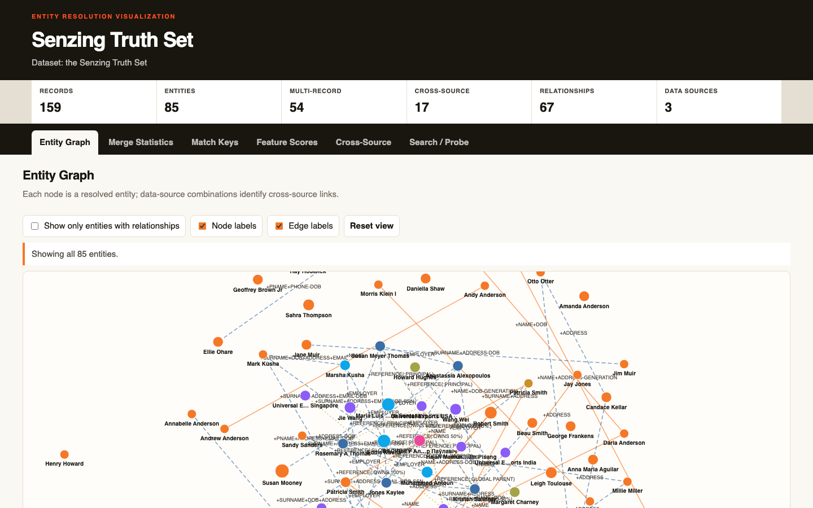

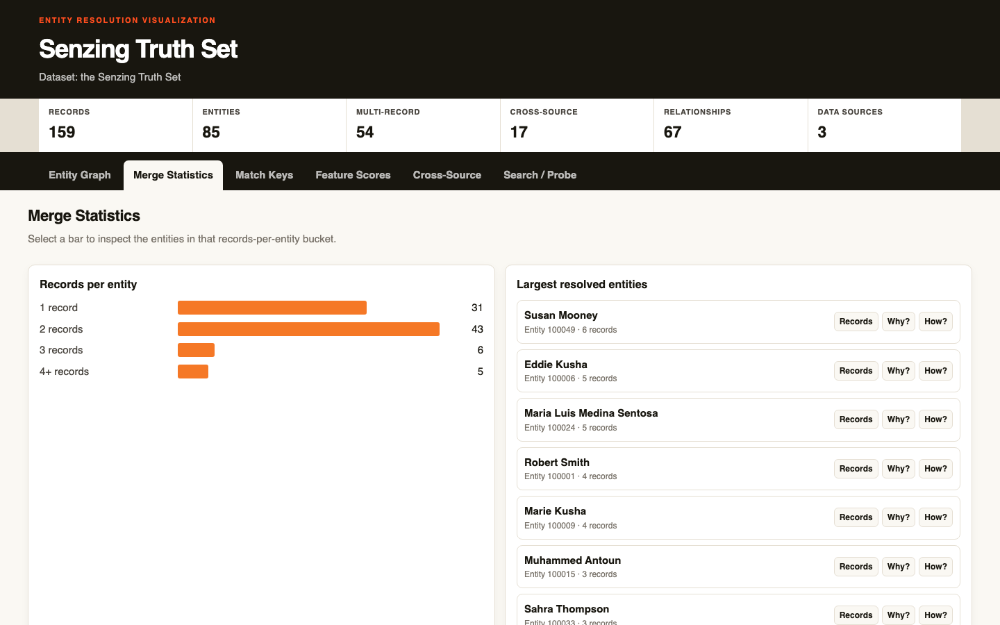

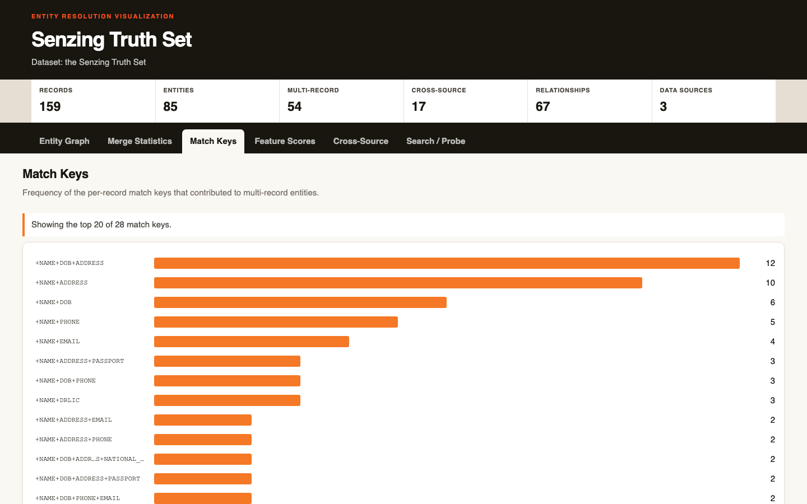

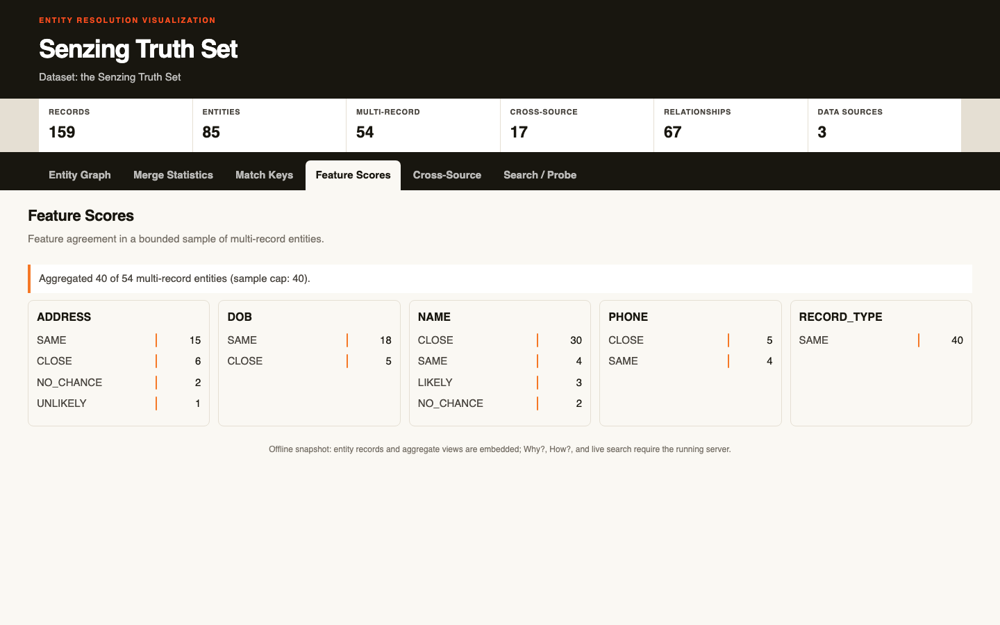

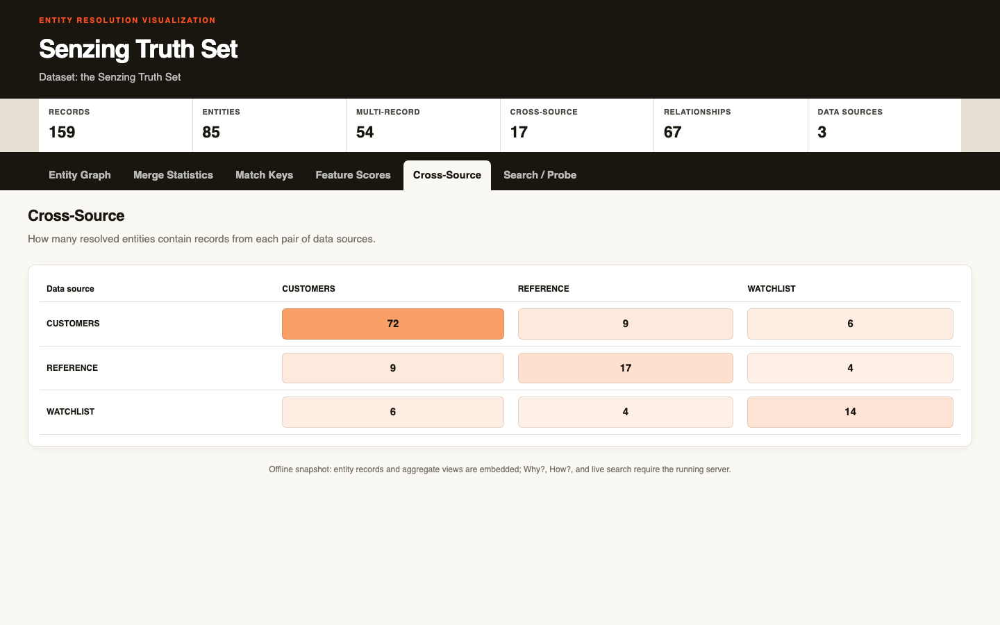

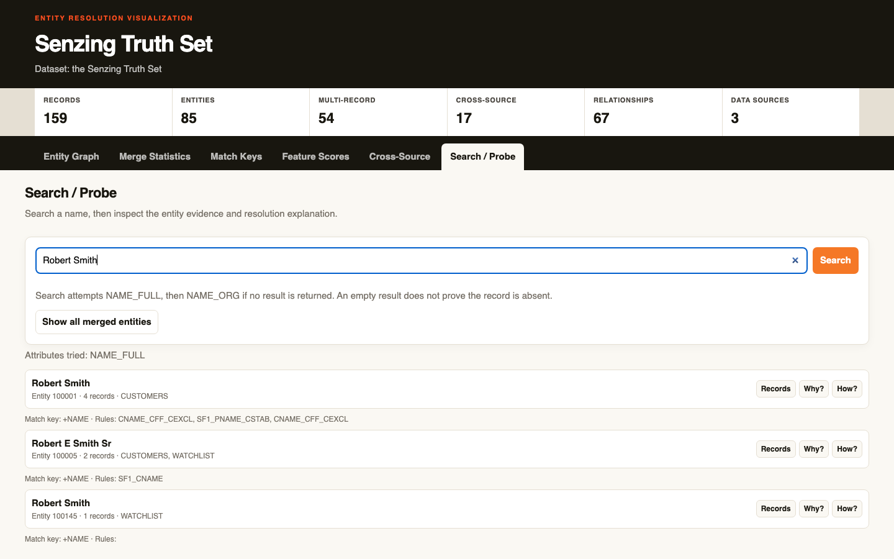

### End-of-Module Summary

**What you accomplished:**

- Loaded and explored the synthetic Truth Set in a live Java visualization, then stopped the server and removed all Truth Set records.
- Produced a standalone HTML snapshot and six screenshots covering the visualization tabs.
- Documented the unresolved 85-versus-84 entity-count difference and the unsettled Entity Graph screenshot.

**Files produced:**

- `pom.xml` — Java and JSON-P build configuration.
- `src/server/TruthSetModel.java` — entity model and visualization API payloads.
- `src/server/SourceColorEncoder.java` — source-set colors and encoding checks.
- `src/server/TruthSetVizServer.java` — loopback visualization server and API routes.
- `src/server/TruthSetPage.java` — generated six-tab visualization UI.
- `src/server/d3.v7.min.js` — vendored D3 asset for offline rendering.
- `src/scripts/run-java.sh` — Java launcher with Senzing runtime setup.
- `src/system_verification/register_truthset_sources.java` — Truth Set source registration.
- `src/system_verification/load_truthset.java` — Truth Set record loader.
- `src/system_verification/purge_truthset_data.java` — scoped SDK cleanup and verification.
- `docs/visualizations/truthset_verification.html` — standalone visualization snapshot.
- `docs/visualizations/truthset_verification-tabs.json` — screenshot coverage manifest.
- `docs/visualizations/truthset_verification-entity-graph.png` — Entity Graph capture.
- `docs/visualizations/truthset_verification-merge-statistics.png` — Merge Statistics capture.
- `docs/visualizations/truthset_verification-match-keys.png` — Match Keys capture.
- `docs/visualizations/truthset_verification-feature-scores.png` — Feature Scores capture.
- `docs/visualizations/truthset_verification-cross-source.png` — Cross-Source capture.
- `docs/visualizations/truthset_verification-search-probe.png` — Search / Probe capture.

**Why it matters:** The visualization demonstrates entity resolution using synthetic data without loading the insurance case. The saved snapshot remains available offline, while the database is clean for the next module.

---

## Data collection — 2026-11-11T13:34:26-05:00

### Information Shared

- The selected Senzing Demo Truth Set contains synthetic data and includes CUSTOMERS, REFERENCE, and WATCHLIST sources.
- Keep the collected files local and out of version control; reviewer approval remains pending before loading.

### Questions & Responses

- **Q:** Would you like to switch to Sonnet 5.5 at medium reasoning effort for this module?
    - **R:** No.
- **Q:** How would you like to provide the data for this source? Reply with a number:
    - **R:** Use the Truth Set at `https://github.com/Senzing/truth-sets/tree/main/truthsets/demo` and asked whether the data could be found.
- **Q:** Should I use REFERENCE for VENDOR_REGISTRY and WATCHLIST for SIU_WATCHLIST?
    - **R:** Yes, use that mapping.

### Actions Taken

- Downloaded and validated 120 CUSTOMERS records as POLICYHOLDERS, 22 REFERENCE records as VENDOR_REGISTRY, and 17 WATCHLIST records as SIU_WATCHLIST.
- Recorded each measured and expected count, file size, provenance, and validation result in `config/data_sources.yaml`.
- Confirmed the stored 500-record license limit covers the 159 collected records; no sample or license prompt was needed.
- Kept the data unloaded pending reviewer approval.

### End-of-Module Summary

**What you accomplished:**

- Collected and validated 159 synthetic Truth Set records across the three approved business-source assignments.
- Documented source locations, validation status, collection status, and privacy handling; retained all records without loading them.

**Files produced:**

- `data/raw/POLICYHOLDERS.jsonl` — 120 validated CUSTOMERS records.
- `data/raw/VENDOR_REGISTRY.jsonl` — 22 validated REFERENCE records.
- `data/raw/SIU_WATCHLIST.jsonl` — 17 validated WATCHLIST records.
- `config/data_sources.yaml` — source registry with measured counts and validation checks.
- `docs/data_source_locations.md` — original source URLs and local file locations.
- `docs/data_collection_checklist.md` — inventory and validation checklist.
- `docs/security_compliance.md` — data-handling notes and reviewer-approval status.
- `.gitignore` — excludes raw source files from version control.

**Why it matters:** The source files are documented and ready for quality evaluation, while remaining unloaded until reviewer approval.

---

## Data Quality, Mapping, and Transformation — 2026-11-11T17:07:24-05:00

### Information Shared

- The quality assessment found all three sources below 70%, chiefly because of sparse field completeness. Missing values were not filled by inference.
- Improved inputs preserve the original collected files. Only documented, source-supported formatting changes were applied; ambiguous dates and meaningful identifier/contact differences were preserved.
- The user chose to use SIU_WATCHLIST as-is at 56.5%, with its quality limitation and one record without a name documented.

### Questions & Responses

- **Q:** Would you like to switch to the recommended model and effort?
    - **R:** No; the current setting was retained.
- **Q:** Which source should be mapped first, and in what level of detail?
    - **R:** POLICYHOLDERS first, using concise mapping; then continued through VENDOR_REGISTRY and SIU_WATCHLIST.
- **Q:** How would you like to handle the below-threshold quality scores?
    - **R:** Initially chose to iterate on the data; after no further safe SIU_WATCHLIST corrections remained, chose to proceed with that source as-is.

### Actions Taken

- Assessed 120 POLICYHOLDERS, 22 VENDOR_REGISTRY, and 17 SIU_WATCHLIST records; documented quality scores, field coverage, and distinct-value overlaps.
- Created improved source copies with safe formatting changes while preserving original files and record keys.
- Mapped all three sources, wrote Java transformers and per-source mapping specifications, and created load-ready outputs. The VENDOR_REGISTRY output also includes three deduplicated embedded employer records.
- Updated the source registry, evaluation report, progress state, mapping documentation, and transformation lineage. The optional sandbox validation was skipped; no records were loaded.

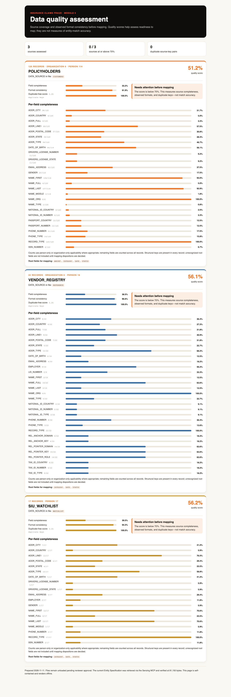

### End-of-Module Summary

**What you accomplished:**

- Assessed and mapped all three insurance-fraud data sources, retaining documented quality limitations.
- Prepared validated JSONL outputs for later processing without loading records in this module.

**Files produced:**

- `data/senzing-ready/POLICYHOLDERS.jsonl` — mapped POLICYHOLDERS output.
- `data/senzing-ready/VENDOR_REGISTRY.jsonl` — mapped vendors and embedded employers.
- `data/senzing-ready/SIU_WATCHLIST.jsonl` — mapped SIU_WATCHLIST output, used as-is.
- `docs/data_source_evaluation.md` — source quality scores, coverage, overlaps, and limitations.
- `docs/mapping/mapping_POLICYHOLDERS.md`, `docs/mapping/mapping_VENDOR_REGISTRY.md`, and `docs/mapping/mapping_SIU_WATCHLIST.md` — source transformation guides.
- `docs/mapping/POLICYHOLDERS_mapper.md`, `docs/mapping/VENDOR_REGISTRY_mapper.md`, and `docs/mapping/SIU_WATCHLIST_mapper.md` — per-source mapping specifications.
- `src/transform/transform_POLICYHOLDERS.java`, `src/transform/transform_VENDOR_REGISTRY.java`, and `src/transform/transform_SIU_WATCHLIST.java` — Java transformers.
- `src/transform/JsonSupport.java` — shared JSON support.
- `config/data_sources.yaml` and `config/bootcamp_progress.json` — source registry and bootcamp progress.
- `docs/visualizations/data_quality_assessment.html` — offline quality visualization.
- `docs/visualizations/data_quality_assessment.png` — quality visualization screenshot.

**Why it matters:** The mapped outputs are documented and ready for the next processing stage, while the low-completeness scores and missing-name gap remain visible and no source records have been loaded here.

---

## Data processing — 2026-11-11T18:30:18-05:00

### Information Shared

- All three sources loaded in full: POLICYHOLDERS 120, VENDOR_REGISTRY 25, and SIU_WATCHLIST 17; the mapped/load total is 162.
- The VENDOR_REGISTRY count differs from the 22 collected records because its mapping produces three deduplicated embedded employer organizations.
- SDK validation found 90 entities, including 15 cross-source entities; all 52 multi-record entities passed the how-state check.
- Sampled match keys and relationships include suppressors; relationship-level conflicts describe candidate links that were not resolved together, not a match-accuracy score.
- The fictional scenario has no real stakeholders. UAT was self-directed, and the sample findings are not ground-truth labels; precision, recall, F1, and absolute match accuracy are unavailable.

### Questions & Responses

- **Q:** Are you ready to move on to Data processing?
    - **R:** Yes.
- **Q:** Would you like to switch to the recommended model and effort for this code-heavy module?
    - **R:** No; kept the current setting.
- **Q:** Which production-volume tier should guide the loading program?
    - **R:** Medium.
- **Q:** Is reviewer approval confirmed for the test and full loads?
    - **R:** Yes.
- **Q:** Which loading strategy should production use?
    - **R:** Incremental.
- **Q:** Is the inventory of data sources complete?
    - **R:** Yes; POLICYHOLDERS, VENDOR_REGISTRY, and SIU_WATCHLIST.
- **Q:** Are there dependencies that require a particular source load order?
    - **R:** No.
- **Q:** Which orchestration approach should be used for the remaining sources?
    - **R:** Sequential.

### Actions Taken

- Loaded 25 VENDOR_REGISTRY records; the 22-to-25 difference is reconciled to three embedded employer organizations. Processed 54 redo records and emptied the queue.
- Sequentially loaded 17 SIU_WATCHLIST and 120 POLICYHOLDERS records, with no failures or retryable records; final SDK record count was 162. Processed 5 additional redo records and emptied the queue.
- Created and ran `src/load/ValidateEntityResults.java`; the SDK export and record-ID queries reconciled to 162 records and 90 entities.
- Reviewed all 15 cross-source entities and 8 single-source multi-record samples. Eight cross-source samples had corroborating evidence; seven require human follow-up. These are provisional assessments, not truth labels.
- Audited 47 single-source and 24 cross-source per-record match keys, 70 deduplicated relationships, and all 52 multi-record entity how-states. Cross-source per-record suppressors: 0; unsettled how-states: 0.
- Recorded load statistics, proxy UAT findings, the absence of real stakeholders, and the lack of ground-truth accuracy metrics.

### End-of-Module Summary

**What you accomplished:**

- Loaded and reconciled all three sources, then drained redo processing.
- Reviewed cross-source matches and single-source examples, documenting provisional follow-up findings without claiming absolute accuracy.

**Files produced:**

- `src/load/ValidateEntityResults.java` — SDK-backed entity, relationship, match-key, and how-state validation.
- `logs/entity_validation.json` — validation metrics and sampled entity evidence.
- `docs/uat_results.md` — self-directed UAT results and review candidates.
- `docs/results_validation.md` — reconciled load, entity, relationship, and audit results.
- `docs/stakeholder_summary_module6.md` — executive summary of outcomes, risks, and recommendations.
- `docs/loading_strategy.md` — final load reconciliation and validation findings.

**Why it matters:** The project now has a reconciled processing baseline and specific cases for review. The synthetic watchlist links remain leads for investigation, not fraud conclusions, and measured accuracy requires adjudicated labels.

---

## Query, Visualize and Discover — 2026-11-12T10:49:13-05:00

### Information Shared

- Derived four query requirements from the refined insurance-claims-fraud criteria: policyholder deduplication, evidence-supported vendor connections, watchlist review leads, and a master list/API/report output.
- Explained that 162 loaded records resolved into 90 entities, and that entity counts and possible-match indicators are review signals rather than truth labels. Absolute accuracy remains unmeasured without adjudicated labels.
- Presented the Why/How evidence model, entity networks, and a two-hop path through disclosed source relationships.
- Reviewed source overlap measurements and the distinction between per-record and relationship suppressors.

### Questions & Responses

- **Q:** Would you like to switch to Claude Opus 5.5 for this module?
    - **R:** No.
- **Q:** Is there anything you'd like to adjust?
    - **R:** No; the derived requirements are accurate.
- **Q:** Would you like an interactive visualization of your resolved data — entity graph with its relationship view, merge statistics, cross-source overlap, and match/feature analysis, all in one app?
    - **R:** Yes.
- **Q:** Would you like to explore Senzing's advanced discover capabilities using examples from your own data?
    - **R:** Yes.
- **Q:** What would you like to do next? Reply with a number:
    - **R:** 1 — continue to How Analysis.
- **Q:** What would you like to do next? Reply with a number:
    - **R:** 1 — continue to Relationship Networks.
- **Q:** Would you like to continue to module completion now?
    - **R:** Yes.
- **Q:** Ready for me to stop the visualization server?
    - **R:** Yes.

### Actions Taken

- Created and ran Java query programs for the master list, source-specific searches, quality samples, cross-source review queue, merge audit, and relationship networks. Documented the programs in `docs/query_programs.md`.
- Built and verified the six-tab visualization. Its offline snapshot retains the aggregate views; live Why, How, and Search require the server.
- Completed Discover steps 4a-4d, including Why and How analysis for Entity 400004 and a two-hop relationship path through Entity 200007.
- Produced the data-discoveries Markdown and PDF. Extracted PDF text was verified to contain the findings.
- Stopped visualization server PID 27637 with approval and confirmed port 49377 no longer served requests.

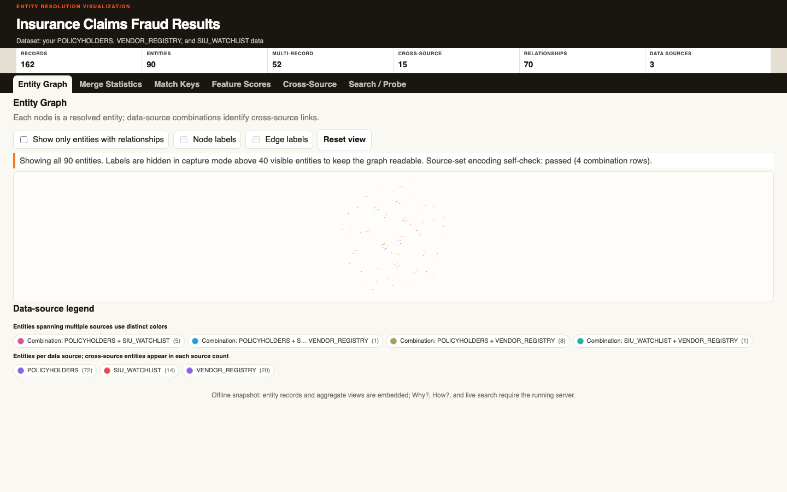
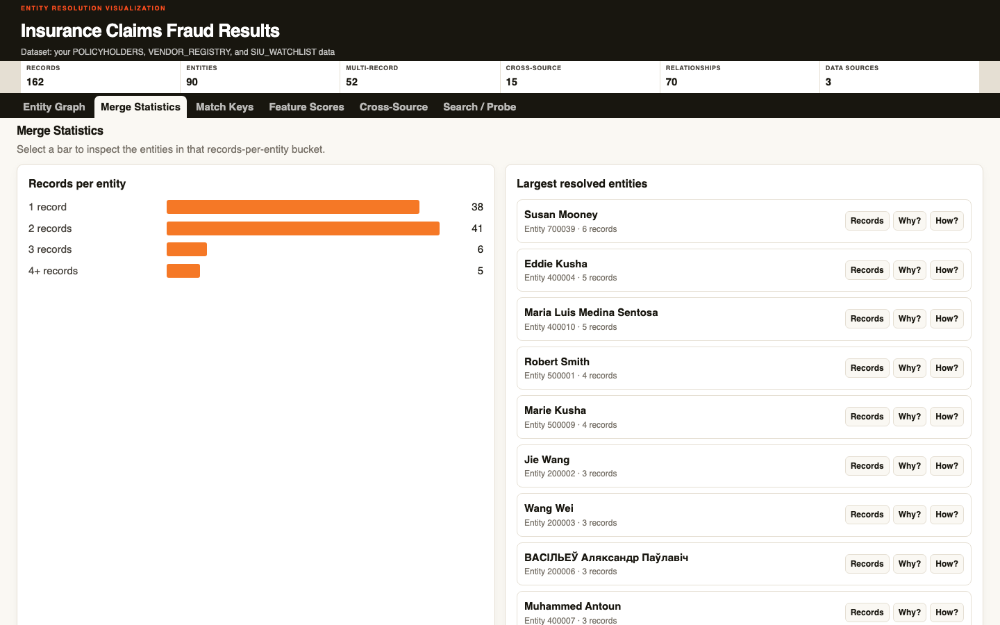
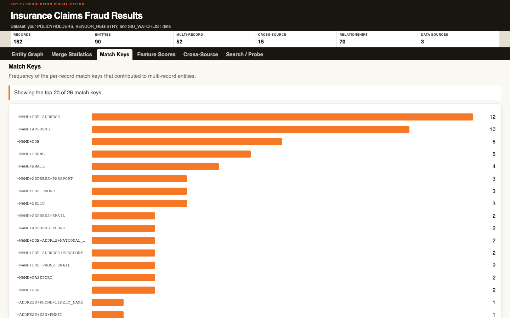
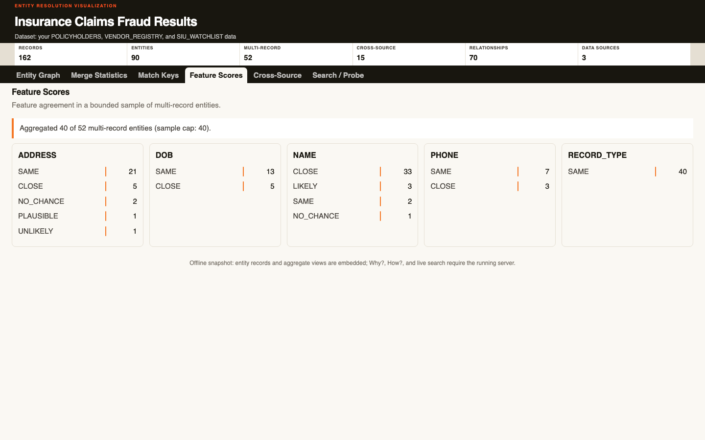
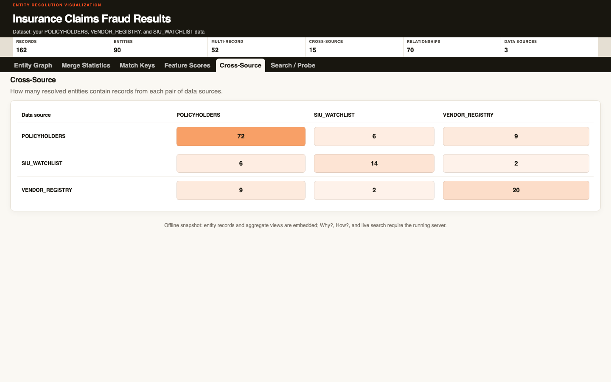
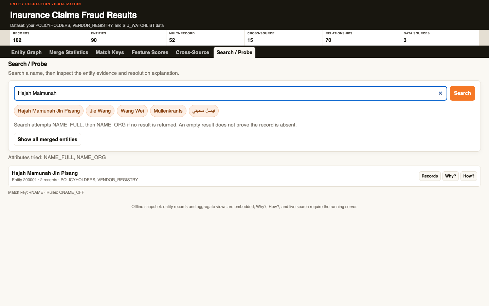

### End-of-Module Summary

**What you accomplished:**

- Created and tested Java query programs, then explored resolution evidence, entity patterns, and relationships.
- Reviewed 14 cross-source POSSIBLY_SAME pairs and documented all 72 How resolution steps across 52 multi-record entities.
- Built the interactive results visualization and completed the Discover phase.

**Files produced:**

- `docs/bootcamp_data_discoveries.md` — evidence-backed findings, merge audit, review queue, and overlap measurements.
- `docs/bootcamp_data_discoveries.pdf` — verified PDF version of the discoveries report.
- `src/query/BuildCrossSourceReviewQueue.java` — SDK-backed cross-source review queue builder.
- `src/query/BuildHowMergeAudit.java` — SDK-backed How resolution-step audit.
- `docs/query_programs.md` — query program usage and output documentation.
- `reports/query/cross_source_review_queue.json` — 14 cross-source review candidates.
- `reports/query/how_merge_audit.json` — 72 resolution steps with their match keys.
- `reports/query/relationship_networks.json` — network and two-hop path evidence.
- `docs/visualizations/results_visualization.html` — offline results-visualization snapshot.
- `docs/visualizations/results_visualization-entity-graph.png` — captured Entity Graph tab.
- `docs/visualizations/results_visualization-merge-statistics.png` — captured Merge Statistics tab.
- `docs/visualizations/results_visualization-match-keys.png` — captured Match Keys tab.
- `docs/visualizations/results_visualization-feature-scores.png` — captured Feature Scores tab.
- `docs/visualizations/results_visualization-cross-source.png` — captured Cross-Source tab.
- `docs/visualizations/results_visualization-search-probe.png` — captured Search / Probe tab.

**Why it matters:** The query evidence and review queue support earlier investigation of potential claims-fraud connections without treating a match as a fraud verdict. The source-overlap findings contextualize the results, while the lack of adjudicated labels keeps absolute accuracy unmeasured.

---
