# Senzing Bootcamp Recap

**Bootcamper:** Michael Dockter
**Started:** 2026-10-06T16:41:13-04:00
**Completed:** 2026-10-07
**Programming language:** Java
**Path:** Core
**Plugin version:** 0.6.1
**Operating system:** macOS 26.6.2 (arm64)
**Python version:** 3.9.6
**Language runtime:** Java (OpenJDK 25.0.2)
**Senzing SDK:** 4.3.2
**Database:** SQLite

---

## Entity Resolution Concepts — 2026-10-06T16:41:13-04:00

### Information Shared

- What entity resolution is: working out when different records refer to the same real-world entity, when they are related, and when they do not match; framed as accurate counting.
- The two failure modes: false negatives (one entity split into two) and false positives (overmatching), plus ambiguous matches, which become invisible false positives unless held as possible matches until a distinguishing attribute arrives.
- The conceptual pipeline: ingestion and standardization, candidate selection, comparison and scoring, classification, entity clustering.
- Disclosed relationships (explicitly stated) versus discovered relationships (detected through shared attributes), and the entity-resolved graph they form.
- Senzing's principle-based approach (principles drawn from the expected behavior of attributes, such as SSNs versus dates of birth), matching records to entities, and the why / why not / how explainability functions. Sourced from Senzing docs via the MCP server.

### Questions & Responses

- **Q:** Do you have any questions about entity resolution before we continue?
    - **R:** No.
- **Q:** Would you like a few quick questions to help the concepts stick?
    - **R:** No.
- **Q:** Are you ready to move on to the next module: Discover the Business Problem?
    - **R:** Yes.

### Actions Taken

- Presented the entity resolution primer, sourced from the Senzing docs through the MCP server.
- Offered the optional knowledge check; the bootcamper declined it.
- Created no project files.

### End-of-Module Summary

**What you accomplished:**

- Learned what entity resolution is and why accurate counting matters.
- Learned the difference between false negatives, false positives and ambiguous matches.
- Walked through the conceptual ER pipeline and the disclosed versus discovered relationship types.
- Saw how Senzing's principle-based approach differs from hand-written rules.

**Files produced:**

- (no files — conceptual primer)

**Why it matters:** These concepts are the vocabulary for everything that follows: you will map data, load it and judge Senzing's results in terms of matches, possible matches and relationships.

---

## Discover the Business Problem — 2026-10-06T17:35:29-04:00

### Information Shared

- A data privacy reminder: confirm permission to use the data and consider anonymizing PII for testing.
- A pattern gallery sourced from the Senzing docs via the MCP server: Customer 360, Fraud Detection (USCIS case study), Vendor MDM integration, and linking people and organizations to assets and claims, with business-value figures from the economic-cost article.
- No Senzing sample dataset fits a customer-style scenario (the three eligible collections are risk, sanctions and ownership data), so the generated scenario is synthesized.
- The roughly 10,000-record scenario exceeds the built-in evaluation capacity of 500 Distinct Source Records, so licensing is checked at the start of Data collection.
- How the bootcamp solves the problem, and why Senzing fits: principle-based matching, explainability, and the resolve-first, search-second layering for the API.

### Questions & Responses

- **Q:** Would you like to see examples of common business problems that entity resolution can solve?
    - **R:** Yes.
- **Q:** Do any of these patterns match your situation?
    - **R:** No.
- **Q:** How would you like to define the business problem?
    - **R:** Option 3: generate a scenario for me.
- **Q:** Does that summary capture your situation accurately?
    - **R:** Yes.
- **Q:** What does the end result look like?
    - **R:** 1, 2, 3 (a clean master list, an API, and reports).
- **Q:** Will your entity-resolution results need to interface with other software?
    - **R:** No.
- **Q:** Where do you plan to deploy the final solution?
    - **R:** Option 3: local / on-premises.
- **Q:** Does this accurately capture your problem and approach?
    - **R:** Yes.

### Actions Taken

- Generated a Customer 360 scenario on synthetic data: three sources (CRM_CONTACTS, WEB_ORDERS, SUPPORT_TICKETS) of about 10,000 records in total.
- Wrote the problem statement, data architecture diagrams, stakeholder summary and data source registry.
- Filled the Overview and Business Problem sections of README.md.
- Recorded license_guidance_deferred, integration_targets and deployment_target in config/bootcamp_preferences.yaml.

### End-of-Module Summary

**What you accomplished:**

- Defined a Customer 360 business problem with three data sources and clear success criteria.
- Chose the outputs you want: a clean master list, an API and reports.
- Set the deployment target to local, with no downstream integrations.

**Files produced:**

- `docs/business_problem.md` — the problem statement, sources, matching criteria and success criteria.
- `docs/data_architecture.md` — data architecture and data flow diagrams for the generated scenario.
- `docs/stakeholder_summary_module1.md` — a one-page summary you can share with stakeholders.
- `config/data_sources.yaml` — the registry of the three generated sources.
- `README.md` — updated with the project overview and business problem.

**Why it matters:** Every later module builds on this roadmap: the sources you collect, the mappings you write and the outputs you query all trace back to this problem and its success criteria.

---

## SDK setup — 2026-10-06T17:46:56-04:00

### Information Shared

- An existing Senzing SDK install was found through Homebrew: version 4.3.2 (build 4.3.2.26162), so no reinstall was needed.
- A newer cask, 4.4.2.26275, is published. The v4.4.0 release notes (via the MCP server) cover upgrading from v4.0-v4.3.x: no schema change, license strings now validated at startup, and configuration-delivered improvements included in a new install's default configuration.
- The official Homebrew tap is labelled a preview release (as-is, unsupported) but is the native route for Java on Apple Silicon.
- The Java bindings (sz-sdk.jar) ship with the SDK and are not on Maven Central; plain javac with the jar on the classpath is enough.
- On macOS, DYLD_LIBRARY_PATH must be set in the shell that launches the JVM; the /usr/bin/java stub drops it (observed as "no Sz in java.library.path"), so the launcher calls the real JDK.
- SQLite is not auto-created: the schema has to be applied before the engine can open it, and the connection path must be absolute.
- A freshly created datastore has no registered configuration until a default one is seeded.

### Questions & Responses

- **Q:** Would you like to switch to Opus 5.5 at high reasoning effort for this module?
    - **R:** Yes.
- **Q:** Are you done modifying the model and effort?
    - **R:** Yes.
- **Q:** Senzing 4.4.2 is available and you have 4.3.2 installed — would you like to update?
    - **R:** Yes.
- **Q:** Do you accept the Senzing End User License Agreement (EULA)?
    - **R:** Yes.
- **Q:** Which database would you like to use?
    - **R:** 1 (SQLite).

### Actions Taken

- Attempted the update with brew update and brew upgrade --cask senzingsdk; it could not run because /opt/homebrew/Cellar is owned by another macOS user, so 4.3.2 was kept.
- Wrote src/scripts/senzing-env.sh (project-local environment) and src/scripts/run-java.sh (Java launcher).
- Fetched GetVersion, GetLicense, InitDefaultConfig and EnginePriming from senzing/code-snippets-v4 into src/setup/, and added CheckDefaultConfig.
- Verified getVersion returns 4.3.2 and that the binding loads from the SDK's own sz-sdk.jar.
- Measured the license twice (before and after the engine configuration): EVAL, recordLimit 500, expiring 2027-06-12.
- Created the project folder layout and .gitignore.
- Created database/G2C.db and applied the Senzing SQLite schema (16 tables).
- Wrote config/engine_config.json from the MCP-returned paths with an absolute SQLite connection.
- Seeded the default configuration (ID 1375095766) and primed the engine successfully.

### End-of-Module Summary

**What you accomplished:**

- Confirmed a working Senzing SDK 4.3.2 install with the Java bindings.
- Set up a project-local environment and a Java launcher that work around the macOS library-path trap.
- Created and seeded a SQLite datastore, and proved the engine initializes with a real engine call.

**Files produced:**

- `src/scripts/senzing-env.sh` — project-local Senzing environment script.
- `src/scripts/run-java.sh` — launcher that sets the environment and starts Java in one step.
- `src/setup/` — version, license, configuration-seeding and engine-priming programs.
- `config/engine_config.json` — the engine configuration.
- `config/license.json` — the measured license.
- `database/G2C.db` — the SQLite datastore with schema and default configuration.

**Why it matters:** Every later module loads, resolves and queries through this engine; the environment script and launcher are how all your Java programs will reach it.

---

## System verification — 2026-10-06T17:53:47-04:00

### Information Shared

- This module verifies the whole system against four synthetic records designed to resolve into a known outcome (two entities, one holding three records) without touching any sample dataset.
- The installation checks (MCP connectivity, engine initialization, SDK initialization, code generation, build, data-source registration, data loading, database operations) decide the module's verdict; results validation compares the engine with a prediction and is reported separately.
- A data source code must be registered in the configuration before records using it can load.
- The Java loader scaffold depends on javax.json, which the SDK does not provide; only the two JSON-extraction lines were substituted and every Senzing SDK call was kept as returned.

### Questions & Responses

- **Q:** Would you like to switch to Sonnet 5.5 for this module?
    - **R:** Yes.
- **Q:** Are you done modifying the model and effort?
    - **R:** Yes.

### Actions Taken

- Confirmed the Senzing MCP server and engine initialization (engine primed in 60 ms).
- Wrote four synthetic records in `src/system_verification/verification_data.jsonl`: a three-record cluster for one invented person (only phone and address formatting varied) and one distractor.
- Initialized the SDK, generated the loader, compiled the verification programs, registered the VERIFY data source and loaded the four records.
- Results validation: 2 entities as predicted, the three-record cluster resolved to one entity, and the distractor stayed a singleton. Database operations: write count 4, read by entity ID and search by attributes all succeeded.
- Purged the four VERIFY records and confirmed none remain readable; the VERIFY code stays registered.

### End-of-Module Summary

**What you accomplished:**

- Verified the full pipeline end to end on your machine: initialize, generate, compile, register, load, resolve and query.
- Saw entity resolution behave as designed: three formatting variants of one person merged into a single entity while a different person stayed separate.

**Files produced:**

- `src/system_verification/verification_data.jsonl` — the four synthetic records.
- `src/system_verification/verify_init.java` — SDK initialization check.
- `src/system_verification/verify_pipeline.java` — generated loader that reads the records file.
- `src/system_verification/register_data_sources.java` — registers the VERIFY data source.
- `src/system_verification/verify_results.java` — results validation and database operation checks.
- `src/system_verification/purge_verification.java` — removes the synthetic records.

**Why it matters:** Your install is proven before your own data goes through it, so any later problem points at the data or the mapping rather than the environment.

---

## Truth Set visualization — 2026-10-06T18:04:34-04:00

### Information Shared

- The Senzing Truth Set is Senzing's synthetic demo data with known answers; it came from the Senzing MCP server: 159 records across CUSTOMERS (120), REFERENCE (22) and WATCHLIST (17), with every per-source count verified against the server's listing.
- After loading and redo processing it resolved into 85 entities: 54 multi-record entities, 17 spanning more than one source, and 67 relationships between entities.
- The visualization server is written in Java, the chosen language, modeled on the bootcamp's reference server; the browser page is generated from that reference, and the vendored D3 is inlined so every page renders offline.
- Graph nodes are colored by their whole set of sources, so cross-source entities stand out; the encoding self-check confirmed the legend names all 4 source combinations present.
- Search tries NAME_FULL and then NAME_ORG, so organization names are found too.
- The saved snapshot keeps every tab but not the live Why?, How? and search actions, which need the running engine.

### Questions & Responses

- **Q:** Would you like to switch to Opus 5.5 for this module?
    - **R:** Yes.
- **Q:** Are you done modifying the model and effort?
    - **R:** Yes.
- **Q:** Are you ready to continue?
    - **R:** Yes.
- **Q:** Ready for me to stop the visualization server and clean up the Truth Set data?
    - **R:** Yes.

### Actions Taken

- Downloaded the Truth Set to `src/system_verification/truthset_data.jsonl`, registered CUSTOMERS, REFERENCE and WATCHLIST, loaded all 159 records and processed 6 redo records.
- Built the Java visualization server in `src/server/` and wrote the standalone snapshot `docs/visualizations/truthset_verification.html`.
- Served the live app on port 8080 (loopback only, identity confirmed by nonce); all ten API endpoints and the page passed their checks.
- Captured one screenshot per tab from the live server, embedded below in the app's tab order. On Match Keys the longest key's label is clipped by two characters at the left edge (a cosmetic issue in the shared page template).
- Stopped the server by its recorded process id and confirmed the port was free, then purged the 159 Truth Set records (0 failures, 0 remaining).

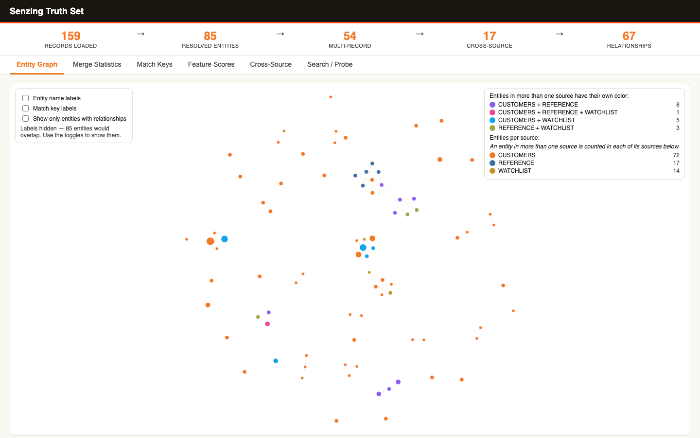

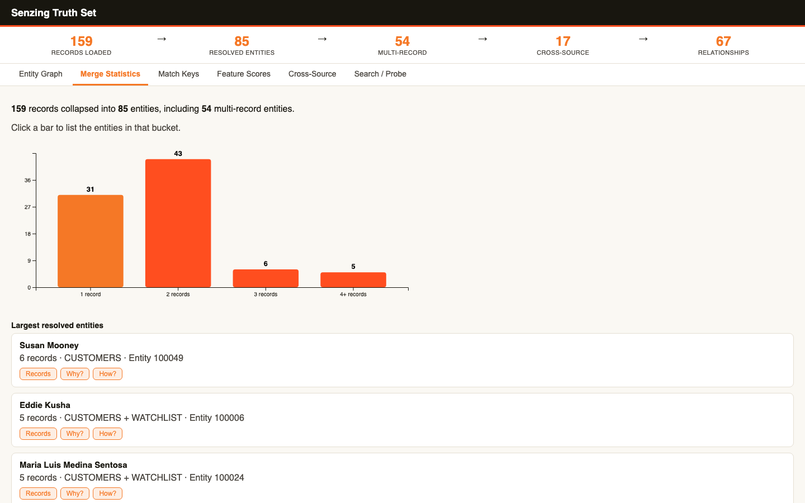

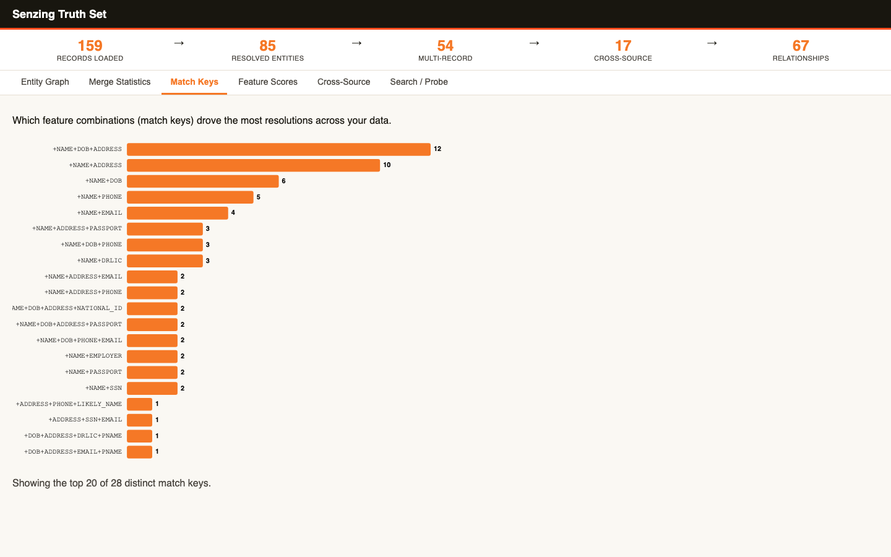

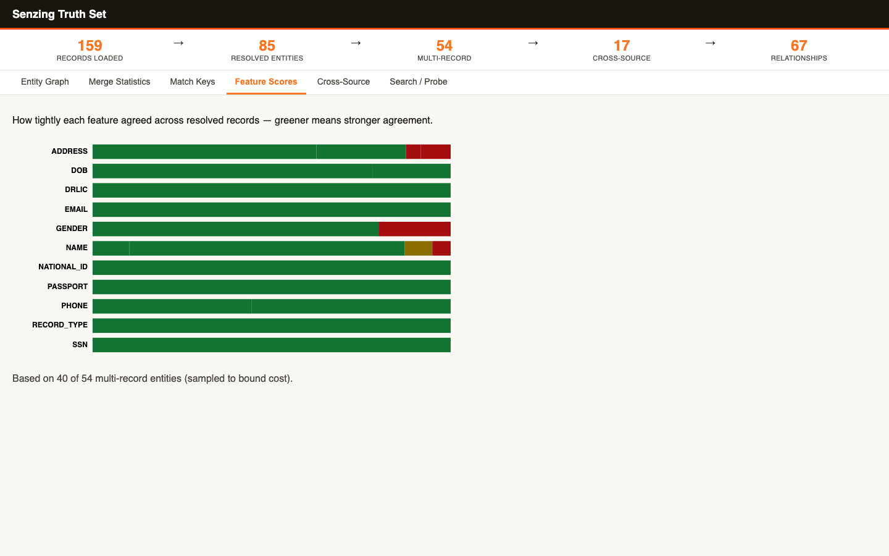

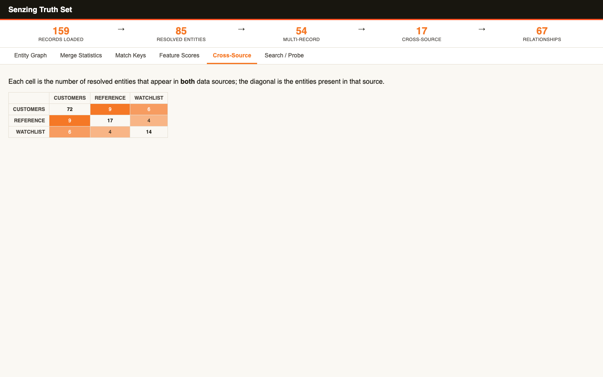

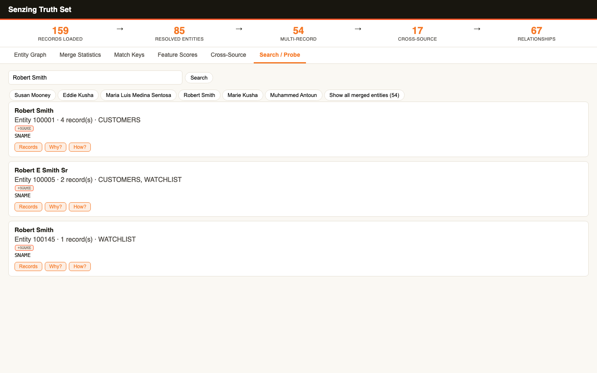

### End-of-Module Summary

**What you accomplished:**

- Watched the Senzing Truth Set resolve: 159 records became 85 entities, 17 of them spanning more than one source.
- Built and ran an interactive entity-resolution web app in Java, with a saved offline copy.
- Explored entities, match keys, feature scores and cross-source overlap, then cleaned up the demo data.

**Files produced:**

- `docs/visualizations/truthset_verification.html` — standalone snapshot of the visualization (works offline).
- `docs/visualizations/truthset_verification-*.png` — six tab screenshots.
- `src/server/VizServer.java` — the Java visualization server.
- `src/server/Json.java` — shared dependency-free JSON reader and writer.
- `src/server/generate_assets.py` — generates the page assets in `src/server/assets/`.
- `src/system_verification/load_truthset.java` — Truth Set loader with redo processing.
- `src/system_verification/register_truthset_sources.java` — registers the Truth Set data sources.
- `src/system_verification/purge_truthset.java` — removes the Truth Set records.

**Why it matters:** The same visualization server will be pointed at your own Customer 360 data in Query, Visualize and Discover, so you have already seen what your results can look like.

---

## Data collection — 2026-10-06T18:11:06-04:00

### Information Shared

- Because the scenario was generated in Discover the Business Problem (synthesized provenance), no provision question was needed; the three source files were generated rather than downloaded.
- The files carry deliberate shape differences across sources, missing and off-pattern values, cross-source overlap and per-source duplicates, so the quality assessment has real findings. As a self-check, the generator scored each source with Module 5's formula: CRM_CONTACTS 93.4, WEB_ORDERS 89.5, SUPPORT_TICKETS 75.5 against target bands of at least 80, at least 80 and 70 to 79.
- No email or phone is shared by two invented customers (0 collisions); names repeat across different customers on purpose, as hard negatives.
- The built-in evaluation license covers 500 records; the collection is 10,000, so the License Key step applied. The Senzing MCP server's SQLite guidance is under 100K records, so no load-time warning was needed.

### Questions & Responses

- **Q:** Would you like to switch to Sonnet 5.5 at medium reasoning effort for this module?
    - **R:** Yes.
- **Q:** Are you done modifying the model and effort?
    - **R:** Yes.
- **Q:** Which best describes your Senzing License Key situation?
    - **R:** 1 (a license file, .lic).
- **Q:** What is the full path to your .lic license file on this machine?
    - **R:** Gave the path to their license file (not recorded here).

### Actions Taken

- Wrote and ran `src/scripts/generate_customer_data.java`, producing `data/raw/crm_contacts.csv` (4,000 records), `data/raw/web_orders.csv` (4,500) and `data/raw/support_tickets.jsonl` (1,500), plus ground truth under `data/ground_truth/`.
- Validated every file (parses, counts match, record keys present and unique) and registered the sources in `config/data_sources.yaml` with their quality intent.
- Documented locations and a collection checklist, noted privacy handling, and excluded `data/raw/*` from version control.
- Copied the license file to `licenses/g2.lic`, added it to the engine configuration, and measured it: an EVAL license with no record cap. The earlier recorded limit of 500 was withdrawn.

### End-of-Module Summary

**What you accomplished:**

- Collected three Customer 360 sources totalling 10,000 records, with realistic gaps, overlap and duplicates.
- Registered and validated every source, and documented where each one lives.
- Applied your Senzing license and confirmed it allows the full dataset.

**Files produced:**

- `data/raw/crm_contacts.csv`, `data/raw/web_orders.csv`, `data/raw/support_tickets.jsonl` — the three generated sources.
- `data/ground_truth/` — which invented customer each record describes, for checking results later.
- `config/data_sources.yaml` — the source registry, with validation results and quality intent.
- `docs/data_source_locations.md` and `docs/data_collection_checklist.md` — where each source lives, and the checklist.
- `docs/security_compliance.md` — data-handling notes.
- `src/scripts/generate_customer_data.java` — the data generator.
- `licenses/g2.lic` and `config/license.json` — your license and its measured limits.

**Why it matters:** The next module measures and maps these exact files, and the gaps and overlap built into them are what make that work, and later the resolution results, meaningful.

---

## Data Quality, Mapping, and Transformation — 2026-10-06T18:34:26-04:00

### Information Shared

- Each source was scored with the module's formula (0.70 x completeness + 0.25 x format consistency + 0.05 x (100 - duplicate rate)) by an assessor independent of the data generator: CRM_CONTACTS 93.4, WEB_ORDERS 89.5 (both Strong, at least 80) and SUPPORT_TICKETS 75.5 (Acceptable, 70 to 79). The independent scores matched the generator's self-check.
- Every identifying field has a Senzing Entity Specification counterpart, and no source carries a record type, so none qualified for the fast path to loading; all three needed mapping.
- Measured cross-source overlap: CRM x WEB 1,404 shared emails and 929 shared phones; CRM x SUPPORT 390 and 224; WEB x SUPPORT 481 and 222.
- Mapping rules from the Senzing MCP server's mapping workflow: a single name field maps to NAME_FULL and a single address string to ADDR_FULL, never split; parsed columns map to their parsed attributes, with all parts of one name or address in one feature object; DATA_SOURCE and RECORD_ID are root keys; a constant RECORD_TYPE needs a stated justification; payload keys must not be registered feature attribute names.
- The validation gates (analyzer, copied-exactly check, routing report) are structural: a mapping that passes them is well formed, and whether it resolves correctly is confirmed after loading, by the match-key audit in Data processing.
- Known checker limitations met along the way: the analyzer needs Python 3.10 or newer, and the copied-exactly and routing scripts read JSON Lines only, so for the two CSV sources they ran unmodified on a JSON Lines copy of the source.

### Questions & Responses

- **Q:** Would you like to switch to Opus 5.5 at high reasoning effort for this module?
    - **R:** Yes.
- **Q:** Are you done modifying the model and effort?
    - **R:** Yes.
- **Q:** Would you like a visual of the quality assessment?
    - **R:** Yes.
- **Q:** Your data quality is acceptable but has some gaps. What would you like to do? (SUPPORT_TICKETS, 75.5)
    - **R:** 2 (continue to mapping now); gaps documented in the evaluation report.
- **Q:** Before we start mapping, which mode would you like?
    - **R:** 2 (concise).
- **Q:** Would you like a web page showing the quality analysis? (WEB_ORDERS)
    - **R:** Yes.
- **Q:** Quality looks strong for WEB_ORDERS. Ready to map the next source, CRM_CONTACTS?
    - **R:** 1 (yes, map CRM_CONTACTS).
- **Q:** Would you like a web page showing the quality analysis? (CRM_CONTACTS)
    - **R:** Yes.
- **Q:** Quality looks strong for CRM_CONTACTS. Ready to map the next source, SUPPORT_TICKETS?
    - **R:** 1 (yes, map SUPPORT_TICKETS).
- **Q:** Would you like a web page showing the quality analysis? (SUPPORT_TICKETS)
    - **R:** Yes.
- **Q:** Quality is acceptable. What would you like to do? (SUPPORT_TICKETS, last source)
    - **R:** 1 (proceed to loading now).

### Actions Taken

- Fetched the Entity Specification to `docs/reference/senzing_entity_specification.md` (size verified) and wrote `docs/data_source_evaluation.md`.
- Wrote `src/scripts/assess_quality.java` (results in `data/mapping/quality_assessment.json`) and `src/scripts/quality_visual.java`, which renders `docs/visualizations/data_quality_assessment.html`.
- Ran one `mapping_workflow` per source (profile, plan, map, generate and validate), each validated by the server at the mapping step and approved at the generate step; the optional sandbox test load was skipped for all three, since the real load happens in Data processing.
- Wrote the Java transformation programs `src/transform/transform_web_orders.java`, `transform_crm_contacts.java` and `transform_support_tickets.java`, on a shared dependency-free reader (`src/transform/Records.java`) and command-line helper (`src/transform/Mapper.java`).
- Mapped WEB_ORDERS (first and last name to NAME_FIRST/NAME_LAST, street/city/state/zip to ADDR_LINE1/ADDR_CITY/ADDR_STATE/ADDR_POSTAL_CODE), CRM_CONTACTS (full name to NAME_FULL, address to ADDR_FULL) and SUPPORT_TICKETS (requester name to NAME_FULL, city/postal code to ADDR_CITY/ADDR_POSTAL_CODE); email and phone to EMAIL_ADDRESS and PHONE_NUMBER everywhere; transaction and ticket fields kept as payload.
- Every source passed the analyzer with no errors or warnings, every emitted value was verified as copied exactly from the source, and each feature's population equals the source field's presence.
- Ran the cross-source shared-feature check: every pair was the same subject described as a full or parsed name or address, or the same email or phone, so all were exempt and recorded in each source's mapping specification; no question was needed.
- Wrote the load-ready files to `data/senzing-ready/` (10,000 records in all), per-source specifications, run notes and lineage under `docs/mapping/`, and repointed `config/data_sources.yaml` at the load-ready files with every source's mapping status complete.
- Wrote `src/scripts/mapping_quality_visual.java` (shared HTML helpers in `src/scripts/Html.java`) and generated one mapping-quality page per source; captured each page as an image.

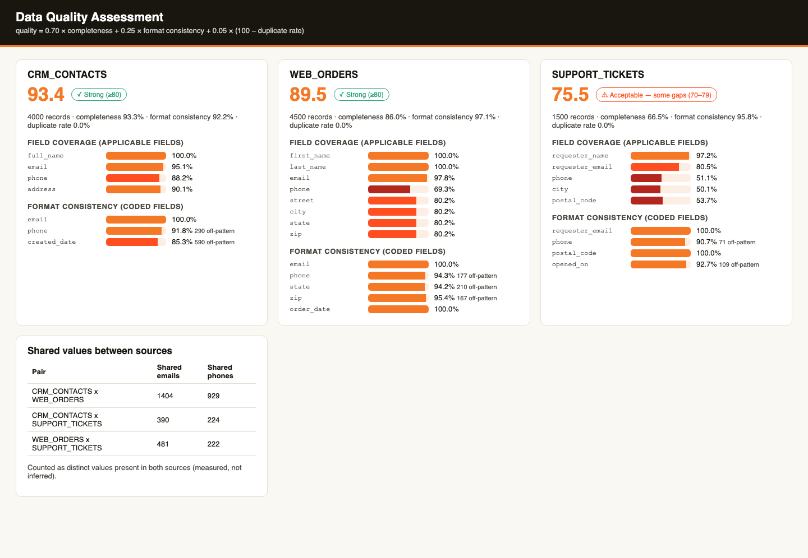

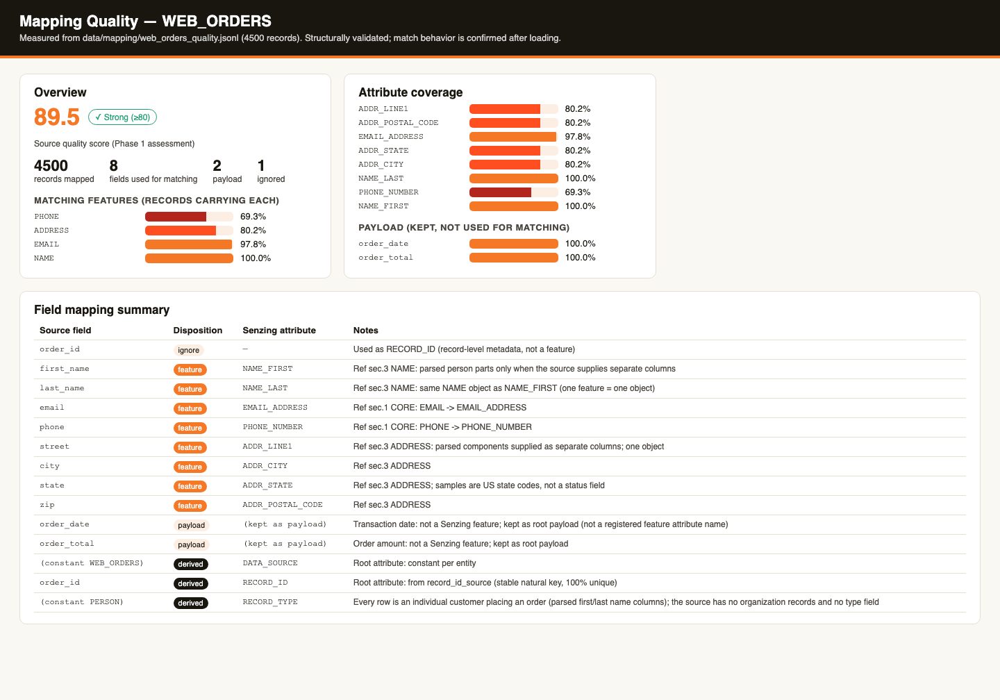

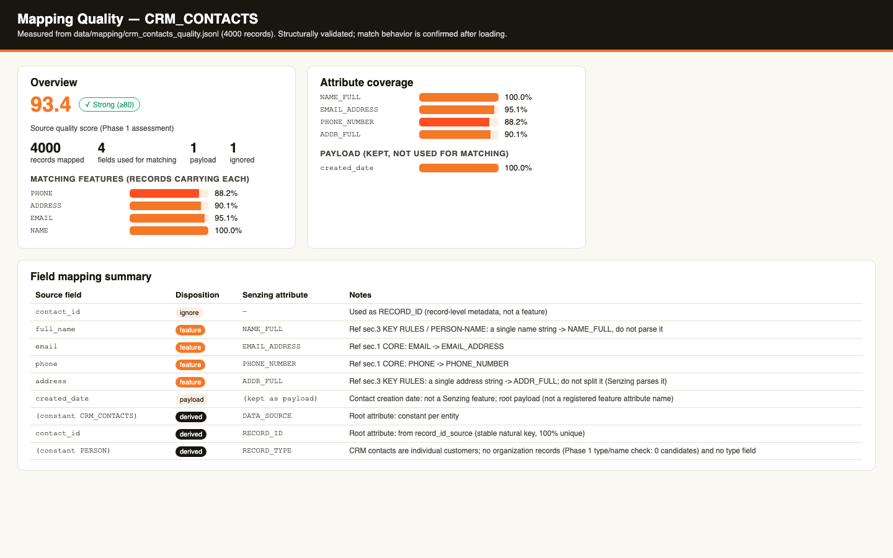

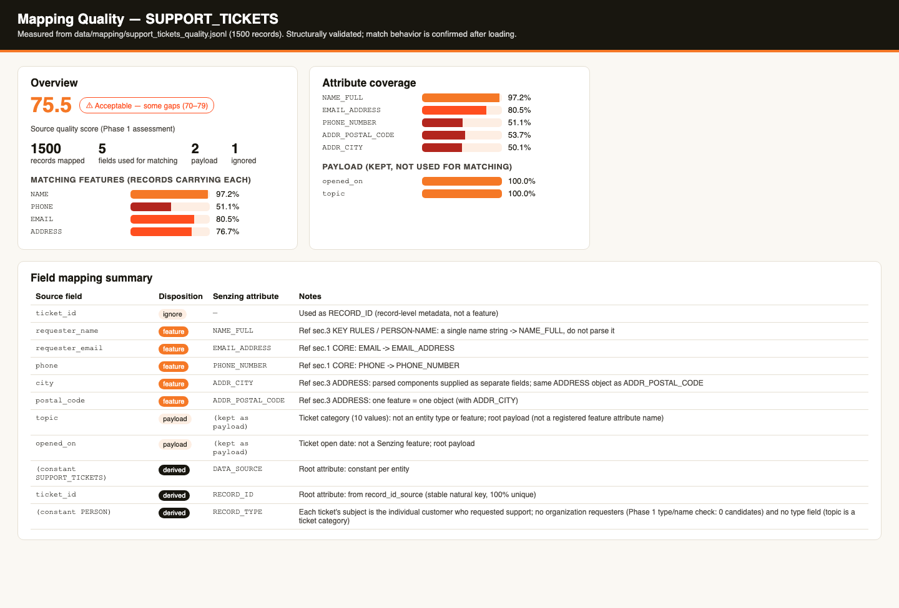

### End-of-Module Summary

**What you accomplished:**

- Scored all three sources for quality: two Strong and one Acceptable, with its gaps documented.
- Mapped every source to Senzing attributes through the Senzing mapping workflow, keeping single name and address fields whole as the specification requires.
- Built and validated a Java transformation program per source and produced 10,000 load-ready records, with every value copied exactly from the source.

**Files produced:**

- `data/senzing-ready/web_orders.jsonl`, `crm_contacts.jsonl`, `support_tickets.jsonl` — the load-ready Senzing JSON (4,500, 4,000 and 1,500 records).
- `src/transform/` — the three mappers plus the shared reader and command-line helper.
- `docs/mapping/` — per-source mapping specifications, how-to-run notes, transformation lineage, profiles and journals.
- `docs/data_source_evaluation.md` — the quality evaluation and readiness findings.
- `docs/visualizations/data_quality_assessment.html` and `mapping_*_quality.html` — the quality pages, with screenshots.
- `config/data_sources.yaml` — the registry, now pointing at the load-ready files.

**Why it matters:** Your three customer sources now speak Senzing's language, so the next module can load them and resolve duplicate customers across CRM, web orders and support, which is the single customer view your business problem asks for.

---

## Data processing — 2026-10-07T09:03:11-04:00

### Information Shared

- The production-volume answer sets the loader's architecture: the medium tier selects Senzing's threaded loading pattern (MCP LoadViaFutures scaffold), run here with one writer because SQLite does not support concurrent writes; on PostgreSQL the guidance is 2-8 workers per CPU core, tuned to the database. At medium production scale, plan on PostgreSQL rather than SQLite.
- Senzing MCP loading anti-patterns: shuffle sorted input, initialize the engine once per process and share it, never skip redo, and drain redo by looping on the fetch rather than a redo count.
- Data source codes must be registered before loading; an unregistered code fails with SENZ2207, which the loader's error test reproduced on purpose.
- A record sent with the same DATA_SOURCE and RECORD_ID as one already loaded replaces it (Senzing DSR guidance), so trial loads and retries never duplicate records.
- The license reports no record cap and 10,000 records is under the SQLite guidance threshold, so neither a license step nor a volume prompt applied.
- Results are judged from one export of the repository (SZ_EXPORT_DEFAULT_FLAGS), never SQL, with evidence at every step: specific entities, records and match keys (Senzing 4-point evaluation framework).

### Questions & Responses

- **Q:** In production — not in this bootcamp — how many records do you expect to load?
    - **R:** 3 (more than 500,000 up to 10,000,000 — medium production).
- **Q:** The generated sources have no load-order dependencies, and I recommend the Sequential loading strategy for this dataset — shall I proceed on both?
    - **R:** Yes.

### Actions Taken

- Backed up the repository to `backups/` before registering codes and again before the multi-source load.
- Wrote `src/load/register_data_sources.java` (re-runnable: reads the data source registry first) and registered CRM_CONTACTS, WEB_ORDERS and SUPPORT_TICKETS.
- Built the loader: `src/load/RecordLoader.java` (shared loading engine with per-load tallies, error log, retry file, progress) and `src/load/load_customer_data.java` (command line); `src/load/process_redo.java` drains redo as a batch.
- Loaded CRM_CONTACTS first (reference before transactional): trial 100 of 100, then 4,000 of 4,000 with 0 errors at about 96 records per second; redo queue empty.
- Wrote `src/load/orchestrator.java` (sequential, one environment, per-source tallies, retry with backoff, error isolation, per-source reconciliation); tested it on 100 records per source and on a deliberately broken file (both bad records logged, run refused to report success); then loaded WEB_ORDERS 4,500 of 4,500 and SUPPORT_TICKETS 1,500 of 1,500 with 0 errors; 39 redo records processed, queue empty.
- Reconciled every source in the registry (`load_count_matches_source: pass`).
- Exported all entities and evaluated them (`src/validate/export_and_audit.java`, `src/validate/evaluate_results.java`): 7,134 entities, 2,090 spanning 2 or more sources, pairwise precision 99.9% and recall 95.1% against ground truth; 2 over-merges and 136 split customers investigated.
- Match-key audit: no suppressors in any of the three buckets (reader proven on 4,592 relationship keys) — no finding. How-state audit: 2,395 of 2,395 multi-record entities checked, 0 unsettled — no finding.
- Self-directed UAT (bootcamp-generated scenario): 10 of 10 cross-source entities correct.
- Wrote `docs/loading_strategy.md`, `docs/uat_results.md`, `docs/results_validation.md` and `docs/stakeholder_summary_module6.md`.

### End-of-Module Summary

**What you accomplished:**

- Built a production-shaped Java loading pipeline: source registration, a threaded loader, a multi-source orchestrator and a redo drain.
- Loaded all 10,000 records from three sources with zero errors and reconciled every count.
- Validated the resolution: 7,134 entities, 2,090 customers recognised across systems, 99.9% precision and 95.1% recall against the answer key.

**Files produced:**

- `src/load/` — registration, loader (`RecordLoader.java`, `load_customer_data.java`), orchestrator and redo programs.
- `src/validate/` — the export, how-state audit and evaluation programs.
- `docs/loading_strategy.md` — architecture, load order, load log, incremental strategy and recommendations.
- `docs/results_validation.md` and `docs/uat_results.md` — the validation baseline and spot-check evidence.
- `docs/stakeholder_summary_module6.md` — one-page executive summary.
- `data/results/` — the entity export, evaluation and audit outputs.

**Why it matters:** Your customers are now resolved across CRM, web orders and support with measured accuracy, which is the foundation the next module queries and visualizes to answer the business problem.

---

## Query, Visualize and Discover — 2026-10-07T10:21:01-04:00

### Information Shared

- Six query requirements were derived from the business problem's success criteria and desired outputs: resolved customer count, customers in more than one system, why two records did or did not match, a customer master list, customer search with a 360 view, and duplicates within each system.
- Reading results: features are the kinds of detail Senzing compares (name, email, phone, address); a match key such as +NAME+PHONE+EMAIL lists the features that agreed; each feature comparison carries a 0-100 score and a bucket such as SAME, LIKELY or NO_CHANCE.
- Quality, by the Senzing 4-point evaluation with evidence: 0.71 entities per record; 29.3% of customers span systems; 70.1% of customers have a "possibly the same" link, above the Poor line by rate but not mapping-actionable, because every one of those links is name-only and by the answer key 4,445 of 4,567 join different people who share a name (the generator's small name pool). Against the answer key: precision 99.9%, recall 95.1%. No return to mapping was needed.
- Why analysis compares two records or entities and explains the current decision; how analysis replays an entity's construction step by step; relationship networks (find network, find path) show links Senzing inferred without merging. All 4,592 relationships here are discovered, none disclosed.
- DEFAULT flag composites are right for exploration; production code should request exactly the flags it consumes, because a composite's membership can change between Senzing versions without an error.

### Questions & Responses

- **Q:** Is there anything you'd like to adjust? (derived query requirements)
    - **R:** No.
- **Q:** Would you like an interactive visualization of your resolved data?
    - **R:** Yes.
- **Q:** Would you like to explore Senzing's advanced discover capabilities using examples from your own data?
    - **R:** Yes.
- **Q:** What would you like to do next? (after Why Analysis)
    - **R:** 1 (continue to How Analysis).
- **Q:** What would you like to do next? (after How Analysis)
    - **R:** 1 (continue to Relationship Networks).
- **Q:** Would you like to continue to module completion now?
    - **R:** Yes.
- **Q:** Ready for me to stop the visualization server?
    - **R:** Yes.

### Actions Taken

- Wrote the Java query programs in `src/query/`: `customer_reports.java` (one export pass: counts, cross-source list, master list, within-source duplicates), `customer_search.java` (search and 360 view), `explain_match.java` (why records), plus the shared `SenzingSession.java`; dumped raw search, entity and why responses before trusting each parser.
- Results: 7,134 customers from 10,000 records; 2,090 in 2+ systems (CRM x Web 1,489, Web x Support 522, CRM x Support 433); within-system duplicates CRM 279 customers / 579 records and Web 288 / 587; written to `docs/query_results.md` and `data/results/`.
- Built the interactive app from Senzing's export stream (new `--export` mode in `src/server/VizServer.java`): six tabs, every API endpoint verified, source-set coloring self-check passed (4 combination rows = 4 combination keys). Snapshot at `docs/visualizations/results_visualization.html`; the server was stopped at the end of the module.
- Discover: 4a found 421 customers with 3+ records (405 cross-source) and 5,015 with relationships (`discover_patterns.java`); 4b explained why Ahmed White's CRM and web records matched (address in one line vs parts scored 99, SAME); 4c replayed his four-step construction (`explain_how.java`, final state settled); 4d explored the Carol Nelson network (9 customers, 23 links) and a 2-degree path through a shared postal code (`explain_network.java`).
- Wrote `docs/bootcamp_data_discoveries.md` and `.pdf` (verified by text extraction) and `data/results/review_queue.csv` (3,661 cross-source possibly-same pairs, 120 true matches by the answer key).
- No quality iteration was run (the step-3b finding was not mapping-actionable).

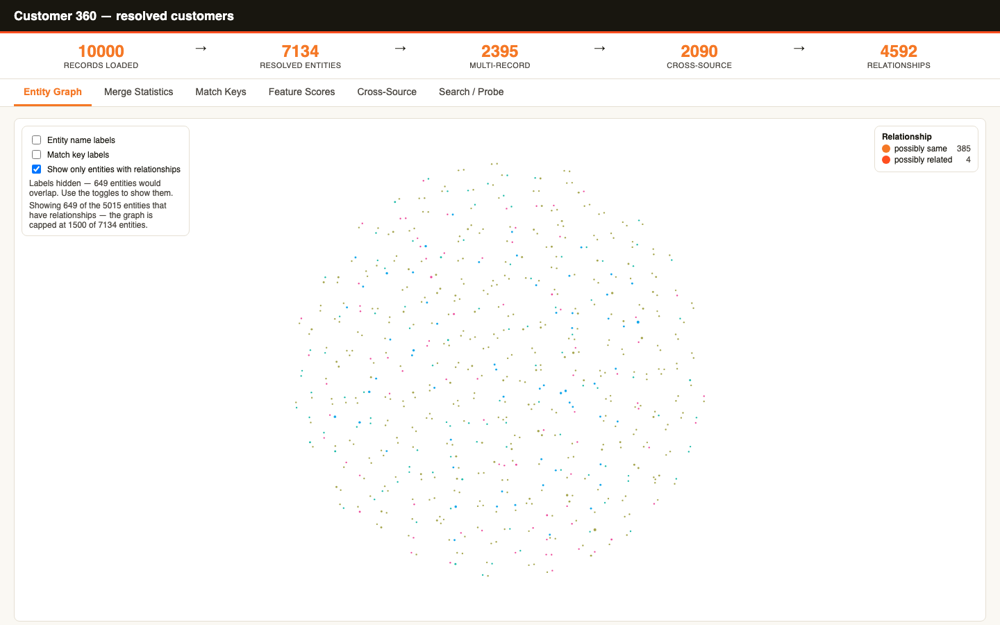

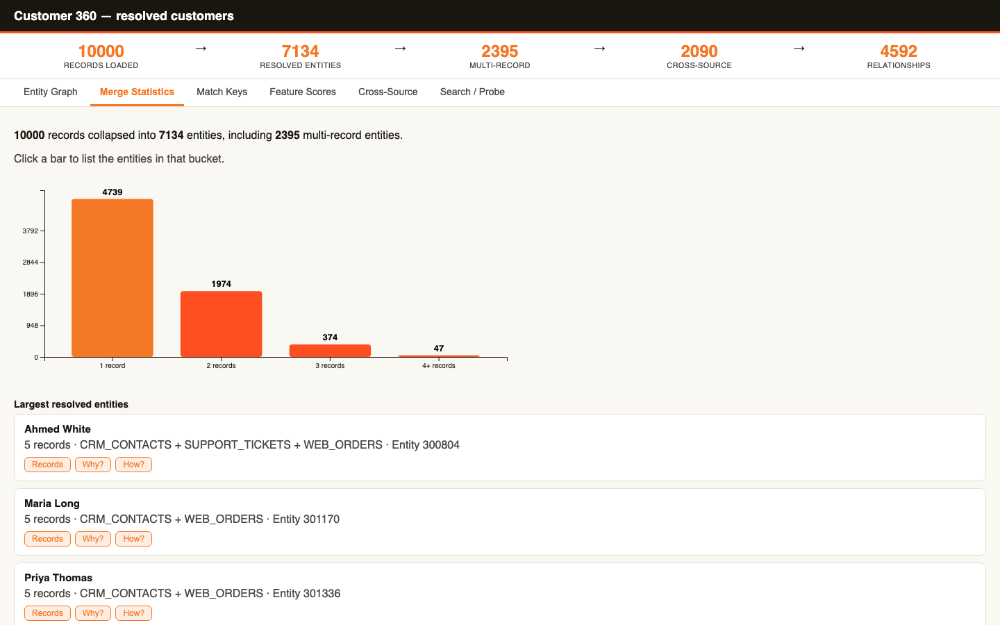

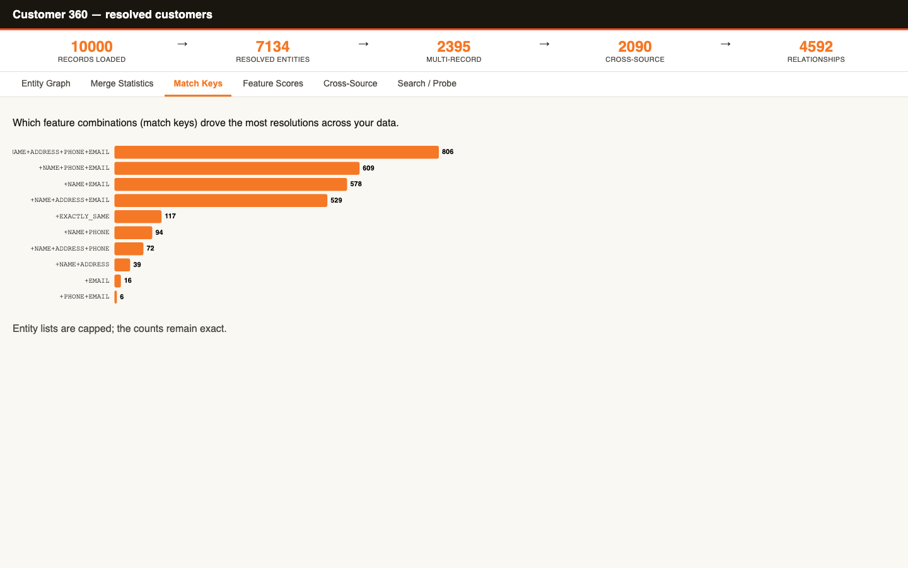

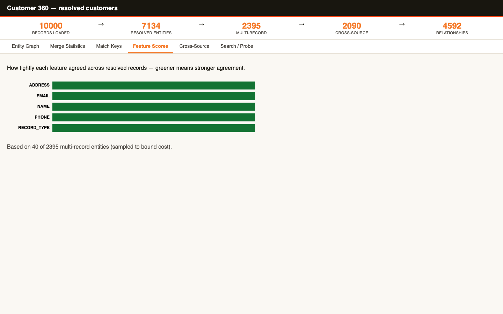

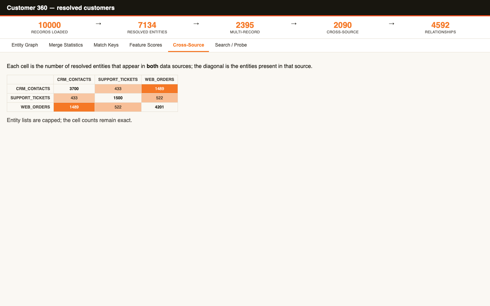

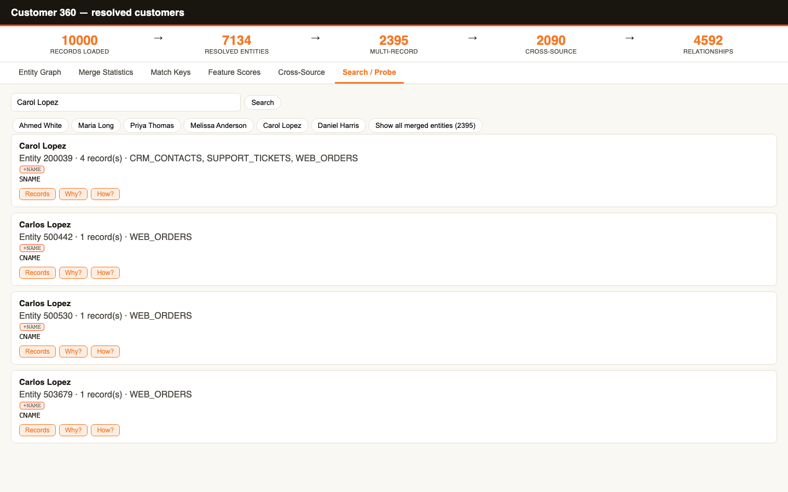

### End-of-Module Summary

**What you accomplished:**

- Answered all six business questions with Java query programs: 7,134 customers from 10,000 records, 2,090 of them in more than one system.
- Built an interactive six-tab app of your resolved customers and a saved offline copy.
- Learned to explain Senzing's decisions: why records matched or did not, how a customer was built, and how customers connect.
- Produced a findings report with a review queue a data steward can act on.

**Files produced:**

- `src/query/` — the query, search, explanation and network programs.
- `docs/query_results.md` — the answers to the six query requirements.
- `docs/visualizations/results_visualization.html` — the saved interactive app, with six tab screenshots.
- `docs/bootcamp_data_discoveries.md` and `docs/bootcamp_data_discoveries.pdf` — the findings report.
- `data/results/` — master list, cross-source list, duplicates and review queue (kept out of git).

**Why it matters:** You can now count your real customers, see them across CRM, web orders and support, and explain every merge, which is the trustworthy single customer view the business problem asked for.

---
