# Senzing Bootcamp Recap

**Bootcamper:** Senzing Bootcamper
**Started:** 2026-11-14T12:00:00-05:00
**Completed:** 2026-11-14
**Programming language:** Java
**Path:** Core
**Plugin version:** 0.6.1
**Operating system:** macOS (arm64)
**Python version:** Python 3.9.6
**Language runtime:** Java (OpenJDK 21.0.13)
**Senzing SDK:** 4.4.4
**Database:** SQLite

---

## Entity Resolution Concepts — 2026-11-14T12:36:47-05:00

### Information Shared

- Entity resolution determines when different data records refer to the same real-world entity, and when they don't (Senzing docs via MCP).
- Two failure modes: false negatives (one entity split apart) and false positives (different entities merged), including ambiguous matches and invisible false positives, which a well-designed system holds as possible matches until a distinguishing attribute arrives.
- The conceptual pipeline: data ingestion and standardization, candidate selection, comparison and scoring, classification, entity clustering.
- Disclosed relationships (stated in the data) versus discovered relationships (found through shared attributes such as an address or phone).
- How Senzing approaches it: principle-based rather than rule-based, preconfigured for people and organizations, entity-centric, real-time, and explainable (why / why not / how).

### Questions & Responses

- **Q:** Do you have any questions about entity resolution before we continue?
    - **R:** No.
- **Q:** Would you like a few quick questions to help the concepts stick?
    - **R:** Yes.
- **Q:** What does a well-designed system do with a record that fits six different people in a household?
    - **R:** Hold it as an ambiguous possible match until a distinguishing attribute arrives (correct).
- **Q:** Which example matches principle-based entity resolution?
    - **R:** An SSN typically points to one person, while a date of birth is shared by many (correct).
- **Q:** What kind of relationship is a guarantor on a credit application?
    - **R:** A disclosed relationship (correct).
- **Q:** What kind of error is one customer split into two entities because each record shares only one detail?
    - **R:** A false negative (correct).
- **Q:** Are you ready to move on to the next module: Discover the Business Problem?
    - **R:** Yes.

### Actions Taken

- Presented the Entity Resolution Concepts primer, sourced from Senzing docs via the MCP server.
- Ran the optional four-question knowledge check, with each question sourced and verified through the MCP server.
- Created no project files for this module (the primer is conceptual).

### End-of-Module Summary

**What you accomplished:**

- Learned what entity resolution is and the two ways it can go wrong.
- Learned how Senzing's principle-based, entity-centric approach differs from rule-based matching.
- Answered all four knowledge-check questions correctly.

**Files produced:**

- (no files — conceptual primer)

**Why it matters:** These concepts are the vocabulary for everything that follows. Understanding ambiguous matches, relationships, and false negatives will help you judge the results when you resolve your insurance customer data.

---

## Discover the Business Problem — 2026-11-14T12:47:42-05:00

### Information Shared

- A data privacy reminder: confirm permission to use the data and consider anonymizing PII for testing.
- A gallery of common entity resolution business problems, sourced from Senzing docs via MCP: Customer 360, fraud detection, insurance claims fraud, stolen or flagged assets screening, and Vendor MDM, with Senzing's published estimates of the annual cost of mismatched identity records for context.
- How the bootcamp will solve the problem: resolve all six sources once, then look up the entity a record resolved into and read its connections for screening; disclosed and discovered relationships cover ownership screening.
- Why Senzing fits this data: ambiguous matches are held as possible matches, why / why-not / how explanations provide evidence for each alert, and no training or tuning is needed.

### Questions & Responses

- **Q:** Would you like to see examples of common business problems that entity resolution can solve?
    - **R:** Yes.
- **Q:** Do any of these patterns match your situation?
    - **R:** No.
- **Q:** How would you like to define the business problem?
    - **R:** Describe a real business case, supplied as a business-problem description file for a US insurer (the first path given was for a different project and was replaced with the correct insurance one).
- **Q:** Does that summary capture your situation accurately?
    - **R:** Yes.
- **Q:** Do you have any diagrams of your data architecture and flows you'd like to share?
    - **R:** No.
- **Q:** Will your entity-resolution results need to interface with other software?
    - **R:** No.
- **Q:** Where do you plan to deploy the final solution?
    - **R:** Local / on-premises.
- **Q:** Does this accurately capture your problem and approach?
    - **R:** Yes.

### Actions Taken

- Read the bootcamper's business-problem description and inferred record types (people and organizations), six data sources totaling 248 records, the matching criteria, and the desired outcome.
- Checked the 248-record total against the built-in evaluation capacity; no license guidance was needed.
- Saved `integration_targets` (none) and `deployment_target` (local) to `config/bootcamp_preferences.yaml`.
- Created `docs/business_problem.md` and filled the Overview and Business Problem sections of `README.md`.
- Created `docs/stakeholder_summary_module1.md`.

### End-of-Module Summary

**What you accomplished:**

- Defined an insurance customer 360 and screening problem across two policy systems and four supporting sources.
- Documented the problem, data sources, matching criteria, and success criteria in your own words.
- Confirmed a standalone, local-first approach with no downstream integrations.

**Files produced:**

- `docs/business_problem.md` — the business problem statement
- `docs/stakeholder_summary_module1.md` — a stakeholder summary of the problem, approach, and next steps
- `README.md` — project Overview and Business Problem sections filled in
- `config/bootcamp_preferences.yaml` — integration and deployment answers recorded

**Why it matters:** A defined problem, named sources, and clear success criteria are the roadmap for every later module. They tell the bootcamp what to collect, how to map it, and how to judge the resolved results for both the customer 360 and screening teams.

---

## SDK setup — 2026-11-14T12:54:39-05:00

### Information Shared

- Recommended Opus 5.5 at high reasoning effort for this module.
- Senzing SDK 4.4.4 (build 4.4.4.26314) was already installed through the Homebrew cask, so installation and the EULA question were skipped (existing-install path).
- The Homebrew tap is a preview release Senzing describes as unsupported; it remains the native macOS route.
- Java bindings come from the sz-sdk.jar bundled with the install, not Maven Central (Senzing guidance via MCP).
- On macOS, DYLD_LIBRARY_PATH must be set in the shell that starts the JVM; /usr/bin/java is a protected stub that strips it, so the launcher calls the JDK's own java.
- SQLite is for learning and evaluation; Senzing recommends PostgreSQL, MySQL or MSSQL for production.

### Questions & Responses

- **Q:** Would you like to switch to Opus 5.5 at high reasoning effort for this module?
    - **R:** Yes.
- **Q:** Are you done modifying the model and effort?
    - **R:** Yes (model set to Opus 5.5).
- **Q:** Which database would you like to use?
    - **R:** SQLite.

### Actions Taken

- Confirmed the existing install: libSz.dylib present, szBuildVersion.json reports 4.4.4. The update check was skipped because Homebrew is not writable by the current macOS user.
- Wrote `src/scripts/senzing-env.sh` (project-local environment, zsh and bash) and `src/scripts/sz-java.sh` (compile and run launcher).
- Fetched Senzing scaffolds (GetVersion, GetLicense, InitDefaultConfig, EnginePriming) with sha256 verification into `src/resources/scaffold/`.
- Built `src/setup/verify_install.java`: binding resolved from the cask's sz-sdk.jar; SzProduct reported 4.4.4; license EVAL with a 500-record limit, measured at Step 5a and confirmed at Step 8a.
- Created the project directory structure and `.gitignore`; recorded `database_type: sqlite`.
- Applied the Senzing SQLite schema to `database/G2C.db` and wrote `config/engine_config.json` from the server's default paths with an absolute connection path.
- Seeded the default configuration (`src/setup/init_default_config.java`).
- Proved the engine works with `src/setup/test_engine_connection.java`: SzEngine.primeEngine() succeeded.

### End-of-Module Summary

**What you accomplished:**

- Confirmed Senzing SDK 4.4.4 works with Java on your Apple Silicon Mac.
- Created and seeded a SQLite datastore for the project.
- Proved a real engine call succeeds, not just a version query.

**Files produced:**

- `src/scripts/senzing-env.sh` — project-local Senzing environment script
- `src/scripts/sz-java.sh` — launcher that compiles and runs Java against the SDK
- `src/setup/verify_install.java` — binding, version and license check
- `src/setup/init_default_config.java` — seeds the default Senzing configuration
- `src/setup/test_engine_connection.java` — engine connection test
- `config/engine_config.json` — engine configuration
- `config/license.json` — the active license reading
- `database/G2C.db` — the SQLite datastore

**Why it matters:** Every later module runs against this verified SDK, environment and datastore, so loading and querying your six insurance sources can start without setup surprises.

---

## System verification — 2026-11-14T13:02:43-05:00

### Information Shared

- Recommended Sonnet 5.5 at high reasoning effort for this module; the bootcamper switched from Opus 5.5 to Sonnet 5.5.
- System verification uses a handful of synthetic records designed to resolve in a known way, and never touches the Truth Set.
- The module runs eight installation checks, and reports results validation separately because it compares the engine against a prediction the guide made, so a mismatch would not by itself mean the install is broken.
- javax.json (JSON-P) is not part of Java SE and is not provided by the Senzing install, so the loader replaces only the JSON-extraction lines with a small dependency-free extractor; the Senzing SDK calls are unchanged from the scaffold.

### Questions & Responses

- **Q:** Would you like to switch to Sonnet 5.5 for this module?
    - **R:** Yes.
- **Q:** Are you done modifying the model and effort?
    - **R:** Yes (model set to Sonnet 5.5).

### Actions Taken

- Generated four synthetic records in `src/system_verification/verification_data.jsonl`: three for one invented person that differ only in formatting, and one distractor, so the expected result is 2 entities with a 3-record cluster.
- Ran the eight installation checks, all passed: MCP connectivity, engine initialization, SDK initialization, code generation, build, data-source registration (VERIFY), data loading (4 of 4 records), and database operations (write, read by entity ID, search by attributes).
- Results validation passed: 4 records resolved into 2 entities, the three-record cluster merged, and the distractor stayed its own entity.
- Purged the synthetic VERIFY records (4 deleted, 0 remaining); the generated files in `src/system_verification/` are kept for reference.

### End-of-Module Summary

**What you accomplished:**

- Verified the whole Java setup end to end: SDK initialization, code generation, compilation, loading, entity resolution, and database operations.
- Watched Senzing resolve three differently formatted records into one entity while keeping a different person separate.
- Left the database clean for your real data.

**Files produced:**

- `src/system_verification/verification_data.jsonl` — the four synthetic records
- `src/system_verification/verify_init.java` — SDK initialization check
- `src/system_verification/verify_pipeline.java` — loading program built from the Senzing scaffold
- `src/system_verification/register_data_sources.java` — registers the VERIFY data source
- `src/system_verification/verify_results.java` — results validation and database operations
- `src/system_verification/purge_verify_data.java` — removes the synthetic records
- `config/data_sources.yaml` — registry of data sources

**Why it matters:** You now know the install, configuration, loader pattern, and query calls all work on your machine, and the loader and query code gives you a working pattern to build on for your insurance data.

---

## Truth Set visualization — 2026-11-14T13:21:45-05:00

### Information Shared

- Recommended Opus 5.5 at high reasoning effort for this module; the bootcamper switched from Sonnet 5.5 to Opus 5.5.
- The Senzing demo Truth Set is synthetic data with known answers (not real people): CUSTOMERS 120, REFERENCE 22 and WATCHLIST 17 records, 159 in all, retrieved from the Senzing MCP server.
- The visualization server was built in Java, the bootcamper's chosen language, as a port of the bootcamp's reference server; the browser page is generated from the reference template and renders offline with vendored D3 and the Senzing brand palette.
- Nodes are colored by an entity's whole set of sources, so entities found in more than one source get their own color; the legend names each combination.
- The live app answers Why? and How? from the running engine; the saved snapshot keeps every tab except those live actions and live search.

### Questions & Responses

- **Q:** Would you like to switch to Opus 5.5 for this module?
    - **R:** Yes.
- **Q:** Are you done modifying the model and effort?
    - **R:** Yes (model set to Opus 5.5).
- **Q:** Are you ready to continue? (after the guided tour)
    - **R:** Yes.
- **Q:** Ready for me to stop the visualization server and clean up the Truth Set data?
    - **R:** Yes.

### Actions Taken

- Downloaded the Truth Set from mcp.senzing.com and verified all 159 of 159 records; registered CUSTOMERS, REFERENCE and WATCHLIST; loaded all 159 records and drained 7 redo records.
- Built the Java visualization server (`src/server/VizServer.java`, `src/server/Json.java`) and generated its page with `src/scripts/extract_viz_page.py`.
- Wrote the standalone snapshot `docs/visualizations/truthset_verification.html`: 159 records resolved into 85 entities, 54 multi-record, 17 cross-source, 65 relationships.
- Served the live app on 127.0.0.1:8080; all 11 endpoint checks passed and the encoding self-check passed (4 combination keys, 4 combination rows in the legend).
- The bundled capture helper found no headless browser, so the six tabs were captured from the live server in the Claude Desktop built-in browser and embedded below in the app's tab order.
- Stopped the server by its process id, confirmed the port was free, then purged all 159 Truth Set records (0 remaining).

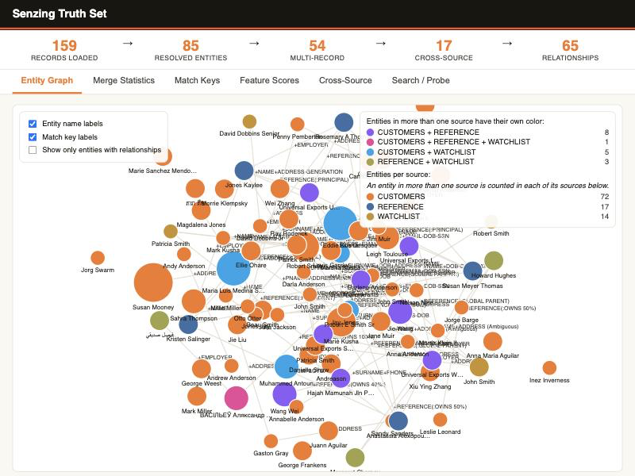
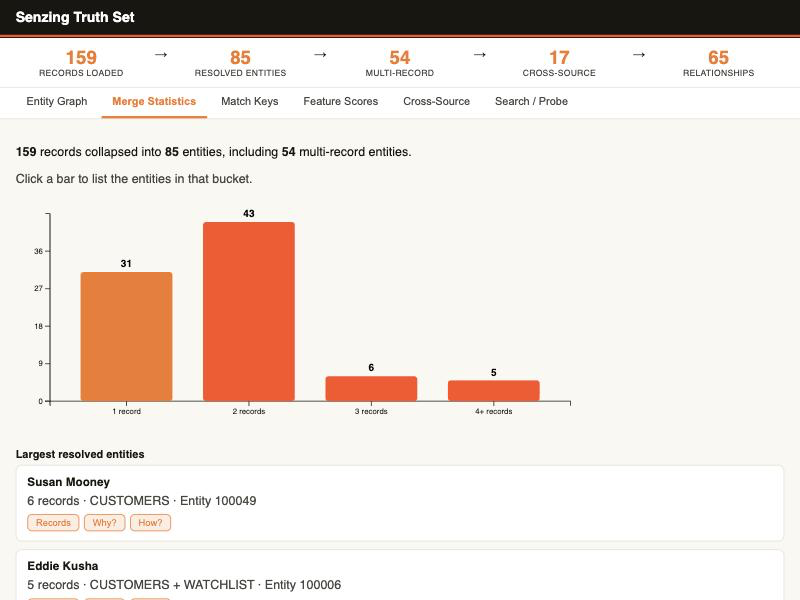
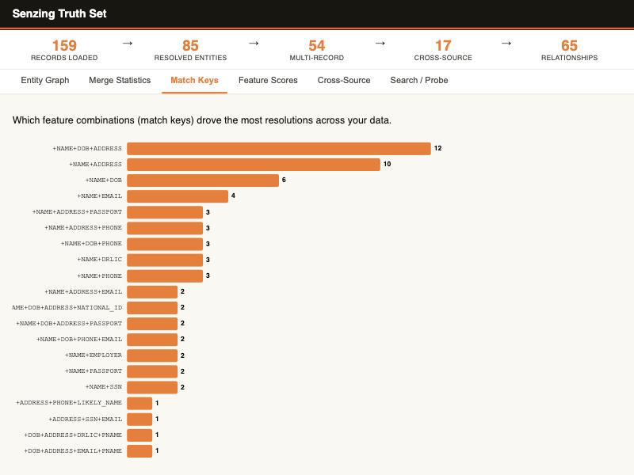
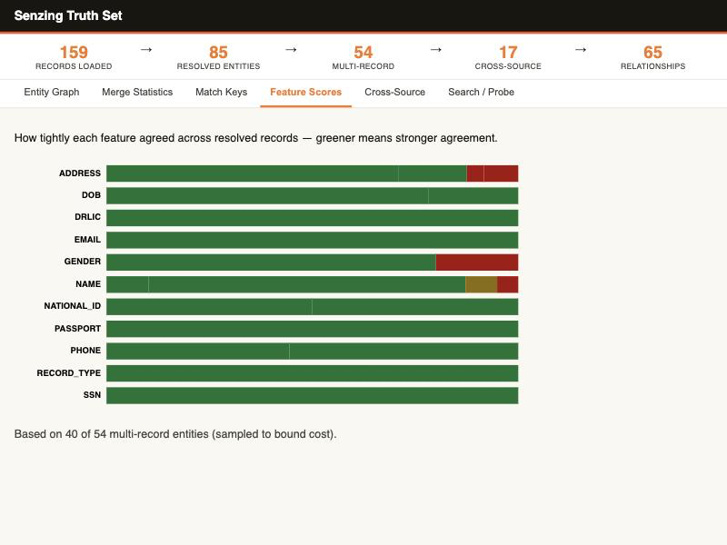
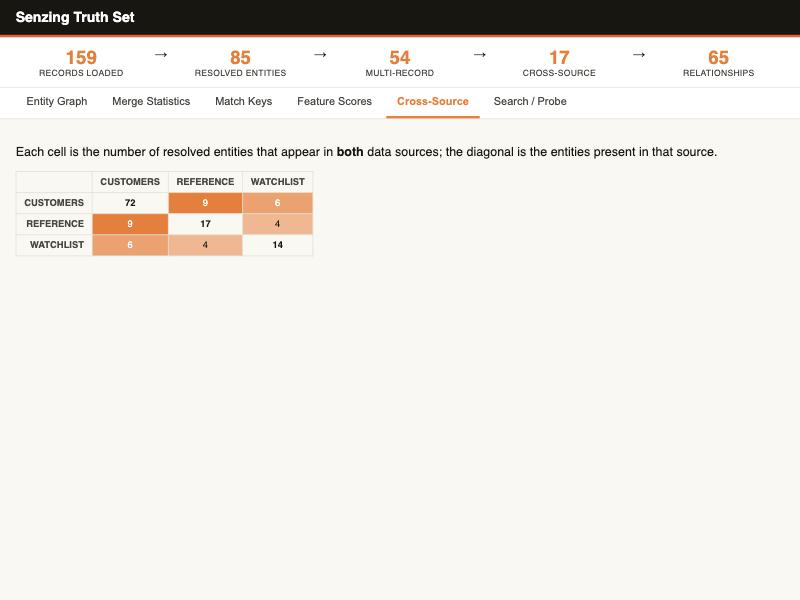
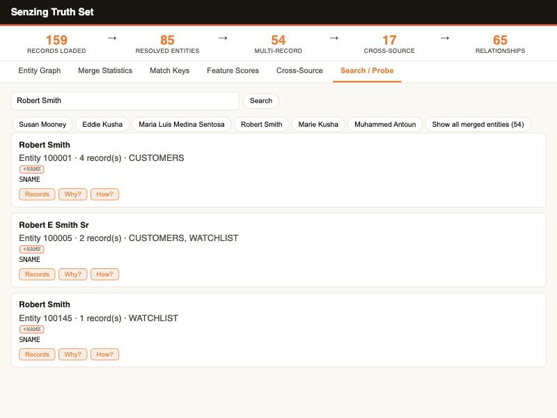

### End-of-Module Summary

**What you accomplished:**

- Watched the Senzing Truth Set resolve 159 records into 85 entities in an interactive web app.
- Built that web app in Java, with an entity graph, merge statistics, match keys, feature scores, cross-source overlap and live search.
- Kept a standalone snapshot and six screenshots, then cleaned the demo data out of the database.

**Files produced:**

- `docs/visualizations/truthset_verification.html` — standalone snapshot of the visualization
- `docs/visualizations/truthset_verification-*.png` — six tab screenshots
- `src/server/VizServer.java` — the Java visualization server
- `src/server/Json.java` — dependency-free JSON helper
- `src/server/resources/page.html` — the generated page template (with vendored D3 beside it)
- `src/scripts/extract_viz_page.py` — generator for the page assets
- `src/system_verification/truthset_data.jsonl` — the Truth Set records
- `src/system_verification/register_truthset_sources.java`, `drain_redo.java`, `purge_truthset_data.java`, `check_viz_endpoints.py` — load, redo, purge and endpoint-check programs

**Why it matters:** You have seen entity resolution working at a meaningful scale on your own machine, and the Java server is the starting point for visualizing your insurance data in Query, Visualize and Discover.

---

## Data collection — 2026-11-14T13:29:54-05:00

### Information Shared

- Recommended Sonnet 5.5 at medium reasoning effort for this module; the bootcamper switched from Opus 5.5 to Sonnet 5.5.
- The bootcamper's six sources were already available as files, so no sample data was needed; Senzing's CORD collections contain real records and were not used.
- The license capacity check: your installed license allows up to 500 records, and the collected total (248) is within it, so no license key and no sampling were needed.
- Senzing's guidance describes SQLite as suited to small local datasets (under 100K records), so 248 records raised no load-time concern.

### Questions & Responses

- **Q:** Would you like to switch to Sonnet 5.5 at medium reasoning effort for this module?
    - **R:** Yes.
- **Q:** Are you done modifying the model and effort?
    - **R:** Yes.
- **Q:** How would you like to provide the data for this source (PC_POLICY_ADMIN)?
    - **R:** Upload a file, then corrected to provide a file path.
- **Q:** What is the file path or URL for the PC_POLICY_ADMIN data?
    - **R:** A local folder holding all six files, which was then used for all six sources.

### Actions Taken

- Copied the six files through a staging folder and validated each: readable UTF-8, valid JSON on every line, record count equal to the business problem's figure, the expected data source code on every record, and present, unique record IDs.
- Moved all six into `data/raw/` (248 records) and left the answer-key files and generator script in the original folder, since they are not data sources.
- Wrote the registry `config/data_sources.yaml`, `docs/data_source_locations.md` and `docs/data_collection_checklist.md`, and `docs/security_compliance.md`.
- Excluded raw data and samples from version control.

### End-of-Module Summary

**What you accomplished:**

- Collected all six insurance sources, 248 records, into your project.
- Confirmed every file's record count against your business problem.
- Confirmed the data fits your license capacity, with no sampling needed.

**Files produced:**

- `data/raw/pc_policy_admin_extract.jsonl`, `life_annuity_admin_extract.jsonl`, `credit_header.jsonl`, `business_registry.jsonl`, `siu_cases.jsonl`, `sanctions_pep.jsonl` — the six source files
- `config/data_sources.yaml` — registry of the six sources and their status
- `docs/data_source_locations.md` — where each source came from
- `docs/data_collection_checklist.md` — inventory and validation checklist
- `docs/security_compliance.md` — data-handling notes

**Why it matters:** Your data is now in the project, verified, and tracked, so the next module can assess its quality and confirm how each source maps to Senzing.

---

## Data Quality, Mapping, and Transformation — 2026-11-14T14:49:04-05:00

### Information Shared

- Recommended Opus 5.5 for this module; the bootcamper first declined, then switched to Opus 5.5 before the quality visual.
- How each source's quality score is calculated: 0.70 × completeness + 0.25 × format consistency + 0.05 × (100 - duplicate rate), with bands of 80 and above (strong), 70–79 (acceptable) and below 70 (recommend fixing first). Completeness counts only the features a record type can carry, with identifiers counted as one group.
- Phase 1 scores: CREDIT_BUREAU 89.8, SANCTIONS_PEP 71.9, BUSINESS_REGISTRY 67.8, PC_POLICY_ADMIN 67.1, LIFE_ANNUITY_ADMIN 63.0, SIU_CASES 62.1. All six sources were already in Senzing's recommended record shape (a FEATURES list); none needed the person/organization retype check (0 candidates).
- Mapping ran through the Senzing mapping workflow for each source: profile, plan, map, then generate and validate with three checks: the structural analyzer, the verbatim check (values copied, never rewritten) and the routing report (nothing dropped).
- These checks are structural. Whether each field means what Senzing assumes is checked after loading, in Data processing.
- The analyzer flagged TAX_ID_TYPE as missing from the default configuration; the Senzing Entity Specification defines it and the installed 4.4.4 configuration includes it, so the notice is a false positive.
- Senzing's globalization guidance describes culture-aware comparison for Arabic, Pakistani and East Slavic names, with shared-script culture identification new in v4.4; the Arabic and Cyrillic watchlist names are kept as written.
- Cross-source relationships found while mapping: LIFE_ANNUITY_ADMIN 1313 points to PC_POLICY_ADMIN 1312 (subsidiary), and PC_POLICY_ADMIN 3050 points to CREDIT_BUREAU 3048 (carer).

### Questions & Responses

- **Q:** Would you like to switch to Opus 5.5 for this module?
    - **R:** No.
- **Q:** Would you like a web page showing the quality assessment?
    - **R:** Yes (after switching to Opus 5.5).
- **Q:** Quality for PC_POLICY_ADMIN is below 70. What would you like to do?
    - **R:** Proceed anyway.
- **Q:** Quality for LIFE_ANNUITY_ADMIN is below 70. What would you like to do?
    - **R:** Proceed anyway.
- **Q:** Quality for BUSINESS_REGISTRY is below 70. What would you like to do?
    - **R:** Proceed anyway.
- **Q:** Quality for SIU_CASES is below 70. What would you like to do?
    - **R:** Proceed anyway.
- **Q:** Quality for SANCTIONS_PEP is acceptable. What would you like to do?
    - **R:** Continue to mapping.
- **Q:** How much detail would you like during mapping?
    - **R:** Concise.
- **Q:** How should PC_POLICY_ADMIN record 3025 (both an organization and a person name, no type) be treated?
    - **R:** As an organization.
- **Q:** Would you like a web page showing the mapping quality analysis? (asked for each of the six sources)
    - **R:** Yes, for all six.
- **Q:** After each source's mapping: iterate on it, or move on?
    - **R:** Moved on each time: PC_POLICY_ADMIN, LIFE_ANNUITY_ADMIN, BUSINESS_REGISTRY and SIU_CASES below 70 ("move on anyway"); CREDIT_BUREAU strong ("map the next source"); SANCTIONS_PEP acceptable ("proceed to loading now").

### Actions Taken

- Scored all six sources (`src/scripts/assess_quality.py`) and built the quality assessment page.
- Ran the Senzing mapping workflow once per source, in order: PC_POLICY_ADMIN, LIFE_ANNUITY_ADMIN, CREDIT_BUREAU, BUSINESS_REGISTRY, SIU_CASES, SANCTIONS_PEP. Every source was approved; the optional sandbox test load was skipped each time because the real load happens in Data processing.
- Wrote one shared Java transformer (`src/transform/FeatureListTransformer.java`) and a small per-source program holding only that source's settings. When the transformer was extended, earlier outputs were re-run and confirmed byte-identical.
- Mapping decisions: record 3025 typed as an organization (bootcamper's choice); BUSINESS_REGISTRY's incorporation year mapped to REGISTRATION_DATE; policy, contract and case numbers kept as payload because no other source shares them; PEP_COUNTRY kept as payload rather than nationality; label-only phone-type objects (4 records) skipped.
- Wrote 248 load-ready records to `data/senzing-ready/` and pointed the source registry at them.
- Wrote per-source mapping specifications, run guides and lineage documents in `docs/mapping/`, and a quality page per source.
- Corrected an earlier note in PC_POLICY_ADMIN's documentation once CREDIT_BUREAU showed where its "Carer" relationship points.

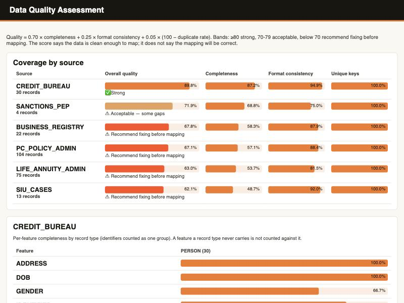
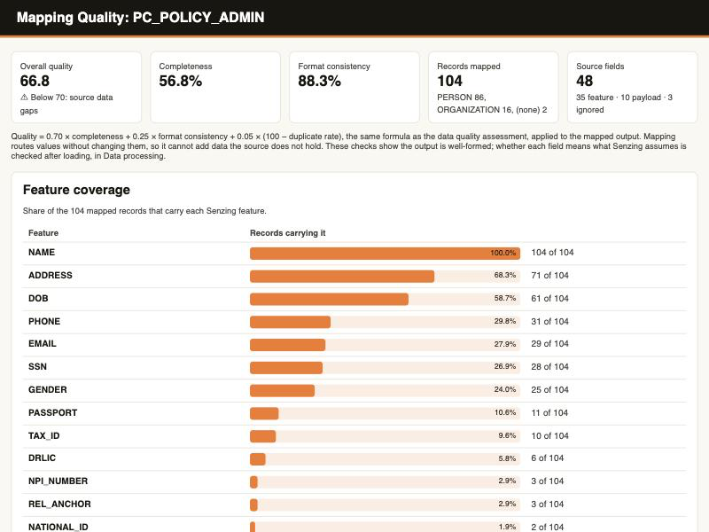
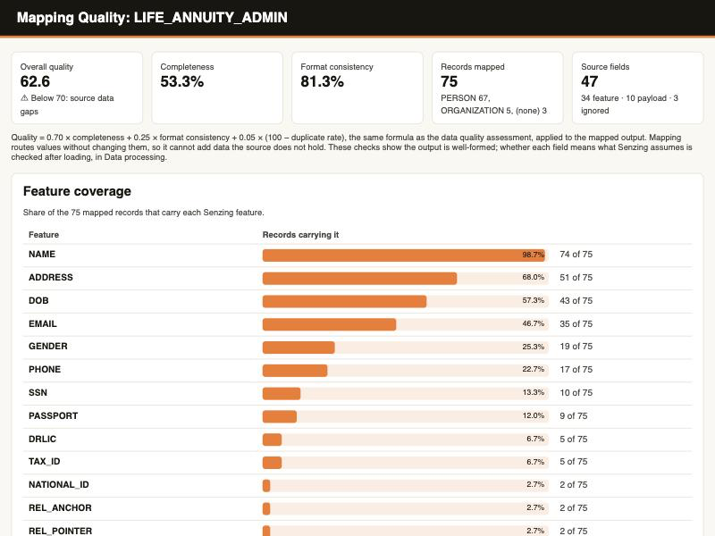
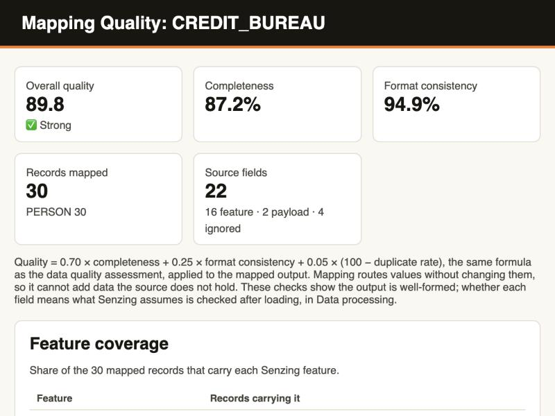
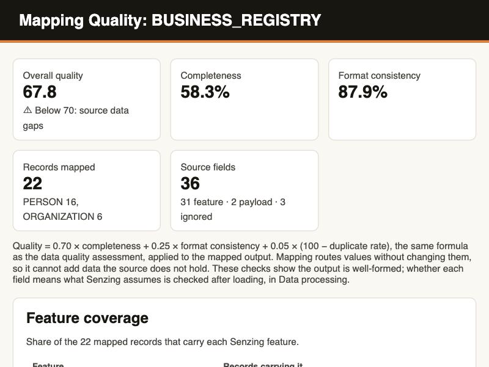
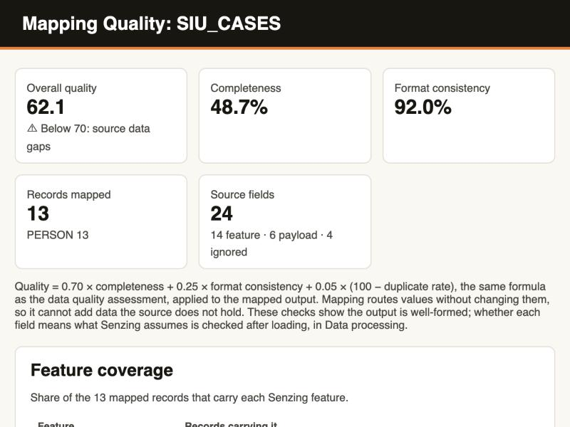
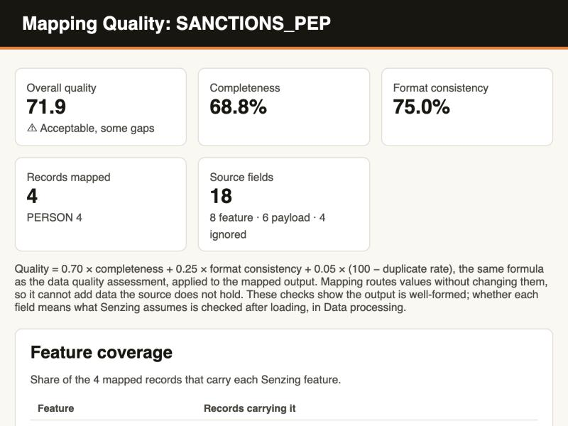

### End-of-Module Summary

**What you accomplished:**

- Scored the quality of all six insurance sources and decided, source by source, how to proceed.
- Mapped every source to Senzing's format through the Senzing mapping workflow, with all three checks passing.
- Produced 248 load-ready records, with every value copied exactly as the source had it.
- Found the cross-source links your screening relies on: ownership in the business registry, and relationships that point between sources.

**Files produced:**

- `data/senzing-ready/` — six load-ready files, 248 records in total
- `src/transform/FeatureListTransformer.java` — shared transformation logic
- `src/transform/transform_*.java` — one small program per source holding its settings
- `docs/mapping/` — per-source mapping specification, run guide, lineage, profile and journal
- `docs/visualizations/data_quality_assessment.html` — the quality assessment across all six sources
- `docs/visualizations/mapping_*_quality.html` — one mapping quality page per source
- `src/scripts/assess_quality.py` and `src/scripts/render_mapping_quality_visual.py` — the scoring and page scripts

**Why it matters:** Every source is now in a form Senzing can load and compare, so Data processing can build the customer 360 and screening view across all six. The scores and decisions are recorded, so you know where thin data may limit what gets matched.

---

## Data processing — 2026-11-14T15:15:41-05:00

### Information Shared

- Recommended Opus 5.5 at high effort; the bootcamper was already on Opus 5.5, so no change was needed.
- Senzing's loading guidance: shuffle input before loading, use a thread pool sized to what the database can take (2–8 workers per CPU core as a starting point), use SQLite only for small local testing (under about 100,000 records) because it does not support concurrent writes, initialize the Senzing environment once per process, and always drain the redo queue, looping on fetching the next redo record rather than on a redo count.
- Senzing's evaluation guidance: compute statistics in one pass over the export stream, deduplicate relationships that appear in both entities' rows, and support every quality claim with specific records and entity IDs.
- In a match key, + means a feature contributed and - means it disagreed. A disagreement inside a merged entity and one inside a relationship mean opposite things, so they are counted separately.

### Questions & Responses

- **Q:** In production — not in this bootcamp — how many records do you expect to load?
    - **R:** Option 3: more than 500,000, up to 10,000,000 (medium production).
- **Q:** Are there load-order dependencies between your data sources?
    - **R:** No.
- **Q:** Which loading strategy would you like?
    - **R:** Sequential.
- **Q:** Would you like to involve business users in testing the cross-source results?
    - **R:** No.

### Actions Taken

- Built the loader from Senzing's thread-pooled loading snippet (`src/load/SenzingLoader.java`, `src/load/load_source.java`), with one writer thread for SQLite, error logging, throughput reporting, checkpoint/resume and an optional shuffle; replaced only the JSON library.
- Adapted Senzing's streaming redo snippet into a batch drainer that stops when the queue is empty (`src/load/RedoDrainer.java`).
- Registered the six data source codes (`src/load/register_data_sources.java`); a re-run confirmed it changes nothing the second time.
- Backed up the database before loading and before orchestration (`database/backups/`).
- Loaded CREDIT_BUREAU first (reference data, highest quality): test load 10 of 10, full load 30 of 30.
- Built the sequential orchestrator (`src/load/orchestrator.java`), tested it at 10 records per source (44 of 44), then loaded the other five sources: 218 of 218, 0 failed, counts reconciled per source; redo 5 processed, queue empty.
- Wrote the export statistics program (`src/validate/ExportStats.java`) and the evidence program (`src/validate/entity_review.java`); reviewed all 63 cross-source entities and all 36 possible-match pairs against their records; ran the match-key and how-state audits.
- Wrote `docs/loading_strategy.md`, `docs/uat_results.md`, `docs/results_validation.md` and `docs/stakeholder_summary_module6.md`.

### End-of-Module Summary

**What you accomplished:**

- Loaded all six sources into Senzing: 248 of 248 records, none failed, every count reconciled.
- Built a take-home loader, orchestrator and redo drainer from Senzing's own code, tuned for SQLite and documented for PostgreSQL.
- Resolved 179 policy records into 127 customers, 38 of whom hold both P&C and life/annuity cover.
- Found the screening cases your business problem described, including a sanctioned person who owns 100% of a P&C customer and is also a policyholder.
- Validated the results with evidence: 5 of 5 UAT tests, 10 of 10 spot-checks, no wrong merges in 63 cross-source entities.

**Files produced:**

- `src/load/SenzingLoader.java` and `src/load/load_source.java` — the production loader
- `src/load/orchestrator.java` — sequential multi-source orchestration
- `src/load/RedoDrainer.java` — batch redo drain
- `src/load/register_data_sources.java` — re-runnable data source registration
- `src/validate/ExportStats.java` and `src/validate/entity_review.java` — statistics and evidence for validation
- `docs/loading_strategy.md` — load order, strategy, per-source results and how to run
- `docs/uat_results.md` — UAT test cases and spot-checks
- `docs/results_validation.md` — validation baseline, match-key and how-state audits
- `docs/stakeholder_summary_module6.md` — one-page summary for stakeholders

**Why it matters:** Your data is now one resolved view across policy, credit, registry, investigation and watchlist sources, with the evidence behind every match, which is what the customer 360 and screening app in the next module is built on.

---

## Query, Visualize and Discover — 2026-11-14T15:55:07-05:00

### Information Shared

- Ten query requirements derived from the business problem's success criteria and desired output: the one-resolution summary, the customer collapse, cross-line customers, the customer 360, the screening queue with each line's rules, ownership screening with the OFAC 50% rule, identity verification, no false hits for common names, evidence on every alert, and analyst dispositions stored by the app.
- The screening rules in the original business description (SIU severities, Low for a PEP on a P&C-only customer, synthetic identity, the 50% rule and roll-up to the parent), copied into `docs/reference/screening_rules.md`.
- Senzing SDK calls used, with signatures, flags and response shapes taken from the Senzing MCP server for Java: getEntity by record key and by entity ID, searchByAttributes (NAME_FULL then NAME_ORG), whyEntities, whyRecords, howEntity, findNetwork, findPath and the export stream.
- Flag lessons: DEFAULT flag composites are the exploration path and may change between versions, so production code should request exactly what it reads. The why default carries no entity name. Match-key details need a relations flag beside them. In Java a composite is a Set that is merged, not listed.
- Quality evaluation: the 4-point framework and the evidence rule (never a verdict without records). Possible matches were 36 pairs (22.9% of entities, the Poor band), traced to sparse identifiers (P&C DOB 60.4%, SSN 27.7%, phone 30.7%) and identifiers deliberately shared between different people, so remapping would not change it.
- Why vs how: why explains a current decision between two records or entities; how replays an entity's build step by step. Disclosed relationships are stated in the data; discovered ones are inferred by Senzing from shared features. Degrees count the hops between entities.

### Questions & Responses

- **Q:** Is there anything you'd like to adjust? (the ten derived query requirements)
    - **R:** No.
- **Q:** Would you like an interactive visualization of your resolved data — entity graph with its relationship view, merge statistics, cross-source overlap, and match/feature analysis, all in one app?
    - **R:** Yes.
- **Q:** Would you like to explore Senzing's advanced discover capabilities using examples from your own data?
    - **R:** Yes.
- **Q:** What would you like to do next? (after why analysis: 1 How Analysis, 2 module completion)
    - **R:** 1, How Analysis.
- **Q:** What would you like to do next? (after how analysis: 1 Relationship Networks, 2 module completion)
    - **R:** 1, Relationship Networks.
- **Q:** Would you like to continue to module completion now?
    - **R:** Yes.
- **Q:** Ready for me to stop the visualization server?
    - **R:** Yes. Stopped by its PID; port 8091 confirmed free. Loaded data untouched.

### Actions Taken

- Wrote the query programs in `src/query/`: `InsuranceModel.java` (shared model and business rules), `customer_resolution`, `customer_360`, `screening_queue`, `search_entities`, `entity_evidence` and `discover_demo`. All go through the Senzing SDK; none queries the database directly.
- Ran them: 179 customer records resolved to 127 customers (38 hold both lines, 57 P&C only, 32 life only; 7 P&C and 4 life customers held more than once in one system). The screening queue has 19 alerts: 2 Prohibited, 7 High, 10 Medium, 0 Low.
- Prohibited alerts: P&C customer 400003 (Alexander Pavlovich Vasiliev, OFAC SDN, found through the Cyrillic list entry), and Müllenkranz 400011, which he owns 100% of (the OFAC 50% rule), with a sanctioned president.
- High alerts: the Universal Exports group (two PEP owners at 50% each, four subsidiaries rolled up, life cover held); four SIU hits (Substantiated or Referred); and a synthetic-identity signal where two customers share one bureau file's SSN with different dates of birth.
- Every Smith alert except one Substantiated SIU hit is a possible match for an analyst. 20 household, address and employer links were deliberately not raised.
- Evaluated quality with evidence. Sampled entities 400030, 500049 and 400016, and explained pairs 400016/400044 (+NAME only), 500013/500104 (shared EIN) and 500049/500100 (+SSN-DOB).
- Built one visualization app by extending the Java server (`src/server/VizServer.java --export --business`, plus `BusinessTabs.java` and `resources/business_tabs.html`).
  - Nine tabs: Overview, Customer 360, Screening & Due Diligence, then the six Senzing tabs.
  - Built from the export stream: 248 records, 157 entities, 140 relationships.
  - Colour self-check passed: 10 combination rows matched 10 combination keys.
  - All 14 endpoints verified. No outside-source data in the Customer 360 and no premiums in screening.
  - Analyst decisions save to `data/app/dispositions.json`, never to Senzing.
  - Snapshot verified offline.
- Captured all nine tabs in the built-in browser (the bundled capture tool found no headless browser on this Mac) and embedded them below in the app's tab order.
- Ran the Discover tour:
  - whyRecords on Bob/Robert Smith: +NAME+DOB+PHONE, name 97 CLOSE, transposed DOB 95 CLOSE.
  - howEntity on Maria Luis Medina Sentosa: 6 steps, the weakest link being the SIU pair joining on partial name, DOB and email.
  - findNetwork and findPath tracing PEP → Universal Exports Worldwide → India subsidiary in 2 degrees.
  - The hub method: a 2-degree chain of weak links.
  - The Willow Glen cluster: 8 people born 1933–1937 at one San Jose address, 28 address-only links.
- Produced `docs/bootcamp_data_discoveries.md` and its PDF (six sections, verified by extracting the PDF's text).

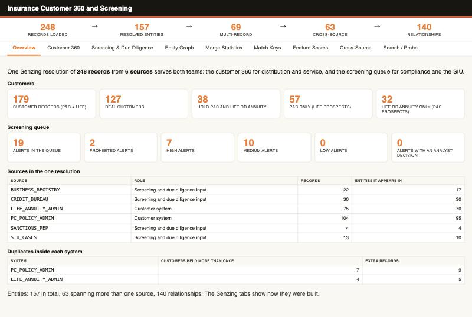

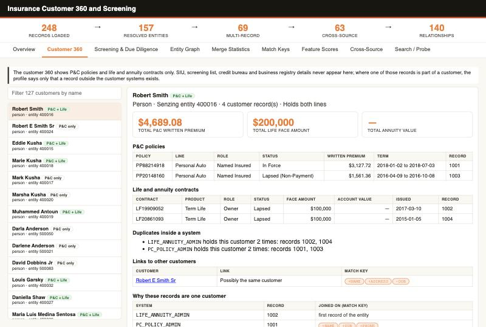

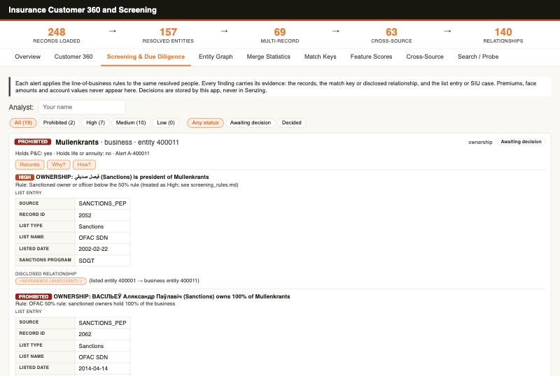

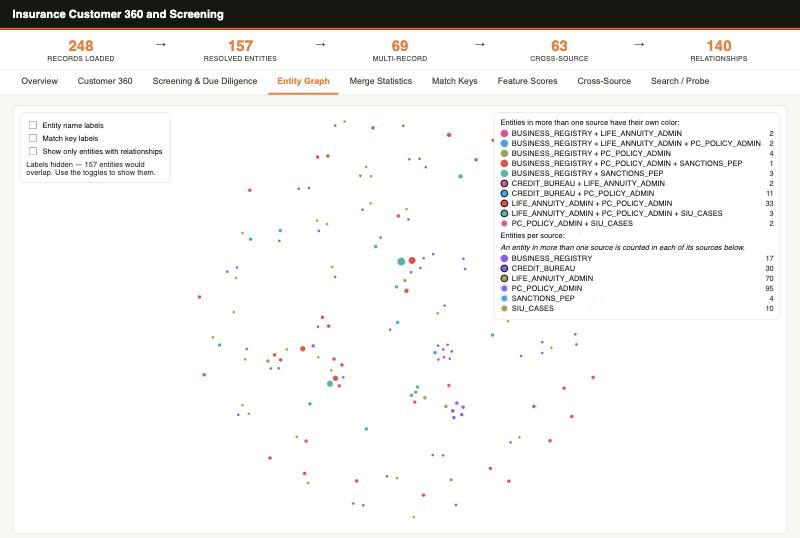

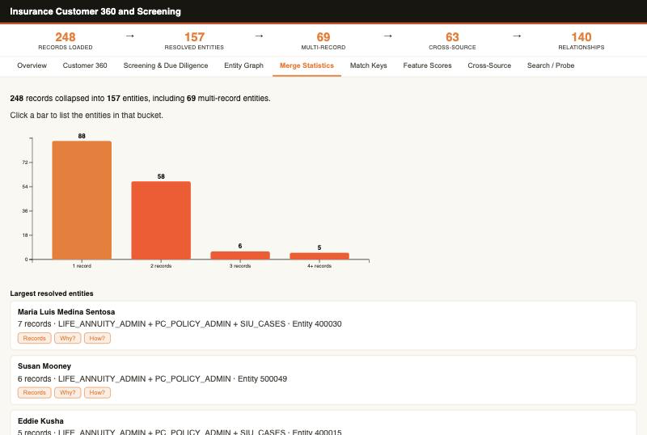

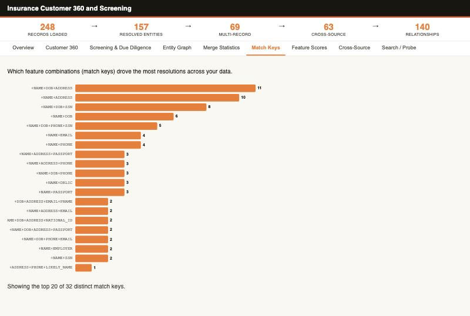

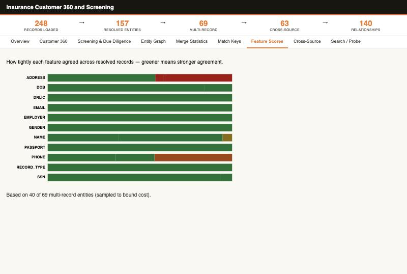

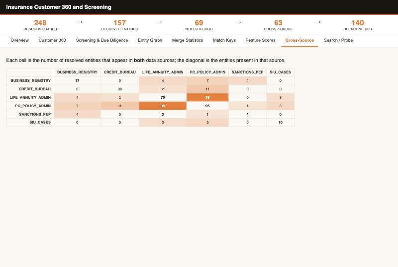

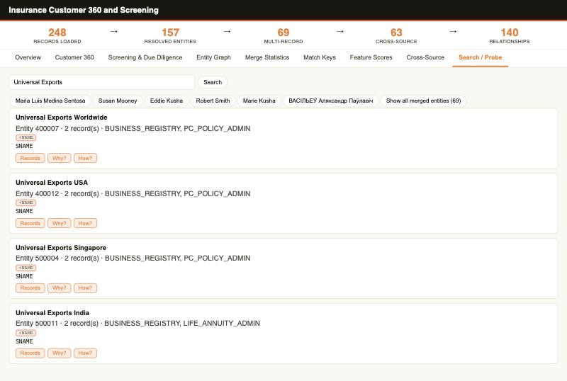

### End-of-Module Summary

**What you accomplished:**

- Answered your business questions with query programs: 127 real customers from 179 policy records, 38 holding both P&C and life or annuity cover.
- Built the screening and due diligence queue with your line-of-business rules: 19 alerts, each with its records, match key or disclosed relationship, and list entry or SIU case. It catches a business owned by a sanctioned person and raises no hit on common names.
- Built the web app you asked for (Overview, Customer 360, Screening & Due Diligence, with analyst decisions saved by the app) alongside Senzing's six analysis tabs.
- Saw why Senzing matched records, how an entity was built step by step, and how ownership networks connect a PEP to a life contract two hops away.
- Wrote up what Senzing found in your data, including what it deliberately did not flag and why.

**Files produced:**

- `src/query/InsuranceModel.java` — shared query model with the screening rules
- `src/query/customer_resolution.java`, `customer_360.java`, `screening_queue.java`, `search_entities.java` — the query programs
- `src/query/entity_evidence.java`, `discover_demo.java` — evidence and Discover demonstrations (why, how, network, path)
- `src/server/VizServer.java`, `src/server/BusinessTabs.java`, `src/server/resources/business_tabs.html` — the visualization app
- `docs/visualizations/results_visualization.html` — standalone snapshot of the app
- `docs/visualizations/results_visualization-*.png` — nine tab screenshots
- `data/query/customer_master_list.json`, `screening_alerts.json`, `customer_resolution.json` — query outputs
- `docs/reference/screening_rules.md` — the screening and customer 360 rules
- `docs/bootcamp_data_discoveries.md` and `.pdf` — what Senzing found in your data
- `src/scripts/build_data_discoveries.py` — rebuilds the discoveries document

**Why it matters:** One Senzing resolution now serves both of your teams: distribution and service see every policy a customer holds across both lines, and compliance and the SIU get a screening queue whose every alert can be explained from the evidence, which is exactly the outcome your business problem set out.

---
