# Senzing Bootcamp Recap

**Bootcamper:** Ima Bootcamper
**Started:** 2026-11-09T18:07:00-05:00
**Completed:** 2026-11-09
**Programming language:** Python
**Path:** Core
**Plugin version:** 0.7.0
**Operating system:** Linux (x86_64)
**Python version:** 3.12.3
**Language runtime:** Python 3.12.3
**Senzing SDK:** 4.4.3
**Database:** SQLite

---

## Entity Resolution Concepts — 2026-11-09T18:26:11-05:00

### Information Shared

- What entity resolution is: deciding whether different records refer to the same real-world entity, then matching, relating, and deduplicating them.
- The conceptual pipeline: ingestion/standardization, candidate selection (blocking), comparison/scoring, classification, entity clustering.
- Two failure modes: false negatives (same entity split apart) and false positives (different entities merged), including the sharper case of ambiguous matches producing invisible false positives.
- Disclosed vs. discovered relationships.
- The difference between entity resolution and master data management (MDM).
- How Senzing handles it: principle-based matching (frequency, exclusivity, stability of attributes), pre-configured for people and organizations, and its differentiators (real-time, no model training required, explainability, scalability).

### Questions & Responses

- **Do you have any questions about entity resolution before we continue?** — No.
- **Would you like a few quick questions to help the concepts stick?** — No, declined the knowledge check.
- **Are you ready to move on to the next module: Discover the Business Problem?** — Yes.

### Actions Taken

- Presented the Entity Resolution Concepts primer, sourced and cross-verified via the Senzing MCP `search_docs` tool.
- Offered the optional knowledge check; the bootcamper declined.

### End-of-Module Summary

**What you accomplished:**

- Learned the core idea of entity resolution: matching, relating, and deduplicating records that refer to the same real-world entity.
- Learned Senzing's principle-based approach and how it differs from hand-written matching rules.

**Files produced:**

- (no files — conceptual primer)

**Why it matters:** This grounding in entity-resolution concepts gives you the vocabulary and mental model you'll need as you define your business problem and start working with the Senzing SDK in the modules ahead.

---

## Discover the Business Problem — 2026-11-09T18:50:00-05:00

### Information Shared

- Entity-resolution business pattern categories (declined to browse the gallery).
- The Customer 360 use case, and why cross-source name/address shape divergence (joined vs. parsed name, free-text vs. parsed address) is exactly what entity resolution reconciles.
- Senzing's published Customer Data Management use case and Time-to-Value framing, tied to this scenario's data.

### Questions & Responses

- **Would you like to see examples of common business problems that entity resolution can solve?** — No.
- **How would you like to define the business problem? Reply with a number:** — 3 (generate a scenario), with the note "make the data a little messy so that the mapping step has to work pretty hard."
- **Does that summary capture your situation accurately?** — Yes.
- **What does the end result look like? Reply with the numbers from the list below, comma-separated:** — 1, 2, 3 (a clean master list, an API, and reports).
- **Will your entity-resolution results need to interface with other software (CRM, search engine, data warehouse, API gateway, downstream app)?** — No, standalone for now.
- **Where do you plan to deploy the final solution? Reply with a number:** — 3 (Local / on-premises).
- **Does this accurately capture your problem and approach?** — Yes.

### Actions Taken

- Generated a Customer 360 business scenario: three sources (CRM_SYSTEM, BILLING_SYSTEM, SUPPORT_TICKETS, ~10,000 records total), with deliberate cross-source shape divergence and data-quality variation.
- Created `docs/data_architecture.md` (data architecture and data flow diagrams).
- Created `docs/business_problem.md` (the problem statement).
- Created `config/data_sources.yaml` (the scenario source registry).
- Updated `README.md`'s Overview and Business Problem sections.
- Created `docs/stakeholder_summary_module1.md`.
- Recorded `integration_targets: []` and `deployment_target: local` in `config/bootcamp_preferences.yaml`.
- Recorded `license_guidance_deferred: true` in `config/bootcamp_progress.json` (the generated scenario's ~10,000 records exceed the built-in evaluation license's default 500-record capacity; Data collection will resolve this once the real collected volume is measured).

### End-of-Module Summary

**What you accomplished:**

- Defined a Customer 360 business problem: unifying fragmented, inconsistently-formatted customer records across three systems.
- Documented data sources, success criteria, and desired output (master list, API, reports).

**Files produced:**

- `docs/business_problem.md` — the business problem statement.
- `docs/data_architecture.md` — data architecture and data flow diagrams.
- `config/data_sources.yaml` — the scenario source registry.
- `docs/stakeholder_summary_module1.md` — stakeholder summary.

**Why it matters:** This problem statement is the roadmap for the rest of the bootcamp — the data sources, success criteria, and output format defined here drive data collection, mapping, and the final query/reporting module.

---

## SDK setup — 2026-11-09T18:55:00-05:00

### Information Shared

- An existing Senzing SDK 4.4.3 install was found (package `4.4.3-26300`, matching `szBuildVersion.json`); the apt candidate is the same version, so it is up to date and was not reinstalled.
- Platform `linux_apt`, decided from `/etc/os-release` (Ubuntu 24.04).
- For Python on `linux_apt`, `sdk_guide`'s Python note requires both `PYTHONPATH` and `LD_LIBRARY_PATH`; the SDK's Python packages ship inside the runtime and must not be pip-installed.
- SQLite needs its schema applied explicitly and an absolute path in `SQL.CONNECTION`.
- A freshly schema-created datastore has no Senzing configuration until a default one is seeded.
- License: the first reading (before engine configuration) showed a 500-record evaluation limit; the re-measurement with the engine configuration in force showed no record cap (`recordLimit: 0`), so the 500 figure was withdrawn.

### Questions & Responses

- **Would you like to switch to Opus 5.5 at high effort reasoning effort for SDK setup?** — Yes.
- **Are you done modifying the model and effort?** — Yes (ran `/model opus` and `/effort high`).
- **Which database would you like to use? Reply with a number:** — 1 (SQLite).

### Actions Taken

- Skipped installation (existing V4.0+ install, up to date); the EULA was not re-asked.
- Wrote the project-local environment script `src/scripts/senzing-env.sh`.
- Fetched official snippets from `senzing/code-snippets-v4` into `src/resources/scaffold/` (sha256-verified): `get_version.py`, `get_license.py`, `init_default_config.py`, `get_config_registry.py`, `engine_priming.py`.
- Verified the Python binding resolves from `/opt/senzing/er/sdk/python` and `SzProduct.get_version()` returns 4.4.3.
- Created the project directory structure.
- Applied the Senzing SQLite schema to `database/G2C.db`.
- Wrote `config/engine_config.json` from `sdk_guide`'s `default_paths`.
- Seeded the default configuration (config ID 1314770777).
- Re-measured the license (no record cap) and saved it to `config/license.json`.
- Ran `engine_priming.py`: `create_engine()` and `prime_engine()` succeeded.

### End-of-Module Summary

**What you accomplished:**

- Confirmed a current Senzing SDK (4.4.3) and wired it into this project with a project-local environment script.
- Set up a SQLite datastore with the Senzing schema and a seeded default configuration.
- Proved the engine initializes and responds with a real engine-class call.

**Files produced:**

- `src/scripts/senzing-env.sh` — project-local Senzing environment script.
- `config/engine_config.json` — engine configuration.
- `database/G2C.db` — the SQLite Senzing datastore.
- `config/license.json` — the installed license reading.
- `src/resources/scaffold/` — official Senzing code snippets used for verification.

**Why it matters:** With a working engine and datastore, every module from here on can load your data and resolve entities for real rather than describing what would happen.

---

## System verification — 2026-11-09T20:31:00-05:00

### Information Shared

- This module verifies the whole pipeline against four invented ("synthetic") person records, deliberately designed so the expected outcome is known by construction: three records of one person with formatting variants, plus one distractor. It never touches the Truth Set.
- Attribute names for the verification records (`DATA_SOURCE`, `RECORD_ID`, `FEATURES`, `RECORD_TYPE`, `NAME_FIRST`, `NAME_LAST`, `DATE_OF_BIRTH`, `ADDR_*`, `PHONE_*`) were confirmed through the Senzing MCP server, not written from memory.
- Response fields used by the verification programs came from `get_sdk_reference`: `RESOLVED_ENTITY.ENTITY_ID` and `RECORDS[].RECORD_ID` for entity lookups, and `WHY_RESULTS[].MATCH_INFO` (`WHY_KEY`, `MATCH_LEVEL_CODE`, `FEATURE_SCORES`) for `why_records`.
- A data source must be registered before records using it can be loaded; `VERIFY` was registered with a new default configuration.
- Seeing the engine's own one-line reason (the why key) next to your expectation is the quickest way to learn how the engine decides.

### Questions & Responses

- **Would you like to switch to Sonnet 5.5 for System verification?** — Yes.
- **Are you done modifying the model and effort?** — Yes.
- **Will this `Mari` record join Marisol's entity? Reply with a number:** — joins → joined (agreed)

### Actions Taken

- Checked Senzing MCP connectivity and engine initialization (`engine_priming.py`, `verify_init.py`).
- Generated four synthetic records under data source `VERIFY` in `src/system_verification/verification_data.jsonl`.
- Registered the `VERIFY` data source and loaded the records with `verify_pipeline.py`, adapted from the official loading snippet (0 errors).
- Validated results with `validate_results.py`: 4 records resolved to 2 entities, as designed.
- Ran the Mari prediction: loaded `mari_record.jsonl` (a copy of one record with only the first name shortened), then looked up both entities and ran `why_records` in `mari_lookup.py`. The engine placed it in the same entity; its why key was `+PNAME+DOB+ADDRESS+PHONE`, with the name scoring 86 (LIKELY) and date of birth, address and phone each scoring 100 (SAME).
- Ran `database_operations.py`: write count (5 of 5 records), read by entity ID, and search by attributes all passed.
- Wrote the Verification Report to `config/bootcamp_progress.json`.
- Purged all five `VERIFY` records through the SDK with `cleanup_verification_data.py`: none remain and a search finds nothing. The `VERIFY` data source stays registered, which is harmless.

### End-of-Module Summary

**What you accomplished:**

- Passed all eight installation checks: MCP connectivity, engine initialization, SDK initialization, code generation, build, data-source registration, data loading and database operations.
- Results validation, reported separately, also passed: 4 records resolved to 2 entities as designed.
- Predicted an engine decision, then compared it with the engine's own explanation.
- Left the database clean of the synthetic verification data.

**Files produced:**

- `src/system_verification/verification_data.jsonl` — the four synthetic verification records.
- `src/system_verification/mari_record.jsonl` — the extra record for the prediction exercise.
- `src/system_verification/verify_pipeline.py` — loads records into the engine.
- `src/system_verification/validate_results.py` — checks the records resolved as designed.
- `src/system_verification/mari_lookup.py` — shows where the Mari record landed and why.
- `src/system_verification/database_operations.py` — write, read and search checks.
- `src/system_verification/cleanup_verification_data.py` — removes the verification records.

**Why it matters:** You now know the install works end to end on this machine, with code you can reuse as the pattern for loading and querying your own data in later modules.

---

## Truth Set visualization — 2026-11-09T20:43:01-05:00

### Information Shared

- The Senzing Truth Set is synthetic, pre-mapped practice data with known answers, built to contain matches: 159 records across CUSTOMERS (120), REFERENCE (22) and WATCHLIST (17), served by the Senzing MCP server's `get_sample_data`.
- The MCP server's per-source call returns only a preview; the full records come from its download URL, and the written count was checked against the listing.
- A data source code must be registered before records using it are loaded.
- The visualization app has six tabs: Entity Graph, Merge Statistics, Match Keys, Feature Scores, Cross-Source and Search / Probe. Every entity offers Records, Why? and How?, which are answered live by the engine.
- Match keys (for example `+NAME+DOB+ADDRESS`) name the features the engine used to resolve records together.

### Questions & Responses

- **Would you like to switch to `/model opus` for Truth Set visualization?** — Yes.
- **Are you done modifying the model and effort?** — Yes.
- **Are you ready to continue?** (after exploring the visualization) — Yes.
- **Ready for me to stop the visualization server and clean up the Truth Set data?** — Yes.

### Actions Taken

- Downloaded the Truth Set from the MCP server (159 of 159 records) to `src/system_verification/truthset_data.jsonl`.
- Registered CUSTOMERS, REFERENCE and WATCHLIST with `register_truthset_sources.py` (new default config 1266139468) and loaded 159 records with 0 errors using `load_truthset.py`.
- Built the standalone snapshot `docs/visualizations/truthset_verification.html`: 84 resolved entities, 55 multi-record, 17 cross-source, 69 relationships.
- Started the live app on port 8081 (port 8080 was in use by another program) and verified all ten API endpoints and the page.
- Ran the encoding self-check: the graph legend names 4 cross-source combinations, matching the 4 combination keys, so cross-source entities carry their own colors.
- Captured one screenshot per tab from the live server and embedded each below.
- Stopped the server by its process id (port 8081 confirmed free) and purged all 159 Truth Set records with `cleanup_truthset.py`; none remain.

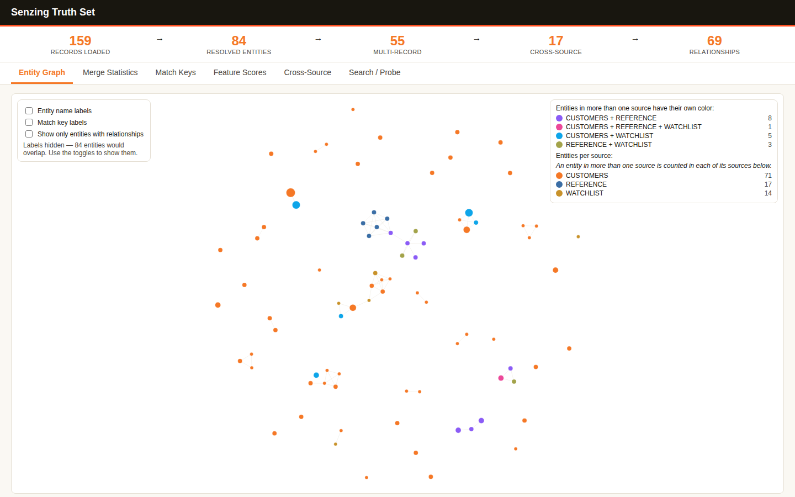

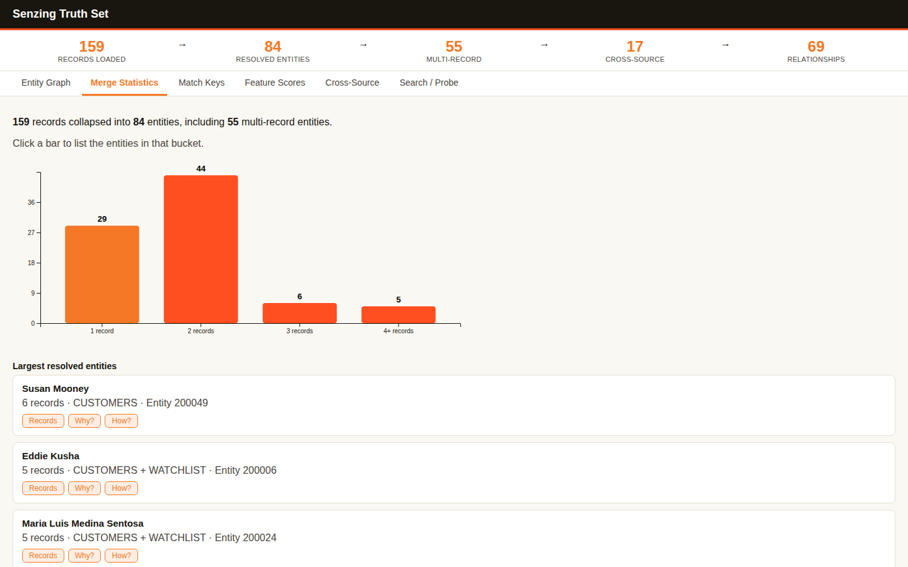

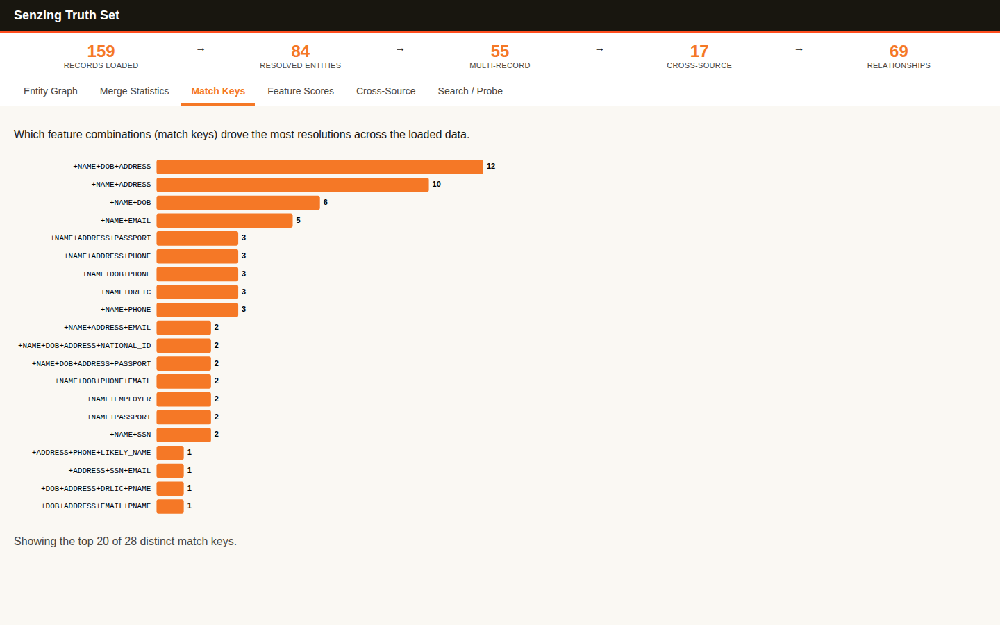

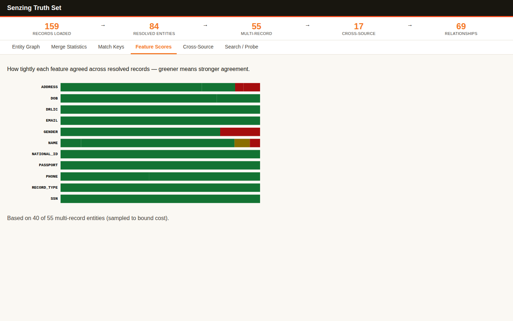

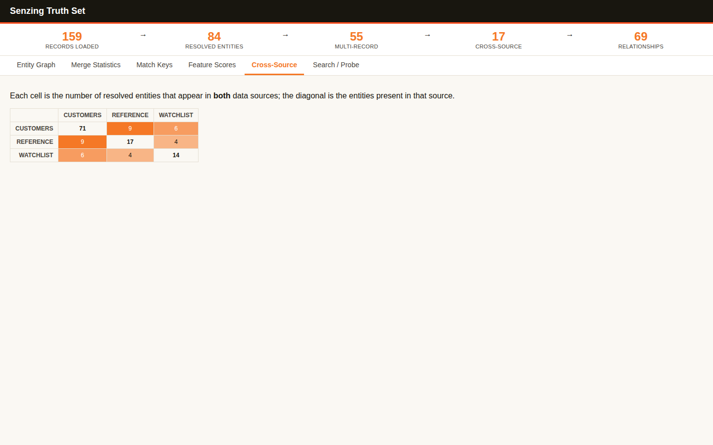

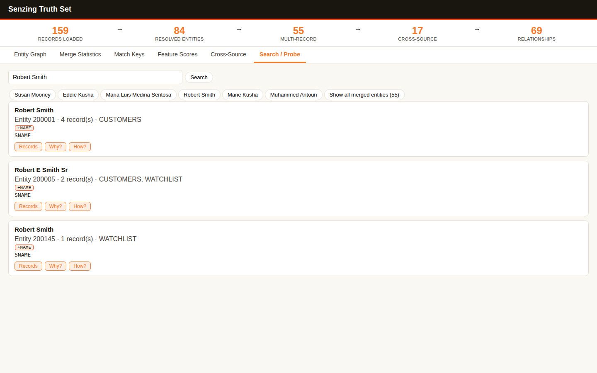

### End-of-Module Summary

**What you accomplished:**

- Loaded Senzing's Truth Set (159 records, three sources) and watched it resolve into 84 entities, 17 of them spanning more than one source.
- Explored the results in an interactive six-tab web app, with live Why? and How? explanations from the engine.
- Kept a standalone copy of the visualization and left the database clean.

**Files produced:**

- `docs/visualizations/truthset_verification.html` — the standalone visualization snapshot you keep.
- `docs/visualizations/truthset_verification-*.png` — one screenshot per tab.
- `src/system_verification/truthset_data.jsonl` — the downloaded Truth Set records.
- `src/system_verification/register_truthset_sources.py` — registers the data source codes, safely re-runnable.
- `src/system_verification/load_truthset.py` — loads the Truth Set.
- `src/system_verification/cleanup_truthset.py` — removes the Truth Set records.

**Why it matters:** You've seen what entity resolution looks like at scale on data built to contain matches, so you'll know what to look for when your own Customer 360 data resolves.

---

## Data collection — 2026-11-09T20:55:00-05:00

### Information Shared

- Because you chose a generated scenario in Discover the Business Problem, this module generated the three source files for you instead of asking how to provide data, and it generated the full size the scenario called for (about 10,000 records) rather than sizing it to a license limit.
- The files were built to carry the differences your scenario promised: one joined name versus first and last name, free-text versus parsed addresses, a sparse support source, inconsistent phone formats, typos and casing.
- Quality was designed in, then measured: Billing was built to be the weak source so Data Quality, Mapping, and Transformation has real work, while CRM and Support are strong, which gives you a contrast to compare.
- Entity resolution needs the same people to appear in more than one source, so the data was built with deliberate overlap: 2,600 of 6,000 invented people appear in two or more systems, and 600 appear in all three.
- Every email and phone belongs to one invented person, and a small, declared set of different people share a name (20 pairs, 0.67% of people), to show later that names alone do not merge people.
- Your license has no record cap, so the License Key question was not needed. SQLite is development and testing technology; Senzing's published guidance puts quick local testing with small datasets under 100K records, so loading 10,000 is comfortably within it.

### Questions & Responses

- **Would you like to switch to `/model sonnet` + `/effort medium` for Data collection?** — Yes.
- **Are you done modifying the model and effort?** — Yes.

### Actions Taken

- Reviewed the three sources from the business problem.
- Wrote and ran `src/collect/generate_scenario_data.py` (fixed seed, so it is reproducible) to produce `data/raw/crm_system.csv` (4,000 records), `data/raw/billing_system.csv` (4,000) and `data/raw/support_tickets.csv` (2,000), plus `data/ground_truth/scenario_ground_truth.csv`, the answer key of which records are the same invented person.
- Measured each source with Module 5's scoring formula: CRM_SYSTEM 93.3, BILLING_SYSTEM 74.8 (31.9% of its applicable field slots empty), SUPPORT_TICKETS 94.9. Bands recorded as intended: at least 80, 70–79, at least 80.
- Checked for identifier collisions (0) and name sharing (20 declared pairs; 40 people, 0.67%, under the 5% budget).
- Validated each file (readable, non-empty, header present, record count equals the scenario count, record keys unique) and recorded the results in `config/data_sources.yaml`.
- Wrote `docs/data_source_locations.md`, `docs/data_collection_checklist.md` and `docs/security_compliance.md`, and created `.gitignore` to keep raw data, the database and license material out of version control.
- Skipped the License Key gate (no record cap) and the SQLite load-time heads-up (10,000 records is within the guidance).

### End-of-Module Summary

**What you accomplished:**

- Collected three source files totaling 10,000 records, deliberately messy and shaped differently from one another.
- Built in real cross-source overlap, so entity resolution will have genuine matches to find.
- Documented where each source lives and recorded validation results for later modules.

**Files produced:**

- `data/raw/crm_system.csv` — 4,000 CRM records.
- `data/raw/billing_system.csv` — 4,000 billing records, the deliberately weakest source.
- `data/raw/support_tickets.csv` — 2,000 support tickets.
- `data/ground_truth/scenario_ground_truth.csv` — the answer key of which records are the same invented person.
- `src/collect/generate_scenario_data.py` — the reproducible generator.
- `docs/data_source_locations.md`, `docs/data_collection_checklist.md`, `docs/security_compliance.md` — documentation.
- `config/data_sources.yaml` — the source registry with counts, validation and quality intent.
- `.gitignore` — keeps data and credentials out of version control.

**Why it matters:** With the files in place and their intended weaknesses recorded, the next module can measure quality honestly and map each source, and later modules can check results against a known answer key.

---

## Data Quality, Mapping, and Transformation — 2026-11-09T21:35:00-05:00

### Information Shared

- The Senzing Entity Specification (fetched to `docs/reference/senzing_entity_specification.md`, size and hash verified) is the reference for attribute names. A single name field maps to `NAME_FULL` and is never parsed; separate first and last name columns map to `NAME_FIRST` and `NAME_LAST` in one name object. A single address string maps to `ADDR_FULL`; separate parts map to `ADDR_LINE1`, `ADDR_CITY`, `ADDR_STATE` and `ADDR_POSTAL_CODE` in one address object.
- Quality score = 0.70 × completeness + 0.25 × format consistency + 0.05 × (100 - duplicate rate). Completeness counts the record key and every field with a specification counterpart; duplicates barely count because resolving them is Senzing's job.
- Missing values cannot be fixed honestly in this module (filling them would be fabricating data); format inconsistencies and duplicate record keys can.
- A mapped record has root keys `DATA_SOURCE`, `RECORD_ID` and `FEATURES`; payload columns ride along at the root and are never matched on.
- A mapper routes values and never rewrites them; the workflow's verbatim check enforces that.

### Questions & Responses

- **Would you like to switch to `/model opus` + `/effort high` for Data Quality, Mapping, and Transformation?** — Yes.
- **Are you done modifying the model and effort?** — Yes.
- **Would you like a visual of the quality assessment (coverage bars and per-field completeness)?** — Yes.
- **The generated data's quality is acceptable but has some gaps. What would you like to do?** (BILLING_SYSTEM, 76.0) — 1, improve the weakest fields first.
- **The generated data's quality is acceptable but has some gaps. What would you like to do?** (BILLING_SYSTEM, 77.7, nothing mechanical left) — 1, return to Data collection for this source.
- **Before we start mapping, which mode would you like?** — 2, concise.
- **What should each of these columns become in CRM_SYSTEM's mapped record?** — asked one column at a time at the Bootcamper's request: `created_date` ignored; `campaign` payload.
- **Would you like a web page showing the quality analysis?** (CRM_SYSTEM, SUPPORT_TICKETS, BILLING_SYSTEM) — Yes, each time.
- **Quality looks strong for CRM_SYSTEM. Ready to map the next source, SUPPORT_TICKETS?** — 1, yes.
- **Quality looks strong for SUPPORT_TICKETS. Ready to map the next source, BILLING_SYSTEM?** — 1, yes.
- **Quality looks strong. Ready to proceed to loading (Data processing)?** — 1, yes.

### Actions Taken

- Scored all three sources with `src/quality/assess_quality.py`: CRM_SYSTEM 94.8, SUPPORT_TICKETS 95.7, BILLING_SYSTEM 76.0. All categorized as needing mapping; no record-type field anywhere, so the type/name check found 0 candidates.
- Wrote `docs/data_source_evaluation.md` with measured cross-source overlaps (for example 2,020 shared names and 1,226 shared phones between CRM_SYSTEM and BILLING_SYSTEM).
- BILLING_SYSTEM: normalized formats into `data/raw/billing_system-improved.csv` (76.0 → 77.7), then regenerated it on the return to Data collection into `data/raw/billing_system-regenerated.csv` (same records, narrower gaps; 77.7 → 90.2).
- Mapped each source with its own `mapping_workflow` run and wrote one transformation program per source: `src/transform/transform_crm_system.py`, `src/transform/transform_support_tickets.py`, `src/transform/transform_billing_system.py`. Every run: analyzer clean, verbatim check passed, 0 records rejected.
- Wrote the load-ready files in `data/senzing-ready/` (crm_system 4,000; support_tickets 2,000; billing_system 4,000 records), each validated by the analyzer, and the per-source mapping specifications, mapping notes and lineage documents in `docs/mapping/`.
- Skipped the optional per-source sandbox test load; the real load happens in Data processing.

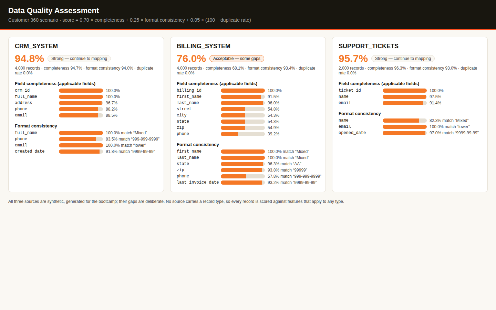

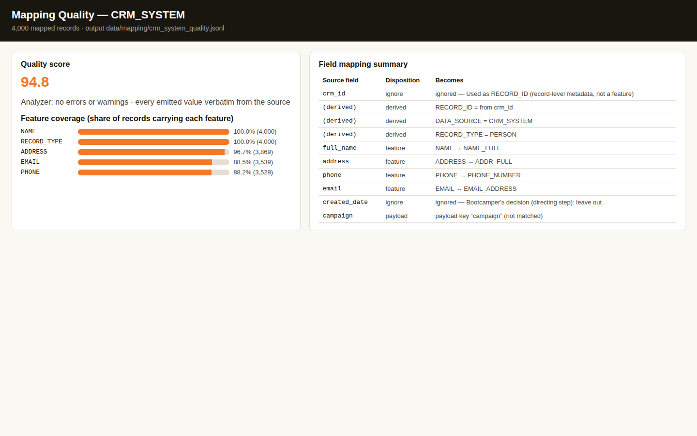

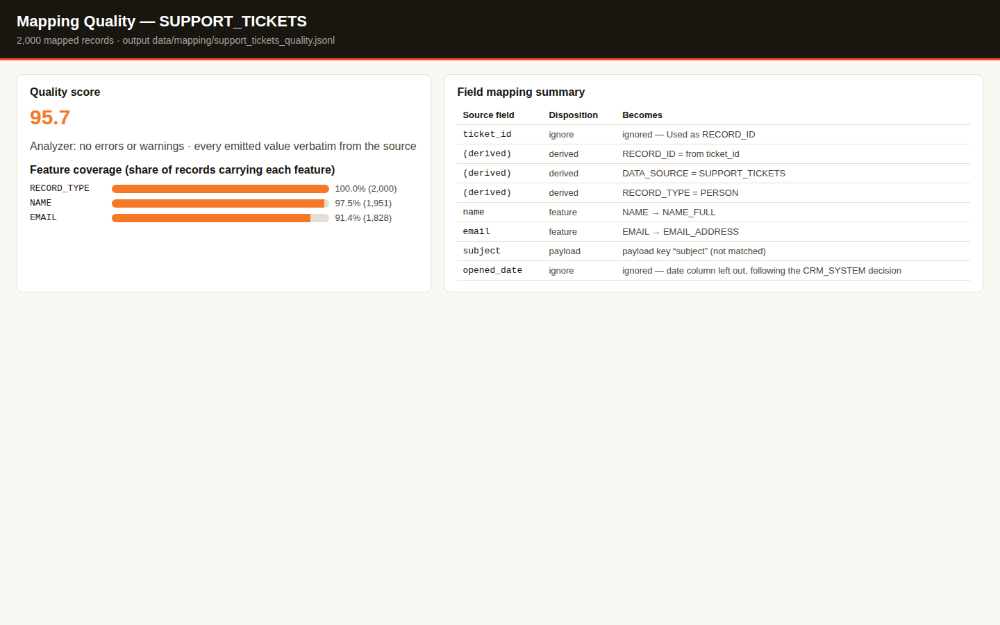

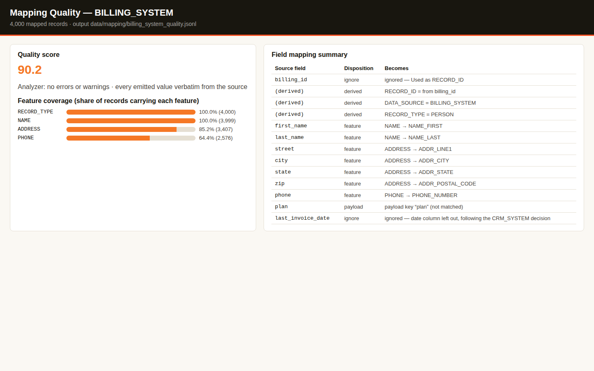

### End-of-Module Summary

**What you accomplished:**

- Measured the quality of all three sources and saw the strong/weak contrast the scenario was built with.
- Raised BILLING_SYSTEM from 76.0 to 90.2: first by normalizing formats, then by regenerating its gaps.
- Mapped all three sources to Senzing JSON, with a tested transformation program for each and every value kept verbatim.

**Files produced:**

- `data/senzing-ready/crm_system.jsonl` — 4,000 load-ready CRM records.
- `data/senzing-ready/support_tickets.jsonl` — 2,000 load-ready support records.
- `data/senzing-ready/billing_system.jsonl` — 4,000 load-ready billing records.
- `src/transform/transform_crm_system.py`, `src/transform/transform_support_tickets.py`, `src/transform/transform_billing_system.py` — the transformation programs.
- `docs/mapping/CRM_SYSTEM_mapper.md`, `docs/mapping/SUPPORT_TICKETS_mapper.md`, `docs/mapping/BILLING_SYSTEM_mapper.md` — per-source mapping specifications.
- `docs/data_source_evaluation.md` — the evaluation report.
- `docs/visualizations/data_quality_assessment.html` and three `mapping_*_quality.html` pages — the quality visuals.

**Why it matters:** Your three systems now speak Senzing's language, so the next module can load all 10,000 records and let entity resolution find the customers they share.
**You directed:** CRM_SYSTEM's two undecided columns, one at a time: `created_date` left out and `campaign` kept as payload. The mapped record matched both, and SUPPORT_TICKETS and BILLING_SYSTEM followed the same choices for their date and category columns.

---

## Data processing — 2026-11-09T22:54:16-05:00

### Information Shared

- Senzing's threaded loading pattern (add_futures) shares one engine across worker threads; SQLite allows one writer, so the loader runs one worker here and should run 2–8 per CPU core on PostgreSQL.
- Redo records are follow-up re-evaluations created during loading; draining the queue after each load finalizes resolution.
- Load order: a reference-style source first, then the rest by quality; independent sources can load sequentially with per-source reconciliation.
- Validation compares Senzing's decisions with expectations and an answer key: precision (no wrong merges) and recall (no missed merges).

### Questions & Responses

- **In production — not in this bootcamp — how many records do you expect to load?** — 3, medium production (500,000 to 10,000,000).
- **Do your sources have load-order dependencies?** — yes, none; load them sequentially.
- **Expectation check, Jenna Rockman (CRM, Billing, Support):** expected CRM + Support together, Billing separate → engine: CRM + Support one entity, Billing possibly same on name (agreed).
- **Expectation check, Andrea Dalewick (CRM, Billing):** expected two customers → engine: two entities, possibly same on name (agreed).
- **Expectation check, Timothy Thornstead (two Support tickets):** expected one customer → engine: one entity on name + email (agreed).
- Three feedback entries filed about the expectation-check step (saved in `docs/feedback/SENZING_BOOTCAMP_PLUGIN_FEEDBACK.md`).

### Actions Taken

- Built `src/load/loader_core.py`, three per-source loaders, `src/load/register_data_sources.py`, `src/load/orchestrator.py` and `src/load/process_redo.py`.
- Backed up the repository to `data/backups/G2C.db.pre-load`.
- Loaded CRM_SYSTEM 4,000, SUPPORT_TICKETS 2,000 and BILLING_SYSTEM 4,000 records with 0 failures; redo queue drained to empty after each phase.
- Validated with `src/query/review_entities.py`, `record_counts.py`, `cross_source_review.py`, `match_key_audit.py` and `how_state_audit.py`; wrote `docs/uat_results.md`, `docs/results_validation.md`, and updated `docs/loading_strategy.md`.

### End-of-Module Summary

**What you accomplished:**

- Loaded all 10,000 records from three systems, which resolved into 6,671 entities.
- Found 2,191 customers in two or more systems, and 451 in all three.
- Measured results: precision 100% (0 wrong merges) and recall 80.9% against the answer key; UAT 20 of 20, per-record accuracy 92%.

**Files produced:**

- `src/load/` — the loaders, orchestrator, registration and redo programs.
- `src/query/` — the entity-review and validation programs.
- `docs/loading_strategy.md`, `docs/uat_results.md`, `docs/results_validation.md` — strategy and validation reports.

**Why it matters:** Your customers are now resolved across CRM, Billing and Support, so the next module can query, visualize and explore them against the business problem.
**You directed:** the expectation check, one example at a time: your predictions for Jenna Rockman, Andrea Dalewick and Timothy Thornstead all matched Senzing's decisions.

## Query, Visualize and Discover — 2026-11-09T23:23:00-05:00

### Information Shared

**Headline entity:** Alan Whitevale (entity 400155), 5 records from CRM_SYSTEM, BILLING_SYSTEM and SUPPORT_TICKETS. CRM-000406 and CRM-003871 share name, address, phone and email; TKT-000406 and TKT-001991 joined on +NAME+EMAIL; BIL-000406 joined on +NAME+ADDRESS ("Ln" vs "Lane"). Re-retrieved at close: unchanged.

- Match keys list the features that agreed (+) when a record joined an entity.
- Quality evaluation follows Senzing's evidence rule: verdicts come with sampled entities and pairs, never aggregates alone.
- why_records explains a decision between two records; how_entity replays an entity's construction; find_network and find_path show discovered and disclosed links and degrees of separation.

### Questions & Responses

- **What do you want to find out about your data?** — chose 1, 3 and 4 of the business-case examples: customers in all three systems with their unified record; likely duplicates needing review; unique customers vs raw counts per system.
- **Shall I build queries for this list?** — yes.
- **Recall: what does `+NAME+ADDRESS+PHONE` on BIL-000100 tell you about entity 300009?** — 1, joined on name, address and phone (correct).
- **Would you like an interactive visualization of your resolved data?** — yes.
- **Would you like to explore Senzing's advanced discover capabilities?** — yes.
- Same-entity prediction pairs: not run. The Bootcamper directed that the prediction exercise live only in Data processing.
- **What next after Why analysis?** — 1, How analysis. **After How analysis?** — 1, Relationship networks.
- **Is there a system to export your results for?** — no.
- **Ready for me to stop the visualization server?** — yes.
- Two feedback entries filed: the open question needed business-case examples and multi-select; the prediction exercise should run once, in Data processing.

### Actions Taken

- Built `src/query/customers_in_all_sources.py`, `review_queue.py`, `unique_customer_counts.py`, `sample_entities.py`, `discover_patterns.py`, `why_pair.py`, `how_entity.py`, `network_explore.py` and the shared `sz_export.py`; extended `show_entity.py` with `--rank sources`.
- Quality evaluation: possible matches 20.0% of entities (Poor band); cause check: not mapping-actionable (source field sparsity in Billing and Support). Finding recorded, no remap.
- Built and ran `src/server/results_server.py` on port 8081; snapshot `docs/visualizations/results_visualization.html` passed the scale checks; server stopped at close (port free).
- Wrote `docs/bootcamp_data_discoveries.md` and `.pdf`.

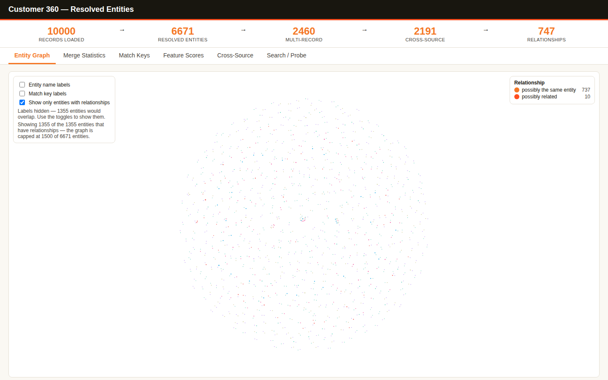

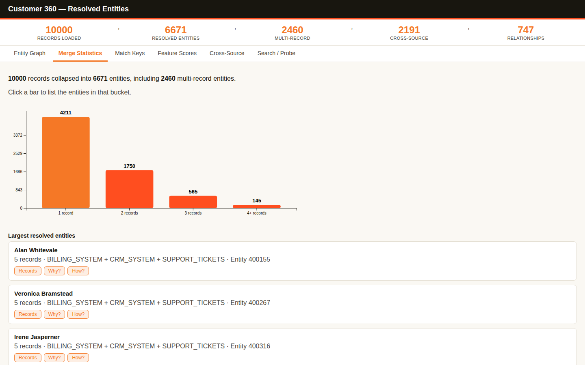

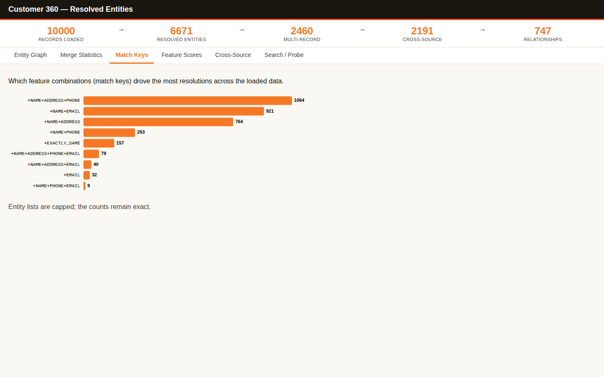

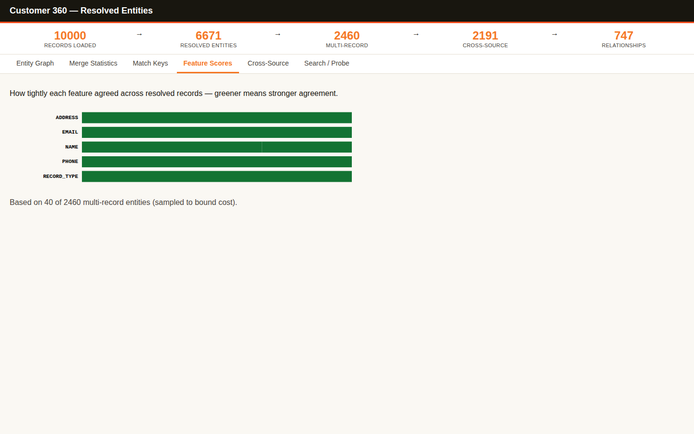

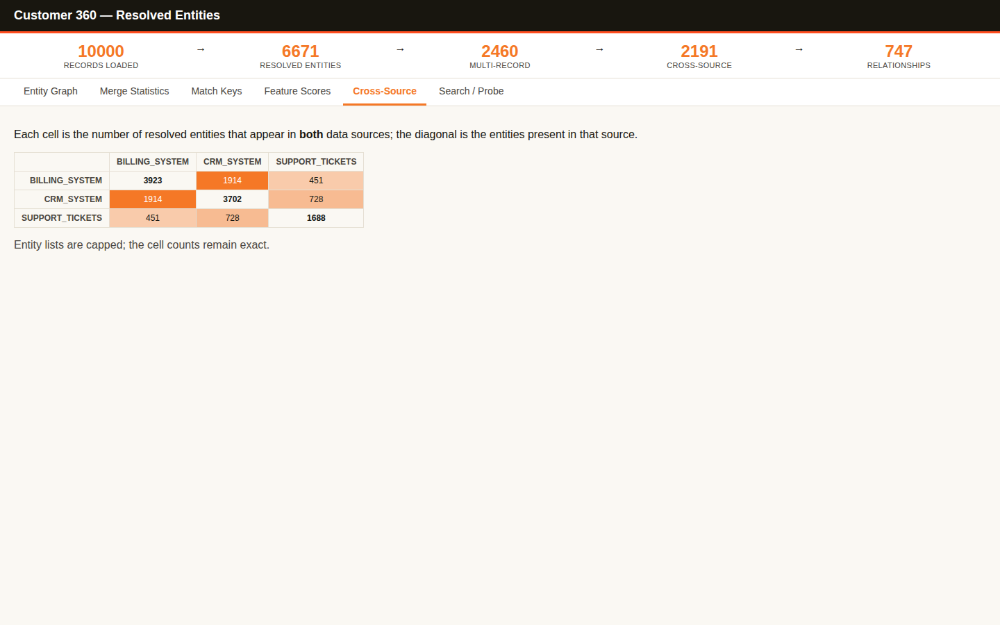

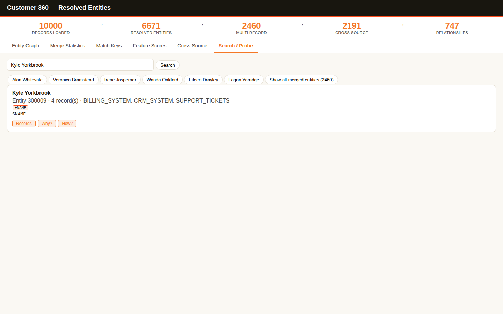

### End-of-Module Summary

**What you accomplished:**

- Answered your three questions: 451 customers in all three systems, a 737-pair review queue, and 6,671 unique customers behind 10,000 records.
- Explored your resolved customers in a six-tab interactive app.
- Saw why and how Senzing resolved Yvonne Vanceson, and how first-name-only Billing records create noisy links.

**Files produced:**

- `src/query/` — query and Discover programs.
- `src/server/results_server.py` — the visualization server.
- `docs/visualizations/results_visualization.html` — the saved visualization.
- `docs/bootcamp_data_discoveries.md` and `docs/bootcamp_data_discoveries.pdf` — your data-discoveries report.

**Why it matters:** You can now answer the business problem's questions from the resolved data and explain each answer.
**You directed:** the questions the queries answered (customers in all three systems, the review queue, and unique-customer counts), each answered and matching what you asked.

<!-- BOOTCAMP-HANDOVER:START -->

## What You Take With You

### Decisions you made

- Discover the Business Problem: had the bootcamp generate a Customer 360 scenario, deliberately messy so mapping works hard.
- Discover the Business Problem: desired output: a clean master list, an API, and reports.
- Discover the Business Problem: standalone (no integration targets), deployed locally / on-premises.
- SDK setup: SQLite as the database.
- System verification: predicted the Mari record joins Marisol's entity (agreed).
- Data Quality, Mapping, and Transformation: BILLING_SYSTEM: improve the weakest fields first, then return to Data collection to regenerate it (76.0 to 90.2).
- Data Quality, Mapping, and Transformation: concise mapping mode; CRM_SYSTEM columns decided one at a time (created_date ignored, campaign as payload).
- Data processing: medium production volume (500,000 to 10,000,000 records); sequential load, no dependencies.
- Data processing: three expectation-check predictions, all agreed with Senzing.
- Query, Visualize and Discover: questions chosen: customers in all three systems, the review queue, unique-customer counts; the prediction exercise kept only in Data processing; no export.

### How you got it built

- **Discover the Business Problem:** you asked for a messy, generated Customer 360 problem; the AI wrote the business case and generated three synthetic sources with an answer key with the Senzing MCP server.
- **SDK setup:** you asked for SQLite; the AI installed and configured the Senzing SDK, environment script and database with the Senzing MCP server.
- **System verification:** you predicted the Mari outcome; the AI built and ran the verification pipeline on synthetic records with the Senzing MCP server.
- **Truth Set visualization:** you explored the Truth Set; the AI loaded it and served a six-tab interactive visualization with the Senzing MCP server.
- **Data Quality, Mapping, and Transformation:** you directed the quality fixes and column decisions; the AI scored, mapped and transformed all three sources with the Senzing MCP server.
- **Data processing:** you set volume and load order; the AI built the threaded loader, orchestrator and redo processor, loaded 10,000 records and validated them with the Senzing MCP server.
- **Query, Visualize and Discover:** you asked three business questions; the AI built the query programs, results visualization, Why/How/network demonstrations and the discoveries report with the Senzing MCP server.

### Next time

**The guide's draft (you passed):** "Help me map and load our real CRM, billing and support-ticket exports into Senzing, and give me a weekly review queue of customers that appear in more than one system but were not merged."
<!-- BOOTCAMP-HANDOVER:END -->
